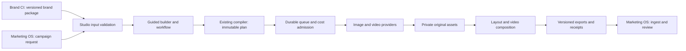
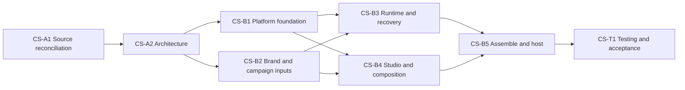
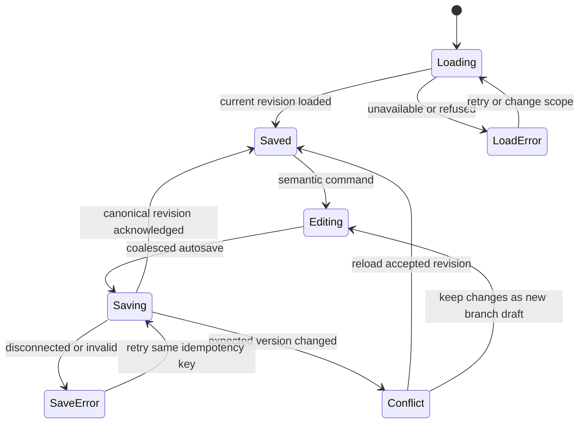
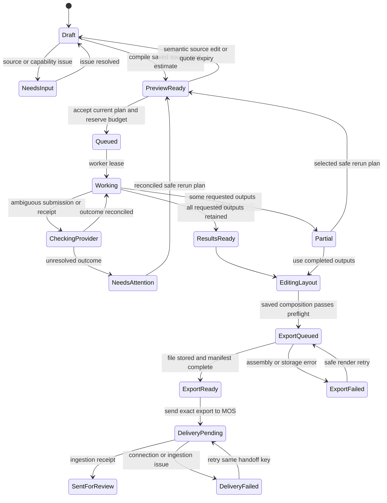

# Creative Studio — complete architecture package

Version 1, proposed, 30 October 2026. CPOS project 95f25a77-9b10-4703-9945-7447a992eec9. Source reconciliation canonical document: 6946c46b-5a45-4896-8a47-06ef099c7bf8 v1. Source and architecture Tasks remain open pending governed settlement; hosted build and product testing have not started. This record embeds every architecture contract and design document; the file manifest identifies exact local originals.

## Packaged file: README.md

# Creative Studio — architecture delivery

30 October 2026 · Existing CPOS project `CREATIVE-STUDIO` / `image-pipeline` (`95f25a77-9b10-4703-9945-7447a992eec9`).

This package turns the approved direction into implementation contracts for the existing standalone compiler. It contains source reconciliation, service and artifact contracts, the hosted platform design, and the guided/canvas/editor experience. It is architecture evidence prepared for CS-A1 and CS-A2. The source repository has not been changed by this work; no hosted service, completed CPOS task, product test, or production readiness is claimed.

## What the finished module will do

A user opens a campaign from Marketing OS, selects its approved Brand CI package and offering/audience, and works through a guided creative builder. They can open the workflow to change how assets are generated, edit exact logos and text in a layout editor, or assemble a short campaign video. The same saved recipe backs the builder and workflow. The user reviews a cost estimate before generation. Jobs survive closing the browser; original outputs, edits, exports and costs remain versioned. Final assets return to Marketing OS for its own exact-version review and publishing workflow.

Brand CI remains the guide and original-brand-asset authority. Marketing OS remains the campaign and publication authority. Creative Studio owns creative execution, composition and export. Existing accounts and services are not joined through shared runtime tables.



## Implementable decisions

| Area | Decision and source |
|---|---|
| Maintained source | Existing root `craigdanielk/image-pipeline`, baseline `e98cf4bf3558f87279ca518d71ee58530f6cf039`. Preserve the historical nested copy and current local modifications. [Source reconciliation](SOURCE_RECONCILIATION.md), [resource decisions](RESOURCE_DECISIONS.md). |
| Service boundary | Extend the Python compiler and existing React/React Flow UI in their current repository. Marketing OS consumes the service; it does not contain another compiler implementation. |
| Hosted execution | Dedicated Vercel project: static UI, authenticated Python API and bounded Python workers. Existing Supabase provides service-owned `cs_*` records, private assets and durable scheduling. [Platform architecture](platform/ARCHITECTURE.md). |
| Contracts | Immutable request, treatment, recipe, plan, composition, asset/export lineage, provider receipts, and MOS handoff contracts. Signed download links are renewable capabilities and never content identity. [Contract specification](contracts/contract.md). |
| Editing | Builder and Workflow share one recipe; Layout edits image layers; Video edits shots, overlays, captions and audio. Incomplete authoring drafts are saved separately until they satisfy the runnable contract. [Experience](experience/README.md). |
| First-release output | Static 1080×1080, 1080×1350 and 1080×1920; vertical 1080×1920 video at 30 fps, up to 30 seconds and six clips. These are chosen product limits, not measured runtime performance. [Composition](experience/COMPOSITION_MODEL.md). |
| Brand accuracy | Original logos, exact copy and approved font files are independently composed; generated imagery is retained as an original. Changed sources create new versions and invalidate affected approvals. |
| Provider operation | Use asynchronous direct provider APIs with workspace credentials, frozen requests, documented idempotency, signed webhooks or polling, and explicit reconciliation of uncertain charges. No machine CLI session in production. |
| Review and delivery | Brand approval does not imply campaign approval. Draft editing, generation eligibility and MOS publication eligibility are separate action checks. MOS handoff is an idempotent durable import with an ingestion receipt. |
| Security and costs | Current membership and workspace binding checks, private assets, restricted runtime database roles, budget reservations, fenced worker leases and recovery receipts. [Database contract](platform/DATABASE_CONTRACT.md). |

## Existing milestone order and ownership

The eight approved tasks and ten dependency edges are unchanged. Sub-agent architecture contributions do not remove a dependency or close a task.



| Gate/task | Required evidence and allocation |
|---|---|
| CS-A1 / NS-10804 | Source/history/ownership decisions and byte inventory; reconcile unresolved resource bindings explicitly. Root owns integration of evidence. |
| CS-A2 / NS-10802 | Agree the complete contracts, hosting/security/data/worker decisions and experience/file map. Contracts, platform and experience contributions were authored in parallel as candidates. Canonical settlement remains separate. |
| CS-B1 / NS-10803 | Implement standalone service entrypoints, authentication, restricted roles, private storage, durable records and scheduling. Can proceed alongside B2 only after the architecture gate. |
| CS-B2 / NS-10800 | Implement versioned Brand CI and campaign input adapters, authoring drafts and compilation mappings. Preserve BCI ownership and support service offerings without physical-product geometry. |
| CS-B3 / NS-10805 | Implement provider catalogue/adapters, admission, receipts, retries/cancellation, bounded render stages and cost accounting after B1+B2. |
| CS-B4 / NS-10801 | Implement guided builder, shared workflow, layout/video editors, run records and export controls after B1+B2. Parallel with B3 on separate modules. |
| CS-B5 / NS-10807 | Assemble all B3+B4 modules and provision the dedicated hosted service with configuration, deployment identity and rollback records. A successful deployment proves hosting, not operational acceptance. |
| CS-T1 / NS-10806 | Only after B5: behavioural, isolation, concurrency, recovery, media quality and authorized live-provider acceptance, including a closed-browser run and MOS ingestion. No earlier task claims these results. |

The MOS consumer remains existing task **NS-10631**. Its changes must implement the handoff contract; this programme does not silently take ownership of MOS publication controls. Product tests and generated-media trials remain behind the complete CS-M2 platform build. Build tooling and document integrity checks must not be reported as product acceptance.

## Evidence and current execution gate

The read-only source inventory contains 108 files and 63 historical counterparts. Its consumer compared recorded hashes with the actual source tree and found no drift. One selected source file differs from the committed baseline: the pre-existing Higgsfield adapter patch, which remains preserved. This was a source evidence check, not application testing; no provider was called.

CPOS admitted the existing project planning session and returned CS-A1 as the first unblocked task. The attempt to author its bounded execution brief was refused with **`Node7 assertion validation failed`**. The proposed source verifier is not registered in the checked Oracle registry. The canonical validator requires registered scripts. The exact proposed contract and refusal are retained in this package's execution record; there is no Brief ID or execution receipt to claim.

The repository's `AGENTS.md` requires the Manual Executor and Git Oracle for autonomous BRIEF work. Before governed source changes can run, the source-evidence verifier needs the supported registration procedure, followed by Brief authoring, admission and dispatch through that existing path. No gate, verifier, task state or access grant was bypassed.

Resource details are explicit in [resource decisions](RESOURCE_DECISIONS.md) and [operations and evidence](platform/OPERATIONS_AND_EVIDENCE.md): the dedicated deployment and `cs_*` objects do not exist yet; current hosting quota is not verified; provider credentials and a media-spend ceiling are needed before paid acceptance. None of these is represented as a completed build.

Technical readiness, operational readiness, commercial viability and external productisation readiness remain separate. This architecture package establishes design detail; it does not advance the wider Marketing OS programme's G1/G5 gates or replace its 136-node reference ontology.


## Packaged file: ARCHITECTURE_EVIDENCE.md

# CS-M1 architecture evidence map

30 October 2026. This maps the approved task criteria to authored evidence. It is not a CPOS acceptance receipt. NS-10804 and NS-10802 remain open until their existing settlement path records the result; CS-M2 has not started.

| Approved criterion | Evidence prepared |
|---|---|
| A1.1 source inventory with commit and relevant working changes | `SOURCE_RECONCILIATION.md`, `source-manifest.json`, `source-integrity-receipt.json`; fresh remote comparison and 108 source-file hashes. |
| A1.2 repo/project/system/deployment relationships and history | `RESOURCE_DECISIONS.md` and `platform/OPERATIONS_AND_EVIDENCE.md`; existing project/repository/ARAGON identities retained, absent System pointer recorded. |
| A1.3 missing bindings explicit rather than assumed | No Creative Studio deployment or cs_* objects claimed; existing shared hosting/identity chosen with separate service ownership; capacity/credentials remain deployment facts. |
| A2.1 architecture and bounded decisions stored against the project | This package and canonical architecture publication receipt. Source, contracts, experience and platform contributions resolve their respective implementation choices. |
| A2.2 builder and optional canvas share saved workflow | `contracts/recipe-v1.schema.json`, `recipe-command-v1.schema.json`, `authoring-draft-v1.schema.json`; `experience/RECIPE_AND_STATE.md` defines promotion, semantic edits and layout-only changes. |
| A2.3 image/video/asset/cost/permissions/background/retry/failure contracts | `contracts/contract.md`, 18 schemas and endpoint outline; platform queue, RLS, cost and crash contracts. Pre-run compilation/import/authoring uses its own durable operation, never a fabricated generation run. |
| A2.4 concrete hosting bill of materials and recovery | `platform/ARCHITECTURE.md`, `DATABASE_CONTRACT.md`, `deployment-contract.json`, `database-contract.json`, `OPERATIONS_AND_EVIDENCE.md`; bounded Python/FFmpeg stages, exact fonts, private objects, rollback and recovery. |
| A2.5 architecture before build; testing defined but not executed | README dependency DAG preserves all eight tasks and ten edges. The platform rollout distinguishes build receipts from CS-M3 behavioural/paid acceptance. No CS-M2 code or provisioning performed. |

## Cross-contribution reconciliation

- Service offerings have their own context lane; physical CAD is optional.
- Brand CI retains its actual approval policy; generation and MOS publication use their own current action checks.
- Original media, exact editable brand layers and rendered exports have separate immutable identities.
- Composition references a prior recipe version to avoid a content-hash cycle.
- An incomplete user draft can be saved without pretending it is executable.
- Long provider waits and media ingest are independently scheduled; closing the page is irrelevant to completion.
- Compilation, brand import and AI treatment authoring exist before a generation run, with their own durable operation and shared budget/attempt mechanisms.
- Crossfades render as bounded transition handles before final concatenation; font bytes and renderer versions are pinned.
- Unknown provider charges remain reserved/uncertain. A timeout cannot authorize a fresh paid attempt.
- MOS ingestion is an idempotent owned import and remains pending its own review.

## Verification performed and deferred

Source evidence integrity: 108 selected files consumed against the observed source tree, 63 historical counterparts, no drift. The pre-existing modified Higgsfield adapter was identified rather than erased.

Contract-document integrity: the contracts contributor parsed 18 JSON files with duplicate-key rejection, resolved 529 local references, and checked unique document IDs; zero structural errors reported. This was document inspection only, not JSON Schema behaviour validation or an application test.

Product tests, schema behaviour validation, media generation, hosting builds/deployments, migrations, performance measurements, isolation checks and real MOS delivery acceptance were not executed. Those future outcomes cannot be inferred from this package.

## Canonical execution blocker

The exact CPOS refusal and proposed Brief are retained in `execution-record.json` and `cs-a1-inventory-planner-contract.json`. The prepared `verifier-registration/` package adds the required read-only source verifier through the protected registry's legitimate writer. No unrelated registry deletion is authorized. Current tool access to the project is working; this is a verifier registration gate, not a claim that CPOS tools or project access are unavailable.


## Packaged file: contracts/authoring-draft-v1.schema.json

```json
{"$schema":"https://json-schema.org/draft/2020-12/schema","$id":"https://schemas.creative-studio.invalid/v1/authoring-draft-v1.schema.json","title":"Non-executable authoring draft v1","$comment":"Mutable optimistic authoring session; pending_fields are JSON-Pointer keyed form values with a total serialized draft limit of256KiB and nesting depth16. They are not source truth and cannot be executed. Compile/run/export accept only immutable canonical refs. Promotion requires a validated request, accepted treatment and valid typed recipe, persists immutable outputs atomically and records promoted_recipe. No AI call or implicit approval occurs on promotion.","type":"object","additionalProperties":false,"properties":{"schema_version":{"const":"cs-authoring-draft-v1"},"id":{"$ref":"common.schema.json#/$defs/uuid"},"workspace_id":{"$ref":"common.schema.json#/$defs/uuid"},"revision":{"type":"integer","minimum":1,"maximum":9007199254740991},"sha256":{"$ref":"common.schema.json#/$defs/sha256"},"created_by":{"$ref":"common.schema.json#/$defs/uuid"},"created_at":{"$ref":"common.schema.json#/$defs/timestamp"},"updated_at":{"$ref":"common.schema.json#/$defs/timestamp"},"name":{"type":"string","minLength":1,"maxLength":200},"step":{"type":"string","enum":["brand","campaign","references","direction","outputs","recipe"]},"status":{"type":"string","enum":["editing","promoted","archived"]},"base_recipe":{"anyOf":[{"$ref":"common.schema.json#/$defs/version_ref"},{"type":"null"}]},"selections":{"type":"object","additionalProperties":false,"properties":{"brand_package":{"anyOf":[{"$ref":"common.schema.json#/$defs/version_ref"},{"type":"null"}]},"offering":{"anyOf":[{"$ref":"common.schema.json#/$defs/version_ref"},{"type":"null"}]},"audiences":{"type":"array","items":{"$ref":"common.schema.json#/$defs/version_ref"},"minItems":0,"maxItems":20},"concept":{"anyOf":[{"$ref":"common.schema.json#/$defs/version_ref"},{"type":"null"}]},"request":{"anyOf":[{"$ref":"common.schema.json#/$defs/version_ref"},{"type":"null"}]},"treatment":{"anyOf":[{"$ref":"common.schema.json#/$defs/version_ref"},{"type":"null"}]}},"required":["brand_package","offering","audiences","concept","request","treatment"]},"pending_fields":{"type":"object","maxProperties":200,"propertyNames":{"type":"string","pattern":"^/","maxLength":300},"additionalProperties":{"type":["string","number","boolean","null","array","object"]}},"working_nodes":{"type":"array","items":{"type":"object","additionalProperties":false,"properties":{"id":{"$ref":"common.schema.json#/$defs/slug"},"kind":{"type":"string","enum":["asset.load","image.generate","video.generate","image.edit","image.transform","image.compose","video.assemble","export.render"]},"pending_config":{"type":"object","maxProperties":100},"inputs":{"type":"array","items":{"type":"object","additionalProperties":false,"properties":{"port":{"$ref":"common.schema.json#/$defs/slug"},"ordinal":{"type":"integer","minimum":0,"maximum":99},"source":{"oneOf":[{"type":"object","additionalProperties":false,"properties":{"kind":{"const":"asset"},"asset":{"$ref":"common.schema.json#/$defs/asset_ref"}},"required":["kind","asset"]},{"type":"object","additionalProperties":false,"properties":{"kind":{"const":"node"},"node_id":{"$ref":"common.schema.json#/$defs/slug"},"output_port":{"$ref":"common.schema.json#/$defs/slug"}},"required":["kind","node_id","output_port"]}]}},"required":["port","ordinal","source"]},"minItems":0,"maxItems":100}},"required":["id","kind","pending_config","inputs"]},"minItems":0,"maxItems":100},"authoring_view":{"type":"object","additionalProperties":false,"properties":{"last_view":{"type":"string","enum":["guided","canvas"]},"positions":{"type":"array","items":{"type":"object","additionalProperties":false,"properties":{"node_id":{"$ref":"common.schema.json#/$defs/slug"},"x":{"type":"number"},"y":{"type":"number"}},"required":["node_id","x","y"]},"minItems":0,"maxItems":100},"collapsed_node_ids":{"type":"array","items":{"$ref":"common.schema.json#/$defs/slug"},"minItems":0,"maxItems":100}},"required":["last_view","positions","collapsed_node_ids"]},"promoted_recipe":{"anyOf":[{"$ref":"common.schema.json#/$defs/version_ref"},{"type":"null"}]}},"required":["schema_version","id","workspace_id","revision","sha256","created_by","created_at","updated_at","name","step","status","base_recipe","selections","pending_fields","working_nodes","authoring_view","promoted_recipe"]}
```

## Packaged file: contracts/brand-package-v1.schema.json

```json
{"$schema":"https://json-schema.org/draft/2020-12/schema","$id":"https://schemas.creative-studio.invalid/v1/brand-package-v1.schema.json","title":"Approved Brand CI package v1","$comment":"workspace_id is the Brand CI account, not a MOS or Creative Studio workspace. Export only the exact currently approved BCI version. All refs must resolve inside this account/brand, rights remain independent of guide approval. Package export must not synthesize missing permission or usable font files.","type":"object","additionalProperties":false,"properties":{"schema_version":{"const":"brand-package-v1"},"id":{"$ref":"common.schema.json#/$defs/uuid"},"version_id":{"$ref":"common.schema.json#/$defs/uuid"},"revision":{"type":"integer","minimum":1,"maximum":9007199254740991},"workspace_id":{"$ref":"common.schema.json#/$defs/uuid"},"created_at":{"$ref":"common.schema.json#/$defs/timestamp"},"created_by":{"$ref":"common.schema.json#/$defs/uuid"},"sha256":{"$ref":"common.schema.json#/$defs/sha256"},"authority":{"const":"brand-ci-studio"},"brand_id":{"$ref":"common.schema.json#/$defs/uuid"},"brand_name":{"type":"string","minLength":1,"maxLength":200},"source":{"type":"object","additionalProperties":false,"properties":{"bci_version_id":{"$ref":"common.schema.json#/$defs/uuid"},"bci_revision":{"type":"integer","minimum":1,"maximum":9007199254740991},"document_digest":{"$ref":"common.schema.json#/$defs/sha256"},"document_digest_algorithm":{"type":"string","minLength":1,"maxLength":100},"document_jcs_sha256":{"$ref":"common.schema.json#/$defs/sha256"},"approval_receipt_id":{"$ref":"common.schema.json#/$defs/uuid"},"guide_document":{"$ref":"common.schema.json#/$defs/version_ref"},"approved_pdf":{"$ref":"common.schema.json#/$defs/asset_ref"},"document_created_by":{"$ref":"common.schema.json#/$defs/uuid"}},"required":["bci_version_id","bci_revision","document_digest","document_digest_algorithm","document_jcs_sha256","approval_receipt_id","guide_document","approved_pdf","document_created_by"]},"approval":{"$ref":"common.schema.json#/$defs/approval"},"assets":{"type":"array","items":{"$ref":"common.schema.json#/$defs/asset_record"},"minItems":1,"maxItems":200},"logos":{"type":"array","items":{"type":"object","additionalProperties":false,"properties":{"id":{"$ref":"common.schema.json#/$defs/slug"},"asset":{"$ref":"common.schema.json#/$defs/asset_ref"},"role":{"type":"string","enum":["primary","secondary","mark","monochrome","reversed"]},"allowed_backgrounds":{"type":"array","items":{"type":"string","minLength":1,"maxLength":100},"minItems":1,"maxItems":20},"min_width_px":{"type":"integer","minimum":1,"maximum":4000},"clear_space_ratio":{"type":"number","minimum":0,"maximum":10},"allow_crop":{"const":false},"allow_distort":{"const":false}},"required":["id","asset","role","allowed_backgrounds","min_width_px","clear_space_ratio","allow_crop","allow_distort"]},"minItems":1,"maxItems":20},"palette":{"type":"array","items":{"type":"object","additionalProperties":false,"properties":{"token":{"$ref":"common.schema.json#/$defs/slug"},"hex":{"type":"string","pattern":"^#[0-9A-Fa-f]{6}$"},"role":{"type":"string","minLength":1,"maxLength":200}},"required":["token","hex","role"]},"minItems":1,"maxItems":60},"typography":{"type":"array","items":{"type":"object","additionalProperties":false,"properties":{"id":{"$ref":"common.schema.json#/$defs/slug"},"family":{"type":"string","minLength":1,"maxLength":200},"role":{"type":"string","minLength":1,"maxLength":100},"font_assets":{"type":"array","items":{"$ref":"common.schema.json#/$defs/asset_ref"},"minItems":1,"maxItems":20},"weights":{"type":"array","items":{"type":"integer","minimum":100,"maximum":900},"minItems":1,"maxItems":9},"fallback_family":{"anyOf":[{"type":"string","minLength":1,"maxLength":200},{"type":"null"}]}},"required":["id","family","role","font_assets","weights","fallback_family"]},"minItems":1,"maxItems":20},"imagery":{"type":"object","additionalProperties":false,"properties":{"principles":{"type":"array","items":{"type":"string","minLength":1,"maxLength":2000},"minItems":0,"maxItems":40},"reference_assets":{"type":"array","items":{"$ref":"common.schema.json#/$defs/asset_ref"},"minItems":0,"maxItems":100},"prohibited":{"type":"array","items":{"type":"string","minLength":1,"maxLength":2000},"minItems":0,"maxItems":40}},"required":["principles","reference_assets","prohibited"]},"voice":{"type":"object","additionalProperties":false,"properties":{"principles":{"type":"array","items":{"type":"string","minLength":1,"maxLength":2000},"minItems":1,"maxItems":40},"preferred_terms":{"type":"array","items":{"type":"string","minLength":1,"maxLength":2000},"minItems":0,"maxItems":100},"prohibited_terms":{"type":"array","items":{"type":"string","minLength":1,"maxLength":2000},"minItems":0,"maxItems":100}},"required":["principles","preferred_terms","prohibited_terms"]},"usage_rules":{"type":"array","items":{"type":"object","additionalProperties":false,"properties":{"id":{"$ref":"common.schema.json#/$defs/slug"},"instruction":{"type":"string","minLength":1,"maxLength":2000},"severity":{"type":"string","enum":["required","recommended"]},"source_path":{"type":"string","minLength":1,"maxLength":300}},"required":["id","instruction","severity","source_path"]},"minItems":0,"maxItems":100},"unresolved_decisions":{"type":"array","items":{"type":"object","additionalProperties":false,"properties":{"id":{"$ref":"common.schema.json#/$defs/slug"},"description":{"type":"string","minLength":1,"maxLength":2000},"blocks_compile":{"type":"boolean"},"affected_asset_ids":{"type":"array","items":{"$ref":"common.schema.json#/$defs/uuid"},"minItems":0,"maxItems":100}},"required":["id","description","blocks_compile","affected_asset_ids"]},"minItems":0,"maxItems":100}},"required":["schema_version","id","version_id","revision","workspace_id","created_at","created_by","sha256","authority","brand_id","brand_name","source","approval","assets","logos","palette","typography","imagery","voice","usage_rules","unresolved_decisions"]}
```

## Packaged file: contracts/common.schema.json

```json
{"$schema":"https://json-schema.org/draft/2020-12/schema","$id":"https://schemas.creative-studio.invalid/v1/common.schema.json","title":"Creative Studio shared types v1","$comment":"Architectural contract; not a deployed URL. Semantic invariants in contract.md are mandatory in addition to schema. Public IDs lowercase UUIDs; money integer USD microdollars; timestamps UTC. The sha256 field of a rights or approval receipt is excluded when hashing that receipt.","$defs":{"uuid":{"type":"string","format":"uuid","pattern":"^[0-9a-f]{8}-[0-9a-f]{4}-[0-9a-f]{4}-[0-9a-f]{4}-[0-9a-f]{12}$"},"sha256":{"type":"string","pattern":"^[a-f0-9]{64}$"},"timestamp":{"type":"string","format":"date-time"},"slug":{"type":"string","pattern":"^[a-z][a-z0-9_-]{0,63}$"},"uri":{"type":"string","format":"uri","maxLength":4096},"money_micros":{"type":"integer","minimum":0,"maximum":9007199254740991},"authority":{"type":"string","enum":["creative-studio","brand-ci-studio","marketing-os"]},"version_ref":{"type":"object","additionalProperties":false,"properties":{"authority":{"$ref":"common.schema.json#/$defs/authority"},"workspace_id":{"$ref":"common.schema.json#/$defs/uuid"},"kind":{"type":"string","minLength":1,"maxLength":64},"id":{"$ref":"common.schema.json#/$defs/uuid"},"version_id":{"$ref":"common.schema.json#/$defs/uuid"},"revision":{"type":"integer","minimum":1,"maximum":9007199254740991},"sha256":{"$ref":"common.schema.json#/$defs/sha256"}},"required":["authority","workspace_id","kind","id","version_id","revision","sha256"]},"asset_ref":{"type":"object","additionalProperties":false,"properties":{"authority":{"$ref":"common.schema.json#/$defs/authority"},"workspace_id":{"$ref":"common.schema.json#/$defs/uuid"},"asset_id":{"$ref":"common.schema.json#/$defs/uuid"},"asset_version_id":{"$ref":"common.schema.json#/$defs/uuid"},"revision":{"type":"integer","minimum":1,"maximum":9007199254740991},"sha256":{"$ref":"common.schema.json#/$defs/sha256"},"mime_type":{"type":"string","minLength":1,"maxLength":100}},"required":["authority","workspace_id","asset_id","asset_version_id","revision","sha256","mime_type"]},"rights":{"type":"object","additionalProperties":false,"properties":{"receipt_id":{"$ref":"common.schema.json#/$defs/uuid"},"revision":{"type":"integer","minimum":1,"maximum":9007199254740991},"sha256":{"$ref":"common.schema.json#/$defs/sha256"},"status":{"type":"string","enum":["unknown","permitted","restricted","denied"]},"holder":{"anyOf":[{"type":"string","minLength":1,"maxLength":2000},{"type":"null"}]},"basis":{"type":"string","enum":["owned","licence","permission","public_domain","provider_terms","unknown"]},"evidence":{"type":"array","items":{"$ref":"common.schema.json#/$defs/version_ref"},"minItems":0,"maxItems":20},"allowed_uses":{"type":"array","items":{"type":"string","enum":["reference","generate","edit","embed","redistribute"]},"minItems":0,"maxItems":5},"channels":{"type":"array","items":{"type":"string","minLength":1,"maxLength":80},"minItems":0,"maxItems":40},"territories":{"type":"array","items":{"type":"string","minLength":1,"maxLength":80},"minItems":0,"maxItems":100},"valid_from":{"$ref":"common.schema.json#/$defs/timestamp"},"expires_at":{"anyOf":[{"$ref":"common.schema.json#/$defs/timestamp"},{"type":"null"}]},"attribution":{"anyOf":[{"type":"string","minLength":1,"maxLength":2000},{"type":"null"}]},"restrictions":{"type":"array","items":{"type":"string","minLength":1,"maxLength":2000},"minItems":0,"maxItems":40},"recorded_by":{"$ref":"common.schema.json#/$defs/uuid"}},"required":["receipt_id","revision","sha256","status","holder","basis","evidence","allowed_uses","channels","territories","valid_from","expires_at","attribution","restrictions","recorded_by"]},"asset_record":{"type":"object","additionalProperties":false,"properties":{"ref":{"$ref":"common.schema.json#/$defs/asset_ref"},"name":{"type":"string","minLength":1,"maxLength":255},"size_bytes":{"type":"integer","minimum":1,"maximum":9007199254740991},"width_px":{"anyOf":[{"type":"integer","minimum":1,"maximum":16384},{"type":"null"}]},"height_px":{"anyOf":[{"type":"integer","minimum":1,"maximum":16384},{"type":"null"}]},"duration_ms":{"anyOf":[{"type":"integer","minimum":1,"maximum":9007199254740991},{"type":"null"}]},"rights":{"$ref":"common.schema.json#/$defs/rights"},"origin":{"type":"string","enum":["capture","upload","provider","derived","legacy_import"]},"source_url":{"anyOf":[{"$ref":"common.schema.json#/$defs/uri"},{"type":"null"}]},"captured_at":{"anyOf":[{"$ref":"common.schema.json#/$defs/timestamp"},{"type":"null"}]},"parent_assets":{"type":"array","items":{"$ref":"common.schema.json#/$defs/asset_ref"},"minItems":0,"maxItems":100}},"required":["ref","name","size_bytes","width_px","height_px","duration_ms","rights","origin","source_url","captured_at","parent_assets"]},"approval":{"type":"object","additionalProperties":false,"properties":{"receipt_id":{"$ref":"common.schema.json#/$defs/uuid"},"authority":{"$ref":"common.schema.json#/$defs/authority"},"workspace_id":{"$ref":"common.schema.json#/$defs/uuid"},"subject":{"$ref":"common.schema.json#/$defs/version_ref"},"decision":{"const":"approved"},"actor_id":{"$ref":"common.schema.json#/$defs/uuid"},"actor_role":{"type":"string","minLength":1,"maxLength":64},"approved_at":{"$ref":"common.schema.json#/$defs/timestamp"},"policy_revision":{"type":"string","minLength":1,"maxLength":120},"sha256":{"$ref":"common.schema.json#/$defs/sha256"}},"required":["receipt_id","authority","workspace_id","subject","decision","actor_id","actor_role","approved_at","policy_revision","sha256"]},"reference_input":{"type":"object","additionalProperties":false,"properties":{"id":{"$ref":"common.schema.json#/$defs/slug"},"role":{"type":"string","enum":["subject","identity","product","style","composition","pose","mask","start_frame","end_frame","audio","source_clip"]},"asset":{"$ref":"common.schema.json#/$defs/asset_ref"},"required":{"type":"boolean"},"strength":{"anyOf":[{"type":"number","minimum":0,"maximum":1},{"type":"null"}]}},"required":["id","role","asset","required","strength"]},"budget":{"type":"object","additionalProperties":false,"properties":{"currency":{"const":"USD"},"max_cost_micros":{"$ref":"common.schema.json#/$defs/money_micros"},"funding_source":{"type":"string","enum":["workspace","platform"]},"credential_binding_id":{"$ref":"common.schema.json#/$defs/uuid"},"policy":{"$ref":"common.schema.json#/$defs/version_ref"},"expires_at":{"$ref":"common.schema.json#/$defs/timestamp"}},"required":["currency","max_cost_micros","funding_source","credential_binding_id","policy","expires_at"]},"format":{"type":"object","additionalProperties":false,"properties":{"id":{"$ref":"common.schema.json#/$defs/slug"},"kind":{"type":"string","enum":["image","video"]},"preset":{"type":"string","enum":["square_1080","portrait_1080x1350","story_1080x1920","video_story_1080x1920_30fps"]},"width_px":{"type":"integer","minimum":1,"maximum":1920},"height_px":{"type":"integer","minimum":1,"maximum":1920},"mime_type":{"type":"string","enum":["image/png","image/jpeg","image/webp","video/mp4"]},"duration_frames":{"anyOf":[{"type":"integer","minimum":1,"maximum":900},{"type":"null"}]},"frame_rate":{"anyOf":[{"type":"object","additionalProperties":false,"properties":{"num":{"const":30},"den":{"const":1}},"required":["num","den"]},{"type":"null"}]},"count":{"type":"integer","minimum":1,"maximum":4},"channel":{"type":"string","minLength":1,"maxLength":80}},"required":["id","kind","preset","width_px","height_px","mime_type","duration_frames","frame_rate","count","channel"],"allOf":[{"if":{"properties":{"preset":{"const":"square_1080"}}},"then":{"properties":{"width_px":{"const":1080},"height_px":{"const":1080},"kind":{"const":"image"},"duration_frames":{"type":"null"},"frame_rate":{"type":"null"},"mime_type":{"type":"string","enum":["image/png","image/jpeg","image/webp"]}}}},{"if":{"properties":{"preset":{"const":"portrait_1080x1350"}}},"then":{"properties":{"width_px":{"const":1080},"height_px":{"const":1350},"kind":{"const":"image"},"duration_frames":{"type":"null"},"frame_rate":{"type":"null"},"mime_type":{"type":"string","enum":["image/png","image/jpeg","image/webp"]}}}},{"if":{"properties":{"preset":{"const":"story_1080x1920"}}},"then":{"properties":{"width_px":{"const":1080},"height_px":{"const":1920},"kind":{"const":"image"},"duration_frames":{"type":"null"},"frame_rate":{"type":"null"},"mime_type":{"type":"string","enum":["image/png","image/jpeg","image/webp"]}}}},{"if":{"properties":{"preset":{"const":"video_story_1080x1920_30fps"}}},"then":{"properties":{"width_px":{"const":1080},"height_px":{"const":1920},"kind":{"const":"video"},"duration_frames":{"type":"integer","minimum":1,"maximum":900},"frame_rate":{"type":"object","additionalProperties":false,"properties":{"num":{"const":30},"den":{"const":1}},"required":["num","den"]},"mime_type":{"const":"video/mp4"},"count":{"const":1}}}}]},"provider_selection":{"type":"object","additionalProperties":false,"properties":{"mode":{"type":"string","enum":["auto","selected"]},"provider":{"anyOf":[{"type":"string","minLength":1,"maxLength":80},{"type":"null"}]},"model_id":{"anyOf":[{"type":"string","minLength":1,"maxLength":160},{"type":"null"}]},"quality":{"type":"string","enum":["standard","high"]},"max_unit_cost_micros":{"$ref":"common.schema.json#/$defs/money_micros"}},"required":["mode","provider","model_id","quality","max_unit_cost_micros"],"allOf":[{"if":{"properties":{"mode":{"const":"selected"}}},"then":{"properties":{"provider":{"type":"string","minLength":1,"maxLength":80},"model_id":{"type":"string","minLength":1,"maxLength":160}}}},{"if":{"properties":{"mode":{"const":"auto"}}},"then":{"properties":{"provider":{"type":"null"},"model_id":{"type":"null"}}}}]},"crop":{"type":"object","additionalProperties":false,"properties":{"x":{"type":"number","minimum":0,"maximum":1},"y":{"type":"number","minimum":0,"maximum":1},"width":{"type":"number","minimum":1e-06,"maximum":1},"height":{"type":"number","minimum":1e-06,"maximum":1}},"required":["x","y","width","height"]},"error":{"type":"object","additionalProperties":false,"properties":{"code":{"type":"string","minLength":1,"maxLength":100},"message":{"type":"string","minLength":1,"maxLength":2000},"retryable":{"type":"boolean"},"field_paths":{"type":"array","items":{"type":"string","minLength":1,"maxLength":300},"minItems":0,"maxItems":30},"related_ids":{"type":"array","items":{"type":"string","minLength":1,"maxLength":100},"minItems":0,"maxItems":30}},"required":["code","message","retryable","field_paths","related_ids"]},"download_ticket":{"type":"object","additionalProperties":false,"properties":{"asset":{"$ref":"common.schema.json#/$defs/asset_ref"},"url":{"type":"string","format":"uri","pattern":"^https://","maxLength":8192},"expires_at":{"$ref":"common.schema.json#/$defs/timestamp"},"content_disposition":{"type":"string","enum":["inline","attachment"]}},"required":["asset","url","expires_at","content_disposition"]},"source_output":{"type":"object","additionalProperties":false,"properties":{"run_id":{"$ref":"common.schema.json#/$defs/uuid"},"plan_id":{"$ref":"common.schema.json#/$defs/uuid"},"compile_hash":{"$ref":"common.schema.json#/$defs/sha256"},"node_id":{"$ref":"common.schema.json#/$defs/slug"},"attempt_id":{"$ref":"common.schema.json#/$defs/uuid"},"output_port":{"$ref":"common.schema.json#/$defs/slug"},"asset":{"$ref":"common.schema.json#/$defs/asset_ref"}},"required":["run_id","plan_id","compile_hash","node_id","attempt_id","output_port","asset"]},"cost":{"type":"object","additionalProperties":false,"properties":{"currency":{"const":"USD"},"state":{"type":"string","enum":["reserved","settled","unknown"]},"estimated_micros":{"$ref":"common.schema.json#/$defs/money_micros"},"reserved_micros":{"$ref":"common.schema.json#/$defs/money_micros"},"settled_micros":{"$ref":"common.schema.json#/$defs/money_micros"},"unresolved_micros":{"$ref":"common.schema.json#/$defs/money_micros"},"receipt_ids":{"type":"array","items":{"$ref":"common.schema.json#/$defs/uuid"},"minItems":0,"maxItems":1000}},"required":["currency","state","estimated_micros","reserved_micros","settled_micros","unresolved_micros","receipt_ids"]},"eligibility_receipt":{"type":"object","additionalProperties":false,"properties":{"id":{"$ref":"common.schema.json#/$defs/uuid"},"authority":{"$ref":"common.schema.json#/$defs/authority"},"workspace_id":{"$ref":"common.schema.json#/$defs/uuid"},"action":{"type":"string","enum":["generate","export","handoff","publish"]},"decision":{"type":"string","enum":["allowed","refused"]},"actor_id":{"$ref":"common.schema.json#/$defs/uuid"},"source_versions":{"type":"array","items":{"$ref":"common.schema.json#/$defs/version_ref"},"minItems":1,"maxItems":100},"policy":{"$ref":"common.schema.json#/$defs/version_ref"},"approval_receipt_ids":{"type":"array","items":{"$ref":"common.schema.json#/$defs/uuid"},"minItems":0,"maxItems":100},"checked_at":{"$ref":"common.schema.json#/$defs/timestamp"},"valid_until":{"$ref":"common.schema.json#/$defs/timestamp"},"reason_codes":{"type":"array","items":{"type":"string","minLength":1,"maxLength":100},"minItems":0,"maxItems":30},"sha256":{"$ref":"common.schema.json#/$defs/sha256"}},"required":["id","authority","workspace_id","action","decision","actor_id","source_versions","policy","approval_receipt_ids","checked_at","valid_until","reason_codes","sha256"]}}}
```

## Packaged file: contracts/compatibility.md

# Existing compiler and service compatibility map

Inspection date: 2026-10-30. This maps observed source symbols to the architectural contract; it does not claim implementation or behavioral verification. The parent CS-M1 source inventory owns commit/working-tree reconciliation. No source below was changed by this contracts lane.

## Existing image-pipeline core

Paths are relative to `/Users/craigkunte/Developer/GitHub/services/image-pipeline`.

| Existing file/symbol | Observed contract | Preserve and extend in CS-M2 |
|---|---|---|
| `schemas/product-spec-v2.schema.json`; `core/prompt_compiler_v2.py::_product_block` | Structured geometry/materials/protected regions; v2 schema requires `product.geometry.description` | Keep physical ProductSpec v2 reader. New creative-request offering lane emits service context without empty/fake CAD or geometry preservation. Do not force service/service-group through v2 validation. |
| `schemas/creative-spec-v2.schema.json` | Campaign/scene/scene-lock structure; required product-spec ID | Retain existing creative semantics as reusable lowering primitives. New request envelope supplies brand/offer/audience/concept/copy/format revisions and separate accepted treatment. No assertion that v2 accepts new fields. |
| `schemas/edit-spec-v2.schema.json`; `core/spec_validator_v2.py` | Structured operation and reference-role constraints | Map supported region edits to exact source/mask AssetRefs. Reject unsupported controls against the catalogue. Pure logo/copy edits use composition instead of generative repainting. |
| `schemas/execution-request-v1.schema.json` | Engine/model, output, references and dry-run; mainly image-oriented; local paths allowed | Compatibility-only input. Add output-specific duration/frame/dimension validation in the new lane; public requests cannot carry local paths or arbitrary runtime params. |
| `core/compile_validator.py::validate_for_compile` | Chooses existing spec lane and rejects mixed languages | Add an explicit Studio lane and adapters; preserve existing v1/v2 behavior. Services lower to the same compiler ownership, not a MOS prompt compiler. |
| `core/prompt_compiler_v2.py::compile_v2` | Deterministic structured assembly to ProviderPrompt v1 | Reuse scene/product/operation assembly; add accepted-treatment, brand/reference and service-offering handlers. AI authoring remains outside compile. |
| `core/job_compiler.py::compile_job`, `compile_job_multi_op` | Legacy job-v1 lowering and per-operation plans | Keep import/read compatibility. Import a legacy file into a scoped immutable source revision with original schema/hash/path metadata; never execute arbitrary caller filesystem paths. |
| `core/capability_resolver.py::resolve`, `_CAPABILITIES` | Inline four-model capabilities, reference support, params, plan hash; retries default to 3 | Externalize/version catalogue; route by exact effective model; add endpoint JSON Schemas, video/control/pricing/funding constraints. Replace undifferentiated retry count with before-dispatch vs same-intent reconciliation vs deliberate new intent. |
| `schemas/provider-prompt-v1.schema.json`, `schemas/provider-execution-plan-v1.schema.json` | Prompt intermediate and concrete provider plan | Preserve as legacy artifacts. New plan envelope binds catalogue, exact sources, costs, outputs and runtime slots. Adapter accepts a frozen effective provider call, never source specs. |
| `core/compile_bundle.py::write_compile_dir`, `build_manifest`, `load_runtime_bundle`, `runtime_artifacts_view` | Hashed compile directory, manifest pointers; source specs explicitly forbidden in runtime bundle | Retain compiler/runtime separation. Store immutable artifact blobs and public IDs instead of client `compile_dir`. Keep legacy byte/object hashes alongside new semantic RFC8785 compile hash. |
| `schemas/compile-manifest-v1.schema.json` | `source.kind` permits job-v1/spec-bundle | Existing `ui/server.py::compile_board` emits `board-ui`, outside that published enum. Resolve through explicit compatibility manifest extension, not silent schema coercion or a claim the current schema already matches. |
| `core/graph_compiler.py::compile_execution_graph`; `core/graph_ir.py::validate` | Execution-only DAG and typed ports | Lower source recipe nodes to registered generation/transform/composition/export nodes. Keep DAG/port checks and explicit bound output slots. |
| `core/node_registry.py::NodeSpec`, `validate_node_type`, `validate_node_ports`, `validate_payload` | Registry of typed handler/port schemas | Add versioned media/layout/video/export nodes and catalogue-bound config validation. Unknown operations cannot be skipped and presented as success. |
| `core/graph_runtime.py::execute_node`, `_exec_engine_generate`, `_exec_result_as_ref`, `input_hash` | Executes planned nodes and reuses result as reference | Execute one durable bounded stage per lease, resolving exact AssetRefs. Preserve result reuse but bind original attempt/hash/rights. |
| `core/run_graph.py::run_graph_async`, `_schedule`; `core/graph_persistence.py::find_idempotent_run`, `start_graph_run`, `record_node_run`, `lookup_compile_cache` | Local scheduler and persistence/cache helpers exist | Reuse semantics behind the new durable cs_* service. Existing helpers are not proof of tenant isolation or crash recovery. Strict workspace+operation idempotency, leases/fencing and event projections replace optional persistence. |
| `core/adapters/engine_higgsfield.py::execute_plan`, `generate`, `cost` | Plan execution through CLI; `--wait`; local uploads/path resolution | Keep legacy operator adapter. Hosted adapter uses authenticated endpoint-specific submission/status receipts and persistent waiting, without an inherited CLI login or synchronous full-run wait. Current provider idempotency is capability-scoped, not guessed from the old adapter. |

## Existing Studio surfaces and storage

| Existing symbol | Observed behavior | Target mapping |
|---|---|---|
| `ui/brief_drafter.py::draft_prompt_template` | AI drafts a job-v1 prompt template | Explicit metered treatment draft; freeze and accept before compile. Keep source/model/template provenance. |
| `ui/server.py::compile_board`, `BoardCompileRequest` | Product/campaign/operations lowered to job-v1; hardcoded model; random board job ID | New recipe command writer plus plan compiler. Stable node identities and shared guided/canvas semantics; selected model is visible and pinned. |
| `ui/app/src/pages/GeneratePage.tsx`, `BoardPage.tsx`, `GraphCanvas.tsx`; `tools/graph_to_reactflow.py::graph_v1_to_reactflow` | Guided intent and board surfaces, typed wiring, runtime rail, per-node reruns | Reuse components/projection where appropriate. Both author the same recipe; runtime rail is read-only execution detail. Remove custom-op silent exclusion and filesystem compile-directory authority. |
| `ui/server.py::create_graph_run`, `_graph_runs`, `get_graph_run` | `asyncio.create_task` and in-memory run status | Persistent `cs-run-v1`, event sequence, durable work item admission and server-driven completion. Browser may close; memory loss cannot lose the run. |
| `ui/server.py::board_artifacts_load` | Approved local artifact becomes `artifacts.load`, path passed into node | Exact AssetRef + current rights/applicability; gallery approval is distinct from MOS publication approval. |
| `ui/artifact_registry.py::_artifact_id`, `sync_registry`, `get_artifact`, `approve_artifact` | Registry exists; identity derived from path; status flags | Scoped logical asset/version UUIDs + byte hashes; preserve path-derived ID only as import provenance. Approval becomes an immutable policy-specific receipt. |
| `ui/cloud_store.py::signed_url`, `upload_object`, `upsert_artifact`, `create_run` | Optional cloud functions using generic product/artifact/run tables | Do not inherit generic table ownership or credentials. Service writes only cs_* through the owned boundary and private bucket. Existing cloud availability is not an accepted resource binding. |
| `ui/workspace_runs.py::create_run`, `update_run`, `set_approval` | Filesystem run/approval state | Import historical records with explicit legacy provenance; new run/events/approval records live in service-owned durable state. |

## Brand CI exporter

Paths are relative to `/Users/craigkunte/Developer/GitHub/services/brand-ci-studio`.

| Existing source | Available now by source inspection | Needed adapter behavior |
|---|---|---|
| `api/service.ts`: GET `/versions/:id` | Immutable version, latest approval, signed approved/draft PDFs | Package exact version+receipt; never “latest” selection after pinning. Source approval eligibility response is separate from immutable export. |
| `api/service.ts`: POST `/approvals` | Owner role required; approved/returned receipt with actor/rationale/time; approved derivative rendered first | Preserve actual owner policy. Add policy identity/source creator/applicability export; do not claim independent review that was not enforced. |
| `api/service.ts`: GET/POST `/assets`; `server/core.ts::storeAsset`, `assetUrl`, `signed` | Asset UUID, SHA-256, MIME, size, source URL, private path and 900-second signed downloads | Explicit versioned asset adapter, rights receipts, exact-version renewable tickets and approved-PDF AssetRecord. Existing synthetic `assets.brand-ci.invalid` URLs are renderer identities, not public download endpoints. |
| `server/render.ts`: `bci_publish_version` call | `digest = sha(JSON.stringify(document))`; PDF SHA in QA metadata | Preserve legacy digest as `sha256-js-json-stringify-v1`; separately compute canonical document SHA and approved-PDF bytes. Never relabel original digest as JCS. |
| `server/document.ts::normalizeReferences`, `validateDocument` | Captured asset aliases/source evidence; proposals/unverified items retained | Translate verified guide structure to package fields, preserving evidence and blockers. Do not treat captured fonts or website logos as licensed by capture alone. |
| `bci_assets`, `bci_versions`, `bci_approvals` migrations | Existing service-owned storage/version/approval records | Rights and package publication are wrapper extensions, not changes to the preserved `vendor/brand-ci/engine`. No direct bci_* access from Studio or MOS. |

## Marketing OS consumer

Paths are relative to `/Users/craigkunte/Developer/GitHub/services/marketing-os`.

| Existing source/symbol | Observed limitation or reusable contract | CS-M2 handoff |
|---|---|---|
| `marketing-os-ui/dashboard/api/brand-studio.ts` | MOS checks own workspace and `mos_has_role`, then calls Brand CI gateway with user and service authentication | Reuse API-only authority pattern for Creative Studio; never share product-table access. |
| `marketing-os-ui/dashboard/src/compiler/job.ts::compileJob` | Thin JobV1 constructor and endpoint map; no complete brand/reference source bundle | Replace active consumer responsibility with request/recipe references and API invocation under NS-10631. Keep historical reader only; no second prompt compiler. |
| `marketing-os-ui/dashboard/api/compile.ts::handler`, `finishGeneration` | Start/poll flow, per-workspace secret resolution, results written to `mos_creative_assets`; status URL read from metadata | Consumer tracks Studio run IDs/export refs. Studio owns media execution/credentials. Finalization becomes server-driven; returned provider URL cannot receive a MOS credential. |
| `marketing-os-ui/dashboard/src/server/generation.ts::routeGeneration`, `HIGGSFIELD_MODEL_COSTS` | Separate hardcoded model/cost list | Read the same Studio capability/catalogue revision for media controls and estimates. MOS retains organization budget/policy authority; no divergent effective model. |
| `marketing-os-ui/dashboard/src/server/campaignPath.ts::campaignPathCapability` (`media.generate`) | Calls `mos_generate_media_version`; stores planned/prompt-ready asset version | Retain exact concept/copy/brand-source lineage; route execution to Studio. Do not call prompt readiness a finished media asset. |
| `campaignPathCapability` (`asset.version`, `asset.rights.record`, `approval.version.bind`) | Existing MOS version lists, rights writer, approval RPC/state | Keep these MOS authorities; add external Studio refs/cost/rights details without accepting Studio/BCI approval as content approval. |
| `marketing-os-ui/dashboard/src/server/deliveryLoop.ts::deliveryLoopCapability` (`asset.ingest`) | Guarded fetch, byte SHA and size; calls `mos_ingest_asset_version` | Extend with explicit Studio export-version/manifest hash, expected hash check, durable owned file storage, source-binding idempotency and lineage/rights preservation. |
| `supabase/migrations/20261012230000_mos_delivery_loop.sql::mos_ingest_asset_version` | Requires production role and approved concept; increments asset version; stores external URL/hash/MIME/size, estimated cost 0 | Preserve current permission/concept gate. Add true cost states and source/receipt bindings; external cost unknown is not zero. A retry must reuse the same imported version. |
| `mos_approve_content`, `mos_content_approval_state`, existing delivery/publish path | Exact MOS review/version eligibility authority | Continue to require current applicable approvals after import. Preserve source changes and invalidation; no direct publishing from Studio. |

## Bounded implementation gaps and decisions

No factual gap prevents authoring this architecture. The following are explicit CS-M2 work, not missing architecture decisions: Brand CI package/rights exporter and usable font files; current model endpoint catalogue and credential-mode admission; cs_* durable state and private assets; service-aware compiler lane; shared recipe revisions; image/video composition; MOS durable ingestion and exact review mapping. Source access, schema presence, captured files and the existing inline model list do not prove any of these are built or funded.

Historical imports require provenance and rights review; they are not automatically publication-ready. Existing hashes retain algorithm labels. Existing CPOS/project/repository identities are untouched, and CPOS remains outside every product API above. CS-M1 closes only through the parent architecture reconciliation; this package makes no readiness/acceptance claim.


## Packaged file: contracts/composition-v1.schema.json

```json
{"$schema":"https://json-schema.org/draft/2020-12/schema","$id":"https://schemas.creative-studio.invalid/v1/composition-v1.schema.json","title":"Editable image/video composition v1","$comment":"Transforms in artboard pixels, normalized crop in source coordinates, text preserved exactly. Video timeline uses integer frames at30fps; each shot<=300frames normalized, total<=900, at most6shots. Duration and time mapping invariants are in contract.md. basis_recipe points backwards so recipe/composition hashes cannot cycle. Fonts/logos are source files, never model-redrawn content.","type":"object","additionalProperties":false,"properties":{"schema_version":{"const":"cs-composition-v1"},"id":{"$ref":"common.schema.json#/$defs/uuid"},"version_id":{"$ref":"common.schema.json#/$defs/uuid"},"revision":{"type":"integer","minimum":1,"maximum":9007199254740991},"workspace_id":{"$ref":"common.schema.json#/$defs/uuid"},"created_at":{"$ref":"common.schema.json#/$defs/timestamp"},"created_by":{"$ref":"common.schema.json#/$defs/uuid"},"sha256":{"$ref":"common.schema.json#/$defs/sha256"},"kind":{"type":"string","enum":["image","video"]},"basis_recipe":{"$ref":"common.schema.json#/$defs/version_ref"},"basis_run":{"anyOf":[{"type":"object","additionalProperties":false,"properties":{"run_id":{"$ref":"common.schema.json#/$defs/uuid"},"plan_id":{"$ref":"common.schema.json#/$defs/uuid"},"compile_hash":{"$ref":"common.schema.json#/$defs/sha256"},"observed_event_sequence":{"type":"integer","minimum":1,"maximum":9007199254740991}},"required":["run_id","plan_id","compile_hash","observed_event_sequence"]},{"type":"null"}]},"artboards":{"type":"array","items":{"type":"object","additionalProperties":false,"properties":{"id":{"$ref":"common.schema.json#/$defs/slug"},"width":{"type":"integer","minimum":1,"maximum":1920},"height":{"type":"integer","minimum":1,"maximum":1920},"color_space":{"const":"srgb"},"background":{"type":"string","pattern":"^#[0-9A-Fa-f]{6}([0-9A-Fa-f]{2})?$"},"layers":{"type":"array","items":{"type":"object","additionalProperties":false,"properties":{"id":{"$ref":"common.schema.json#/$defs/slug"},"name":{"type":"string","minLength":1,"maxLength":200},"type":{"type":"string","enum":["image","logo","text","shape","group"]},"transform":{"type":"object","additionalProperties":false,"properties":{"x":{"type":"number"},"y":{"type":"number"},"width":{"type":"number","minimum":1e-06},"height":{"type":"number","minimum":1e-06},"rotation_deg":{"type":"number","minimum":-360,"maximum":360},"opacity":{"type":"number","minimum":0,"maximum":1}},"required":["x","y","width","height","rotation_deg","opacity"]},"order":{"type":"integer","minimum":0,"maximum":1000},"locked":{"type":"boolean"},"content":{}},"required":["id","name","type","transform","order","locked","content"],"allOf":[{"if":{"properties":{"type":{"const":"image"}}},"then":{"properties":{"content":{"type":"object","additionalProperties":false,"properties":{"asset":{"$ref":"common.schema.json#/$defs/asset_ref"},"fit":{"type":"string","enum":["cover","contain","native"]},"crop":{"anyOf":[{"$ref":"common.schema.json#/$defs/crop"},{"type":"null"}]}},"required":["asset","fit","crop"]}}}},{"if":{"properties":{"type":{"const":"logo"}}},"then":{"properties":{"content":{"type":"object","additionalProperties":false,"properties":{"asset":{"$ref":"common.schema.json#/$defs/asset_ref"},"brand_logo_id":{"$ref":"common.schema.json#/$defs/slug"},"fit":{"const":"contain"}},"required":["asset","brand_logo_id","fit"]}}}},{"if":{"properties":{"type":{"const":"text"}}},"then":{"properties":{"content":{"type":"object","additionalProperties":false,"properties":{"text":{"type":"string","minLength":1,"maxLength":7000},"copy_id":{"anyOf":[{"$ref":"common.schema.json#/$defs/slug"},{"type":"null"}]},"font":{"$ref":"common.schema.json#/$defs/asset_ref"},"style":{"type":"object","additionalProperties":false,"properties":{"font_size_px":{"type":"number","minimum":1,"maximum":1000},"weight":{"type":"integer","minimum":100,"maximum":900},"line_height":{"type":"number","minimum":0.5,"maximum":5},"letter_spacing_px":{"type":"number","minimum":-100,"maximum":100},"fill":{"type":"string","pattern":"^#[0-9A-Fa-f]{6}([0-9A-Fa-f]{2})?$"},"align":{"type":"string","enum":["left","center","right"]},"vertical_align":{"type":"string","enum":["top","center","bottom"]}},"required":["font_size_px","weight","line_height","letter_spacing_px","fill","align","vertical_align"]}},"required":["text","copy_id","font","style"]}}}},{"if":{"properties":{"type":{"const":"shape"}}},"then":{"properties":{"content":{"type":"object","additionalProperties":false,"properties":{"shape":{"type":"string","enum":["rectangle","ellipse","line"]},"fill":{"type":"string","pattern":"^#[0-9A-Fa-f]{6}([0-9A-Fa-f]{2})?$"},"stroke":{"anyOf":[{"type":"string","pattern":"^#[0-9A-Fa-f]{6}([0-9A-Fa-f]{2})?$"},{"type":"null"}]},"stroke_width_px":{"type":"number","minimum":0,"maximum":100},"corner_radius_px":{"type":"number","minimum":0,"maximum":1000}},"required":["shape","fill","stroke","stroke_width_px","corner_radius_px"]}}}},{"if":{"properties":{"type":{"const":"group"}}},"then":{"properties":{"content":{"type":"object","additionalProperties":false,"properties":{"child_ids":{"type":"array","items":{"$ref":"common.schema.json#/$defs/slug"},"minItems":1,"maxItems":100}},"required":["child_ids"]}}}}]},"minItems":1,"maxItems":200}},"required":["id","width","height","color_space","background","layers"]},"minItems":0,"maxItems":20},"video":{"anyOf":[{"type":"object","additionalProperties":false,"properties":{"width":{"const":1080},"height":{"const":1920},"frame_rate":{"type":"object","additionalProperties":false,"properties":{"num":{"const":30},"den":{"const":1}},"required":["num","den"]},"duration_frames":{"type":"integer","minimum":1,"maximum":900},"shots":{"type":"array","items":{"type":"object","additionalProperties":false,"properties":{"id":{"$ref":"common.schema.json#/$defs/slug"},"source":{"$ref":"common.schema.json#/$defs/asset_ref"},"source_in_frame":{"type":"integer","minimum":0,"maximum":9007199254740991},"source_out_frame":{"type":"integer","minimum":1,"maximum":9007199254740991},"sequence_start_frame":{"type":"integer","minimum":0,"maximum":899},"source_fps":{"type":"object","additionalProperties":false,"properties":{"num":{"type":"integer","minimum":1,"maximum":120000},"den":{"type":"integer","minimum":1,"maximum":10000}},"required":["num","den"]},"fit":{"type":"string","enum":["cover","contain"]},"crop":{"anyOf":[{"$ref":"common.schema.json#/$defs/crop"},{"type":"null"}]},"muted":{"type":"boolean"}},"required":["id","source","source_in_frame","source_out_frame","sequence_start_frame","source_fps","fit","crop","muted"]},"minItems":1,"maxItems":6},"transitions":{"type":"array","items":{"type":"object","additionalProperties":false,"properties":{"id":{"$ref":"common.schema.json#/$defs/slug"},"from_shot_id":{"$ref":"common.schema.json#/$defs/slug"},"to_shot_id":{"$ref":"common.schema.json#/$defs/slug"},"type":{"type":"string","enum":["cut","crossfade"]},"duration_frames":{"type":"integer","minimum":0,"maximum":30}},"required":["id","from_shot_id","to_shot_id","type","duration_frames"]},"minItems":0,"maxItems":5},"overlays":{"type":"array","items":{"type":"object","additionalProperties":false,"properties":{"id":{"$ref":"common.schema.json#/$defs/slug"},"layer":{"type":"object","additionalProperties":false,"properties":{"id":{"$ref":"common.schema.json#/$defs/slug"},"name":{"type":"string","minLength":1,"maxLength":200},"type":{"type":"string","enum":["image","logo","text","shape","group"]},"transform":{"type":"object","additionalProperties":false,"properties":{"x":{"type":"number"},"y":{"type":"number"},"width":{"type":"number","minimum":1e-06},"height":{"type":"number","minimum":1e-06},"rotation_deg":{"type":"number","minimum":-360,"maximum":360},"opacity":{"type":"number","minimum":0,"maximum":1}},"required":["x","y","width","height","rotation_deg","opacity"]},"order":{"type":"integer","minimum":0,"maximum":1000},"locked":{"type":"boolean"},"content":{}},"required":["id","name","type","transform","order","locked","content"],"allOf":[{"if":{"properties":{"type":{"const":"image"}}},"then":{"properties":{"content":{"type":"object","additionalProperties":false,"properties":{"asset":{"$ref":"common.schema.json#/$defs/asset_ref"},"fit":{"type":"string","enum":["cover","contain","native"]},"crop":{"anyOf":[{"$ref":"common.schema.json#/$defs/crop"},{"type":"null"}]}},"required":["asset","fit","crop"]}}}},{"if":{"properties":{"type":{"const":"logo"}}},"then":{"properties":{"content":{"type":"object","additionalProperties":false,"properties":{"asset":{"$ref":"common.schema.json#/$defs/asset_ref"},"brand_logo_id":{"$ref":"common.schema.json#/$defs/slug"},"fit":{"const":"contain"}},"required":["asset","brand_logo_id","fit"]}}}},{"if":{"properties":{"type":{"const":"text"}}},"then":{"properties":{"content":{"type":"object","additionalProperties":false,"properties":{"text":{"type":"string","minLength":1,"maxLength":7000},"copy_id":{"anyOf":[{"$ref":"common.schema.json#/$defs/slug"},{"type":"null"}]},"font":{"$ref":"common.schema.json#/$defs/asset_ref"},"style":{"type":"object","additionalProperties":false,"properties":{"font_size_px":{"type":"number","minimum":1,"maximum":1000},"weight":{"type":"integer","minimum":100,"maximum":900},"line_height":{"type":"number","minimum":0.5,"maximum":5},"letter_spacing_px":{"type":"number","minimum":-100,"maximum":100},"fill":{"type":"string","pattern":"^#[0-9A-Fa-f]{6}([0-9A-Fa-f]{2})?$"},"align":{"type":"string","enum":["left","center","right"]},"vertical_align":{"type":"string","enum":["top","center","bottom"]}},"required":["font_size_px","weight","line_height","letter_spacing_px","fill","align","vertical_align"]}},"required":["text","copy_id","font","style"]}}}},{"if":{"properties":{"type":{"const":"shape"}}},"then":{"properties":{"content":{"type":"object","additionalProperties":false,"properties":{"shape":{"type":"string","enum":["rectangle","ellipse","line"]},"fill":{"type":"string","pattern":"^#[0-9A-Fa-f]{6}([0-9A-Fa-f]{2})?$"},"stroke":{"anyOf":[{"type":"string","pattern":"^#[0-9A-Fa-f]{6}([0-9A-Fa-f]{2})?$"},{"type":"null"}]},"stroke_width_px":{"type":"number","minimum":0,"maximum":100},"corner_radius_px":{"type":"number","minimum":0,"maximum":1000}},"required":["shape","fill","stroke","stroke_width_px","corner_radius_px"]}}}},{"if":{"properties":{"type":{"const":"group"}}},"then":{"properties":{"content":{"type":"object","additionalProperties":false,"properties":{"child_ids":{"type":"array","items":{"$ref":"common.schema.json#/$defs/slug"},"minItems":1,"maxItems":100}},"required":["child_ids"]}}}}]},"start_frame":{"type":"integer","minimum":0,"maximum":899},"end_frame":{"type":"integer","minimum":1,"maximum":900}},"required":["id","layer","start_frame","end_frame"]},"minItems":0,"maxItems":100},"captions":{"type":"array","items":{"type":"object","additionalProperties":false,"properties":{"id":{"$ref":"common.schema.json#/$defs/slug"},"start_frame":{"type":"integer","minimum":0,"maximum":899},"end_frame":{"type":"integer","minimum":1,"maximum":900},"text":{"type":"string","minLength":1,"maxLength":1000},"copy_id":{"anyOf":[{"$ref":"common.schema.json#/$defs/slug"},{"type":"null"}]},"font_ref":{"$ref":"common.schema.json#/$defs/asset_ref"},"style":{"type":"object","additionalProperties":false,"properties":{"font_size_px":{"type":"number","minimum":1,"maximum":1000},"weight":{"type":"integer","minimum":100,"maximum":900},"line_height":{"type":"number","minimum":0.5,"maximum":5},"letter_spacing_px":{"type":"number","minimum":-100,"maximum":100},"fill":{"type":"string","pattern":"^#[0-9A-Fa-f]{6}([0-9A-Fa-f]{2})?$"},"align":{"type":"string","enum":["left","center","right"]},"vertical_align":{"type":"string","enum":["top","center","bottom"]}},"required":["font_size_px","weight","line_height","letter_spacing_px","fill","align","vertical_align"]},"x":{"type":"number"},"y":{"type":"number"},"width":{"type":"number","minimum":1},"height":{"type":"number","minimum":1}},"required":["id","start_frame","end_frame","text","copy_id","font_ref","style","x","y","width","height"]},"minItems":0,"maxItems":200},"audio":{"type":"array","items":{"type":"object","additionalProperties":false,"properties":{"id":{"$ref":"common.schema.json#/$defs/slug"},"source":{"$ref":"common.schema.json#/$defs/asset_ref"},"offset_frames":{"type":"integer","minimum":0,"maximum":899},"trim_in_frame":{"type":"integer","minimum":0,"maximum":9007199254740991},"trim_out_frame":{"type":"integer","minimum":1,"maximum":9007199254740991},"gain_db":{"type":"number","minimum":-60,"maximum":12},"fade_in_frames":{"type":"integer","minimum":0,"maximum":900},"fade_out_frames":{"type":"integer","minimum":0,"maximum":900}},"required":["id","source","offset_frames","trim_in_frame","trim_out_frame","gain_db","fade_in_frames","fade_out_frames"]},"minItems":0,"maxItems":8}},"required":["width","height","frame_rate","duration_frames","shots","transitions","overlays","captions","audio"]},{"type":"null"}]}},"required":["schema_version","id","version_id","revision","workspace_id","created_at","created_by","sha256","kind","basis_recipe","basis_run","artboards","video"],"allOf":[{"if":{"properties":{"kind":{"const":"video"}}},"then":{"properties":{"video":{"type":"object","additionalProperties":false,"properties":{"width":{"const":1080},"height":{"const":1920},"frame_rate":{"type":"object","additionalProperties":false,"properties":{"num":{"const":30},"den":{"const":1}},"required":["num","den"]},"duration_frames":{"type":"integer","minimum":1,"maximum":900},"shots":{"type":"array","items":{"type":"object","additionalProperties":false,"properties":{"id":{"$ref":"common.schema.json#/$defs/slug"},"source":{"$ref":"common.schema.json#/$defs/asset_ref"},"source_in_frame":{"type":"integer","minimum":0,"maximum":9007199254740991},"source_out_frame":{"type":"integer","minimum":1,"maximum":9007199254740991},"sequence_start_frame":{"type":"integer","minimum":0,"maximum":899},"source_fps":{"type":"object","additionalProperties":false,"properties":{"num":{"type":"integer","minimum":1,"maximum":120000},"den":{"type":"integer","minimum":1,"maximum":10000}},"required":["num","den"]},"fit":{"type":"string","enum":["cover","contain"]},"crop":{"anyOf":[{"$ref":"common.schema.json#/$defs/crop"},{"type":"null"}]},"muted":{"type":"boolean"}},"required":["id","source","source_in_frame","source_out_frame","sequence_start_frame","source_fps","fit","crop","muted"]},"minItems":1,"maxItems":6},"transitions":{"type":"array","items":{"type":"object","additionalProperties":false,"properties":{"id":{"$ref":"common.schema.json#/$defs/slug"},"from_shot_id":{"$ref":"common.schema.json#/$defs/slug"},"to_shot_id":{"$ref":"common.schema.json#/$defs/slug"},"type":{"type":"string","enum":["cut","crossfade"]},"duration_frames":{"type":"integer","minimum":0,"maximum":30}},"required":["id","from_shot_id","to_shot_id","type","duration_frames"]},"minItems":0,"maxItems":5},"overlays":{"type":"array","items":{"type":"object","additionalProperties":false,"properties":{"id":{"$ref":"common.schema.json#/$defs/slug"},"layer":{"type":"object","additionalProperties":false,"properties":{"id":{"$ref":"common.schema.json#/$defs/slug"},"name":{"type":"string","minLength":1,"maxLength":200},"type":{"type":"string","enum":["image","logo","text","shape","group"]},"transform":{"type":"object","additionalProperties":false,"properties":{"x":{"type":"number"},"y":{"type":"number"},"width":{"type":"number","minimum":1e-06},"height":{"type":"number","minimum":1e-06},"rotation_deg":{"type":"number","minimum":-360,"maximum":360},"opacity":{"type":"number","minimum":0,"maximum":1}},"required":["x","y","width","height","rotation_deg","opacity"]},"order":{"type":"integer","minimum":0,"maximum":1000},"locked":{"type":"boolean"},"content":{}},"required":["id","name","type","transform","order","locked","content"],"allOf":[{"if":{"properties":{"type":{"const":"image"}}},"then":{"properties":{"content":{"type":"object","additionalProperties":false,"properties":{"asset":{"$ref":"common.schema.json#/$defs/asset_ref"},"fit":{"type":"string","enum":["cover","contain","native"]},"crop":{"anyOf":[{"$ref":"common.schema.json#/$defs/crop"},{"type":"null"}]}},"required":["asset","fit","crop"]}}}},{"if":{"properties":{"type":{"const":"logo"}}},"then":{"properties":{"content":{"type":"object","additionalProperties":false,"properties":{"asset":{"$ref":"common.schema.json#/$defs/asset_ref"},"brand_logo_id":{"$ref":"common.schema.json#/$defs/slug"},"fit":{"const":"contain"}},"required":["asset","brand_logo_id","fit"]}}}},{"if":{"properties":{"type":{"const":"text"}}},"then":{"properties":{"content":{"type":"object","additionalProperties":false,"properties":{"text":{"type":"string","minLength":1,"maxLength":7000},"copy_id":{"anyOf":[{"$ref":"common.schema.json#/$defs/slug"},{"type":"null"}]},"font":{"$ref":"common.schema.json#/$defs/asset_ref"},"style":{"type":"object","additionalProperties":false,"properties":{"font_size_px":{"type":"number","minimum":1,"maximum":1000},"weight":{"type":"integer","minimum":100,"maximum":900},"line_height":{"type":"number","minimum":0.5,"maximum":5},"letter_spacing_px":{"type":"number","minimum":-100,"maximum":100},"fill":{"type":"string","pattern":"^#[0-9A-Fa-f]{6}([0-9A-Fa-f]{2})?$"},"align":{"type":"string","enum":["left","center","right"]},"vertical_align":{"type":"string","enum":["top","center","bottom"]}},"required":["font_size_px","weight","line_height","letter_spacing_px","fill","align","vertical_align"]}},"required":["text","copy_id","font","style"]}}}},{"if":{"properties":{"type":{"const":"shape"}}},"then":{"properties":{"content":{"type":"object","additionalProperties":false,"properties":{"shape":{"type":"string","enum":["rectangle","ellipse","line"]},"fill":{"type":"string","pattern":"^#[0-9A-Fa-f]{6}([0-9A-Fa-f]{2})?$"},"stroke":{"anyOf":[{"type":"string","pattern":"^#[0-9A-Fa-f]{6}([0-9A-Fa-f]{2})?$"},{"type":"null"}]},"stroke_width_px":{"type":"number","minimum":0,"maximum":100},"corner_radius_px":{"type":"number","minimum":0,"maximum":1000}},"required":["shape","fill","stroke","stroke_width_px","corner_radius_px"]}}}},{"if":{"properties":{"type":{"const":"group"}}},"then":{"properties":{"content":{"type":"object","additionalProperties":false,"properties":{"child_ids":{"type":"array","items":{"$ref":"common.schema.json#/$defs/slug"},"minItems":1,"maxItems":100}},"required":["child_ids"]}}}}]},"start_frame":{"type":"integer","minimum":0,"maximum":899},"end_frame":{"type":"integer","minimum":1,"maximum":900}},"required":["id","layer","start_frame","end_frame"]},"minItems":0,"maxItems":100},"captions":{"type":"array","items":{"type":"object","additionalProperties":false,"properties":{"id":{"$ref":"common.schema.json#/$defs/slug"},"start_frame":{"type":"integer","minimum":0,"maximum":899},"end_frame":{"type":"integer","minimum":1,"maximum":900},"text":{"type":"string","minLength":1,"maxLength":1000},"copy_id":{"anyOf":[{"$ref":"common.schema.json#/$defs/slug"},{"type":"null"}]},"font_ref":{"$ref":"common.schema.json#/$defs/asset_ref"},"style":{"type":"object","additionalProperties":false,"properties":{"font_size_px":{"type":"number","minimum":1,"maximum":1000},"weight":{"type":"integer","minimum":100,"maximum":900},"line_height":{"type":"number","minimum":0.5,"maximum":5},"letter_spacing_px":{"type":"number","minimum":-100,"maximum":100},"fill":{"type":"string","pattern":"^#[0-9A-Fa-f]{6}([0-9A-Fa-f]{2})?$"},"align":{"type":"string","enum":["left","center","right"]},"vertical_align":{"type":"string","enum":["top","center","bottom"]}},"required":["font_size_px","weight","line_height","letter_spacing_px","fill","align","vertical_align"]},"x":{"type":"number"},"y":{"type":"number"},"width":{"type":"number","minimum":1},"height":{"type":"number","minimum":1}},"required":["id","start_frame","end_frame","text","copy_id","font_ref","style","x","y","width","height"]},"minItems":0,"maxItems":200},"audio":{"type":"array","items":{"type":"object","additionalProperties":false,"properties":{"id":{"$ref":"common.schema.json#/$defs/slug"},"source":{"$ref":"common.schema.json#/$defs/asset_ref"},"offset_frames":{"type":"integer","minimum":0,"maximum":899},"trim_in_frame":{"type":"integer","minimum":0,"maximum":9007199254740991},"trim_out_frame":{"type":"integer","minimum":1,"maximum":9007199254740991},"gain_db":{"type":"number","minimum":-60,"maximum":12},"fade_in_frames":{"type":"integer","minimum":0,"maximum":900},"fade_out_frames":{"type":"integer","minimum":0,"maximum":900}},"required":["id","source","offset_frames","trim_in_frame","trim_out_frame","gain_db","fade_in_frames","fade_out_frames"]},"minItems":0,"maxItems":8}},"required":["width","height","frame_rate","duration_frames","shots","transitions","overlays","captions","audio"]}}}},{"if":{"properties":{"kind":{"const":"image"}}},"then":{"properties":{"artboards":{"type":"array","items":{"type":"object","additionalProperties":false,"properties":{"id":{"$ref":"common.schema.json#/$defs/slug"},"width":{"type":"integer","minimum":1,"maximum":1920},"height":{"type":"integer","minimum":1,"maximum":1920},"color_space":{"const":"srgb"},"background":{"type":"string","pattern":"^#[0-9A-Fa-f]{6}([0-9A-Fa-f]{2})?$"},"layers":{"type":"array","items":{"type":"object","additionalProperties":false,"properties":{"id":{"$ref":"common.schema.json#/$defs/slug"},"name":{"type":"string","minLength":1,"maxLength":200},"type":{"type":"string","enum":["image","logo","text","shape","group"]},"transform":{"type":"object","additionalProperties":false,"properties":{"x":{"type":"number"},"y":{"type":"number"},"width":{"type":"number","minimum":1e-06},"height":{"type":"number","minimum":1e-06},"rotation_deg":{"type":"number","minimum":-360,"maximum":360},"opacity":{"type":"number","minimum":0,"maximum":1}},"required":["x","y","width","height","rotation_deg","opacity"]},"order":{"type":"integer","minimum":0,"maximum":1000},"locked":{"type":"boolean"},"content":{}},"required":["id","name","type","transform","order","locked","content"],"allOf":[{"if":{"properties":{"type":{"const":"image"}}},"then":{"properties":{"content":{"type":"object","additionalProperties":false,"properties":{"asset":{"$ref":"common.schema.json#/$defs/asset_ref"},"fit":{"type":"string","enum":["cover","contain","native"]},"crop":{"anyOf":[{"$ref":"common.schema.json#/$defs/crop"},{"type":"null"}]}},"required":["asset","fit","crop"]}}}},{"if":{"properties":{"type":{"const":"logo"}}},"then":{"properties":{"content":{"type":"object","additionalProperties":false,"properties":{"asset":{"$ref":"common.schema.json#/$defs/asset_ref"},"brand_logo_id":{"$ref":"common.schema.json#/$defs/slug"},"fit":{"const":"contain"}},"required":["asset","brand_logo_id","fit"]}}}},{"if":{"properties":{"type":{"const":"text"}}},"then":{"properties":{"content":{"type":"object","additionalProperties":false,"properties":{"text":{"type":"string","minLength":1,"maxLength":7000},"copy_id":{"anyOf":[{"$ref":"common.schema.json#/$defs/slug"},{"type":"null"}]},"font":{"$ref":"common.schema.json#/$defs/asset_ref"},"style":{"type":"object","additionalProperties":false,"properties":{"font_size_px":{"type":"number","minimum":1,"maximum":1000},"weight":{"type":"integer","minimum":100,"maximum":900},"line_height":{"type":"number","minimum":0.5,"maximum":5},"letter_spacing_px":{"type":"number","minimum":-100,"maximum":100},"fill":{"type":"string","pattern":"^#[0-9A-Fa-f]{6}([0-9A-Fa-f]{2})?$"},"align":{"type":"string","enum":["left","center","right"]},"vertical_align":{"type":"string","enum":["top","center","bottom"]}},"required":["font_size_px","weight","line_height","letter_spacing_px","fill","align","vertical_align"]}},"required":["text","copy_id","font","style"]}}}},{"if":{"properties":{"type":{"const":"shape"}}},"then":{"properties":{"content":{"type":"object","additionalProperties":false,"properties":{"shape":{"type":"string","enum":["rectangle","ellipse","line"]},"fill":{"type":"string","pattern":"^#[0-9A-Fa-f]{6}([0-9A-Fa-f]{2})?$"},"stroke":{"anyOf":[{"type":"string","pattern":"^#[0-9A-Fa-f]{6}([0-9A-Fa-f]{2})?$"},{"type":"null"}]},"stroke_width_px":{"type":"number","minimum":0,"maximum":100},"corner_radius_px":{"type":"number","minimum":0,"maximum":1000}},"required":["shape","fill","stroke","stroke_width_px","corner_radius_px"]}}}},{"if":{"properties":{"type":{"const":"group"}}},"then":{"properties":{"content":{"type":"object","additionalProperties":false,"properties":{"child_ids":{"type":"array","items":{"$ref":"common.schema.json#/$defs/slug"},"minItems":1,"maxItems":100}},"required":["child_ids"]}}}}]},"minItems":1,"maxItems":200}},"required":["id","width","height","color_space","background","layers"]},"minItems":1,"maxItems":20},"video":{"type":"null"}}}}]}
```

## Packaged file: contracts/contract.md

# Creative Studio v1 — executable contract architecture

Date: 2026-10-30. Scope: CS-M1 / CS-A2. Canonical implementation repository: `services/image-pipeline`; project `95f25a77-9b10-4703-9945-7447a992eec9` (`CREATIVE-STUDIO`). These are architecture artifacts for implementation in CS-M2. No runtime implementation, schema validator, compiler, test, media generation or deployment was executed to produce this package. Testing starts in CS-M3 after the hosted build gate.

The approved task packet, MOS `SPEC_V1.md`, and the standalone Brand CI boundary control this design. The old ARAGON source stays historical. Existing compiler languages remain compatibility inputs; the new contracts do not imply that today's handlers already accept them.

## 1. Contract files and authority

| Contract | Owner | Purpose |
|---|---|---|
| `common.schema.json` | Shared API vocabulary | Exact versions, assets, rights, approvals, formats, budgets, costs and download tickets |
| `brand-package-v1.schema.json` | Brand CI | Export of one approved guide revision and its source files |
| `creative-request-v1.schema.json` | Creative Studio; MOS sources remain MOS-owned | Campaign/offering/audience/copy/output input snapshot |
| `treatment-v1.schema.json` | Creative Studio | Human or AI direction, explicitly accepted before compilation |
| `recipe-v1.schema.json` | Creative Studio | One saved graph edited by guided builder and canvas |
| `authoring-draft-v1.schema.json`, `recipe-command-v1.schema.json` | Creative Studio | Non-executable initial work and atomic shared recipe revisions |
| `provider-catalogue-v1.schema.json` | Creative Studio | Versioned endpoint schemas, controls, pricing and supported retry behavior |
| `dispatch-envelope-v1.schema.json`, `provider-receipt-v1.schema.json` | Creative Studio | Frozen private transport and immutable provider evidence |
| `execution-plan-v1.schema.json` | Creative Studio | Immutable resolved program, cost ceiling and source lineage |
| `operation-v1.schema.json` | Creative Studio | Durable pre-run compilation, package import or paid treatment authoring |
| `run-v1.schema.json`, `run-event-v1.schema.json` | Creative Studio | Mutable run snapshot and append-only events/attempt evidence |
| `composition-v1.schema.json` | Creative Studio | Exact image layers and bounded video timeline |
| `export-v1.schema.json` | Creative Studio | Final bytes, rendition details and full provenance |
| `mos-handoff-v1.schema.json` | Creative Studio | Exact export set offered to MOS |
| `mos-ingestion-receipt-v1.schema.json` | MOS | Evidence that MOS accepted those exact bytes and versions |

The `$id` base `https://schemas.creative-studio.invalid/v1/` is a reserved schema identifier, not a deployed service. Bundle these files into both implementations; never fetch arbitrary schema URLs during a customer request. JSON Schema [2020-12](https://json-schema.org/draft/2020-12/json-schema-core) defines the structural dialect. Configure validation to assert formats, reject unknown fields, reject duplicate JSON keys, and report a JSON Pointer for each invalid field. The semantic rules below are equally normative; JSON Schema alone cannot verify references, DAGs, sums, hashes or permissions.

## 2. Identity, scope and data boundary

1. Studio owns `cs_*` rows/RPCs and private `creative-studio` objects. Brand CI owns `bci_*`; MOS owns `mos_*`. Only `auth.users` is shared identity. No cross-service product-table queries, FKs, CPOS imports or CPOS-dependent customer actions are permitted.
2. A Studio workspace UUID, MOS workspace UUID and BCI account UUID are different identifiers. A service-owned connection record maps them after both services authorize the connection. A body parameter, email address, matching UUID, client-supplied role or CPOS tenant is never sufficient authorization.
3. Studio checks its membership for standalone users. MOS-origin requests use the user identity plus trusted service authentication and a fresh MOS authorization response for the exact workspace/action. Workers use narrowly scoped job identity and a recorded admission; they do not persist user bearer tokens in recipes or plans. Current membership and action eligibility are rechecked before a new paid dispatch and handoff.
4. Every stored object, queue item, attempt, reservation, private storage path and lookup carries Studio `workspace_id`. Internal composite references require matching workspace IDs. Cross-service references are checked only through configured APIs. A mismatched scope returns `scope_mismatch` without exposing the other workspace's object.
5. Supabase storage has its own access policies; an asset ID is not authorization. Service credentials stay server-side. This follows [Storage access control](https://supabase.com/docs/guides/storage/security/access-control). Shared identity validation does not substitute for current workspace authorization; see [Supabase JWT guidance](https://supabase.com/docs/guides/auth/jwts).

## 3. Version and hashing rules

Saved artifacts have logical `id`, immutable `version_id`, integer `revision`, `workspace_id`, UTC timestamps and `sha256`. IDs are lowercase UUIDs; stable node/layer/shot/artboard IDs are case-sensitive slugs. A mutation creates a new version. It never overwrites bytes, changes a prior recipe, or rewrites an earlier approval. Run state is deliberately different: it is a projection of ordered events, identified by `run_id` and `event_sequence` rather than a fake immutable version.

Use these separate digests:

| Digest | Exact preimage | Meaning |
|---|---|---|
| Asset `sha256` | Raw bytes | File integrity; independent of URL, path or MIME claims |
| Artifact `sha256` | RFC8785 canonical UTF-8 saved document with only its top-level `sha256` omitted | Exact version integrity, including provenance and view metadata |
| `text_sha256` | Exact UTF-8 text, with no trimming or normalization | Exact approved visible/spoken copy |
| Semantic source hashes | Projections below | Stable compiler inputs without audit/view noise |
| `compile_hash` | RFC8785 canonical UTF-8 `execution_plan.program` | Repeatable compiler result |
| `node_input_sha256` | Compile hash, node ID, resolved dependency output AssetRefs, input roles/ordinals and immutable operation config | Actual inputs to one execution attempt |
| Operation `step_input_sha256` | Operation request hash, step key, exact input version/asset refs and versioned authoring-policy/adapter config | Actual inputs to one pre-run paid treatment attempt |
| `dispatch_envelope_sha256` | Provider account binding, endpoint, request JSON, webhook and expiry header; no authorization secret | Exact provider generation intent including frozen transport URLs |
| `request_sha256` | Canonical provider request JSON | Stored outbound body integrity |

Canonicalization uses [RFC8785](https://www.rfc-editor.org/rfc/rfc8785). Reject non-finite numbers, duplicate keys, invalid Unicode and integers outside JavaScript's exact integer range. Do not normalize source copy or silently trim strings. All money is integer USD microdollars, never binary floating-point dollars. Parent and child receipt hashes are independent: omit only the current object's own `sha256`, not nested receipt digests.

Semantic projections are fixed for v1:

- Request: `schema_version`, origin/source bindings, brand package, offering, audiences, objective, hook, locale, exact copy, formats, references, provider selection and constraints. Exclude the entire `origin.generation_eligibility` receipt, which is an admission observation rather than creative content. Funding credentials and approval-check timestamps are admission data; the plan carries the budget ceiling explicitly.
- Treatment: `schema_version`, `direction`, `shots`, `sources`. Acceptance and authorship receipts remain source provenance and eligibility checks.
- Recipe graph: `schema_version`, `template`, `nodes`, `outputs`. Before hashing, replace node config composition VersionRefs with `{kind:"composition",semantic_sha256:<composition projection hash>}`. `authoring_view`, root identity/audit fields, and references to separately hashed request/treatment/composition are excluded. Lowered render parameters contain concrete resolved layout values and that semantic hash, not an ancestry-sensitive composition pointer; exact source VersionRefs stay in plan provenance.
- Composition: `schema_version`, `kind`, `artboards`, `video`. `basis_recipe`/`basis_run` remain provenance; excluding them from semantics prevents irrelevant ancestry changes from altering render work.

Normalize unordered collections before deriving semantic projections: recipe nodes by stable ID, node inputs by `(port, ordinal)`, output declarations and reference collections by stable ID, artboards by ID, layers by `(order, id)`, shots by `(sequence_start_frame, id)`, caption/overlay/audio entries by `(start or offset frame, id)`. Preserve semantic arrays such as ordered provider references and sequences of prompt fragments. Lower program nodes in topological order with stable-ID tie breaking; dependencies are sorted. Catalogue and compiler revisions, effective model/parameters, prompt text, source hashes, render versions and referenced file hashes are included. Expiring URLs, filesystem paths, provider request IDs, runtime progress and wall-clock timestamps are excluded from `program`.

The same program has the same compile hash. It does **not** promise identical generated pixels or video, even with a seed. Each actual provider output gets its own byte hash and asset version. A rerun is a new execution with explicit reuse of selected earlier outputs. Existing Python sorted-JSON hashes remain `legacy_compile_hash`; they are not relabeled as RFC8785 hashes.

## 4. Stable assets, rights and refresh

`AssetRef = {authority, workspace_id, asset_id, asset_version_id, revision, sha256, mime_type}`. A signed URL, local path or provider media ID is transport, never identity. A file-changing edit creates a new `asset_version_id`; cropping or rasterizing an SVG is a derivative with `parent_assets` pointing to the original. Original logo/font/media bytes are retained. Logical asset identity may group versions, but hashes never select another workspace's file.

At import, Studio requests a fresh download ticket from the asset owner, checks its exact scope/version/hash, streams with a size limit, verifies the received MIME and byte hash, and writes an immutable Studio-owned copy. The source AssetRef and rights receipt remain attached to that copy. A unique `(Studio workspace, source authority, source workspace, source asset version, source byte hash)` mapping reuses the same mirror on replay. No asset is marked available until persistence and metadata commit are complete. Private paths follow `<workspace_id>/assets/<asset_id>/<asset_version_id>/<sha256>.<ext>`; path names never grant access.

Download tickets are separate responses with URL and expiry. Renewing a ticket for unchanged bytes does not create a new asset or plan. A missing source becomes `source_unavailable`; changed bytes under the old ID become `asset_hash_mismatch`, never an automatic new version. Before initial provider dispatch, tickets must remain valid for the catalogue's required fetch window. After dispatch begins, the exact provider request including URLs is frozen for same-intent reconciliation. An expired URL cannot be silently substituted into an idempotent replay: first reconcile the old intent; a changed request requires an explicit new intent/admission. Successfully mirrored source files remain reusable when their original website URL expires, subject to current permission.

Rights are independent versioned evidence. `unknown` is not permission. `permitted`/`restricted` must cover the requested operation, channel, territory, validity period and redistribution/embedding as applicable. Empty rights scope grants nothing; an explicit `*` denotes all channels/territories only when supported by the actual evidence. `denied` refuses use. Public website access and guide approval do not establish font, image, trademark or redistribution rights. Unresolved decisions can be preserved in a package, but a blocking decision affecting the current operation refuses that operation. A withdrawal creates a new rights/revocation event; historical bytes and provenance stay readable under retention policy while new restricted actions stop.

## 5. Approved brand package and action-specific eligibility

Brand CI exports one exact `bci_version_id`, its original digest and declared digest algorithm, its canonical document digest, original document creator, current approved receipt, approved PDF, and all referenced file records. The package is a read-only derivative of that guide. Studio never creates another editable guide authority. No package may silently resolve “latest” after the request pins a revision.

The package contains actual logo variants and usage constraints, palette, font bytes, imagery/voice rules, prohibited uses, unresolved decisions and rights. Every logo/font/media reference must be present in `assets` with matching hash and scope. Typography without a licensed usable font asset is a visible `font_asset_missing` blocker for exact export, not a silent substitute. An explicitly accepted substitution creates a new request/composition revision. A legacy BCI asset can be exported as revision 1 with `asset_version_id = asset_id`; it must retain that identity/hash immutably thereafter.

Current BCI code records owner approval. Export it honestly as `bci-owner-approval-v1`; do not invent an independent-review claim. MOS can map compatible guide/version/receipt evidence into its existing policy and retain a derived brand-rule pointer. It must not demand a duplicate guide as the default integration. Where existing MOS policy requires an independent actor, compare the original author and receipt actor or collect the missing review under MOS's own action; never fabricate equivalence.

Three different actions are intentional:

1. Draft authoring and preview may display draft/unresolved upstream evidence and compile diagnostics. They cannot return a runnable successful plan that bypasses a failed prerequisite.
2. Paid generation requires an approved Brand CI package, accepted treatment, sufficient rights, budget and current action-specific generation eligibility. MOS verifies its approved concept and the source revisions required by its current policy. Optional MOS brand-rule mapping evidence is required only when that generation policy requires it.
3. Official delivery and publication require their own current checks. A Studio export is not MOS approval. MOS keeps policy/brand/clinical/client review, version binding, destination and claim gates. Missing independent review is displayed at the action whose policy requires it.

Source policy checks are API receipts, not body assertions. Client-supplied receipts are verified with their issuer; admission checks have at most a 60-second freshness window. A new upstream current revision does not mutate historical work. It marks new actions stale where policy requires current versions, offers an explicit rebase, and invalidates the applicable MOS approval through MOS's own rules.

## 6. Source request and frozen treatment

The request pins brand, offering/service-group revision, one or more audience/avatar revisions, approved concept, exact copy and its claim set, objective/hook, locale, references, output formats and budget policy. MOS origin preserves campaign/placement/destination/policy references; standalone origin has its own direction approval. Claimed facts remain source-linked, never promoted from generated text.

`offering.kind` is `physical_product`, `service`, `service_group`, `digital_product` or `hybrid`. `physical_product_spec` is optional for physical offerings and must be null for service/service-group. Services use `summary`, value propositions and sourced service facts. The compiler's new lane emits service context without synthetic CAD, imaginary geometry, product-preservation flags or empty placeholder geometry. Existing ProductSpec v2 remains a physical compatibility lane.

AI treatment drafting is a separate explicit, metered authoring action. Admission creates a durable `treatment_authoring` operation before a treatment, recipe, plan or run exists. Save its immutable funding admission, attempt/receipt IDs, raw-response hash, model and prompt-template revision; the user can edit the resulting direction. Success creates only a draft treatment linked to its operation and attempt. Acceptance is a separate user action that freezes the treatment revision before compilation. Compile, refresh, resume and rerun never call a model to rewrite direction. A text/model/template change creates a new treatment/recipe revision and visible plan/cost changes.

Exact logos, claims, captions, CTA and copy are composition layers. Generative prompts may request a scene with space for overlays; they do not make provider-redrawn marks or text authoritative. MOS copy editing creates/returns the appropriate MOS copy revision through its own API before final handoff; the request and composition then pin that revision. A changed visible/spoken string without that source revision is an explicit draft mismatch, not an approved export.

## 7. Shared recipe, typed nodes and partial reruns

Guided builder and canvas submit commands to the same revision writer with `If-Match` on the saved artifact hash. `409 revision_conflict` returns the current reference; neither view overwrites the other's unsaved changes. Canvas positions and collapsed nodes are presentation metadata. They do not change `compile_hash`, incur spend or rewrite provider parameters.

An initial empty Studio session saves as `cs-authoring-draft-v1`, a non-executable workspace record with optimistic revision/hash, selections, pending form values and working nodes. It is not another compiler language. Its ID is refused by compile/run/export. Promotion is an explicit atomic operation after required source refs exist, treatment is accepted, and the proposed canonical recipe passes structural/semantic checks. Promotion saves the ordinary immutable recipe and records its reference in the draft; repeating the same admission returns that recipe. An incomplete draft can always be left and resumed without weakening canonical recipe requirements.

Each recipe node has stable `id`, registered `kind`, typed config and named ordered input bindings. V1 kinds are `asset.load`, `image.generate`, `video.generate`, `image.edit`, `image.transform`, `image.compose`, `video.assemble`, `export.render`. These are source node kinds; the existing graph compiler lowers them to execution-only nodes. Every kind requires a registered config/port schema and versioned implementation. Unknown kinds/fields/ports, multiple values for a singleton input, duplicate IDs or `(port, ordinal)` pairs, dangling edges, cycles and unreachable required outputs fail compilation. No arbitrary Python, shell, endpoint or custom executable node is accepted.

| Kind | Inputs | Outputs | Required semantic binding |
|---|---|---|---|
| `asset.load` | None | `media` | Exact available AssetRef |
| `image.generate` | Ordered optional `reference` | `image` | Image format and selected/auto catalogue policy |
| `video.generate` | Catalogue-supported `reference`, `start_frame`, `end_frame`, `audio` | `clip` | Accepted shot and <=10-second clip requirement |
| `image.edit` | `image`; optional `mask` and references | `image` | Supported operation and exact source/mask versions |
| `image.transform` | `image` | `image` | Crop/resize or supported upscale with explicit cost policy |
| `image.compose` | `media` bindings used by the pinned artboard | `image` | Composition/artboard and exact fonts/logo/copy |
| `video.assemble` | Exact clip/audio/image bindings | `video` | Pinned composition timeline |
| `export.render` | `image` or `video` matching format | `export` | Pinned composition and final format |

Compilation resolves the effective model from one immutable catalogue. Auto selection filters all requested capabilities and rights/funding availability, then chooses the least estimated total cost; ties use catalogue entry ID. Selected mode either resolves that exact model or refuses. It never silently substitutes another model. Request parameters must validate against that entry's frozen JSON Schema. UI controls consume that same revision.

Generation-only recipes can produce durable image/clip assets before composition exists. Adding a composition creates it against an earlier `basis_recipe` and optional run snapshot, then creates a new recipe pointing to it; no recipe/composition hash cycle. Export recipes bind all chosen assets. A saved template is copied into an ordinary recipe revision with template provenance; later template edits cannot alter saved work.

A partial rerun creates a child run or a new plan when semantics changed. Compute affected descendants, show their estimated/maximum costs, and require explicit admission. Reuse only exact successful output AssetRefs with matching node-input hash and current rights. The parent run and original outputs never change. Reused outputs still retain original cost and attempt lineage; shared attempt costs are counted once. Unchanged downstream composition can be rerendered without another media generation. `skipped` is valid only for a pruned node, never a required output hidden by failure.

## 8. Frozen execution and provider transport

`program` contains concrete prompt strings, effective models, endpoint keys, parameter values, typed input/output slots, implementation versions and per-node costs. It contains no draft source languages, secrets, URLs or local paths. Runtime consumes the plan and verifies its hash. It does not compile, choose a model or infer a prompt.

For an upstream node output, the program binds a node/port/ordinal; actual bytes cannot exist yet. Runtime resolves that exact successful output to an AssetRef, records `node_input_sha256`, binds validated media transport, freezes the outbound request, then records an attempt before dispatch. Temporary provider media IDs/URLs and receipts remain protected runtime records. They do not alter the program. Downloads and status destinations use configured provider origins and verified paths/request IDs; arbitrary persisted URLs never receive provider credentials.

The present Higgsfield API documents same-account generation replay using an `Idempotency-Key` with unchanged endpoint, JSON, webhook and expiry header. Its response supplies the request ID and status URL. A mismatch is a refusal, not a reason to rotate the key. Studio permits at most three identical reconciliation replays when the frozen catalogue proves support; otherwise dispatch uncertainty stops for reconciliation. A new generation always requires a new admitted intent. [Higgsfield idempotency](https://docs.higgsfield.ai/docs/concepts/idempotency).

Unsigned callbacks cannot finalize work. Validate raw-body signatures and freshness, scope to the saved provider account/request, persist event identity before acknowledgement, and deduplicate. Where the account has no configured signing secret, use authenticated polling. [Higgsfield webhooks](https://docs.higgsfield.ai/docs/how-to/webhooks).

## 9. Durable run, attempts and money

Compilation, package import and AI treatment authoring use `cs-operation-v1` before a runnable plan exists. Atomic admission records its scoped ID, kind, immutable request hash/input references, API idempotency binding, initial event and durable work item; HTTP 202 returns that operation with `Location: W/operations/{id}`. `cs_admit_compile` accepts only the exact immutable recipe and catalogue refs, never a draft ID. The compile worker resolves/checks inputs and persists the plan before committing `completed` plus its result VersionRef. Failed compilation stores diagnostics on the operation and creates no runnable plan. Import completes only after the exact package and mirrored assets are durable; authoring completes with a draft treatment only. Request-time authentication/structural refusal still returns 4xx without admitting an operation.

Operations use the same state names as runs but their own event sequence; they are not runs and cannot be passed to the execution API. Result references remain empty until committed results exist. Every work item, attempt, budget reservation, provider receipt and generated-asset provenance has exactly one parent: `(workspace_id, run_id, node_id)` or `(workspace_id, operation_id, operation_step_key)`. An exactly-one-parent constraint and scoped foreign keys enforce this. A treatment operation uses the same frozen dispatch envelope, immutable budget reservation/admission, provider account binding, attempt numbering, billing receipts and uncertain-cost rules as media execution, without creating a fake accepted treatment, recipe, plan or run. Treatment `authorship.operation_id` and `attempt_id` retain that cost/provenance lineage after acceptance. Compile/import do not call paid models and have null paid admission/cost fields.

Run states: `queued`, `running`, `waiting_provider`, `needs_reconciliation`, `budget_blocked`, `authorization_blocked`, `cancel_requested`, `completed`, `failed`, `cancelled`. Node states add `pending`, `succeeded`, `skipped`; attempts use `prepared`, `dispatching`, `submitted`, `waiting_provider`, `ingesting`, `succeeded`, `failed`, `uncertain`, `cancel_requested`, `cancelled`.

| Transition | Transactional precondition/effect |
|---|---|
| Request → queued run | Unique operation idempotency key, exact request hash, valid plan/eligibility, atomic budget reservation and durable work item |
| Queued node → prepared attempt | Dependencies persisted, immutable node-input hash, reserved maximum spend, unique attempt number |
| Prepared → dispatching | Durable frozen dispatch envelope and provider idempotency key written before network call |
| Dispatching → submitted/waiting | Save returned provider request ID once; queue a later status step; release worker invocation |
| Ambiguous dispatch → uncertain | Keep reservation/exposure; use allowed identical replay or mark `needs_reconciliation`; never assume no charge |
| Provider success → ingesting → succeeded | Persist all required original outputs, verify hashes/metadata, then atomically expose assets and descendants |
| Definite failure | Store classified error and billing evidence; preserve partial outputs; a deliberate new attempt is a new admission |
| Cancel request | Prevent new paid dispatch; request provider cancellation if supported; continue reconciling in-flight cost/results |
| All required outputs durable → completed | Commit terminal run event; costs may still explicitly be `unknown` pending a later billing receipt |

Internal work items use leases, monotonically increasing fencing tokens and expected state transitions. A stale worker cannot commit over a newer claim. A crash before dispatch can be reclaimed; a crash in dispatch is uncertain until provider evidence resolves it. No in-memory task registry or browser session owns completion. Per-run event sequence is monotonically increasing; event append and state projection are one transaction. Polling/SSE are read-only views, resumable by sequence.

Money fields: `estimated_micros` is a quote; `reserved_micros` is held budget; `settled_micros` is evidenced charge; `unresolved_micros` is maximum remaining exposure. `reserved` means not settled, `unknown` means ambiguous exposure remains, `settled` means none remains. Releasing unused reservation requires positive evidence of no charge, a final charge amount, or an explicit documented operator reconciliation. A failed status alone does not mean free. `settled_micros + unresolved_micros` may not exceed the admitted maximum without recording a provider billing exception and blocking new spend. A funding renewal cannot increase the frozen plan ceiling; increasing it requires a new plan/admission. Polling, download retry and render retries do not start a new paid generation.

Run idempotency is `(workspace_id, operation, idempotency_key)` with canonical admitted request hash. Same key/same body returns the same resource even after response loss; changed body returns `409 idempotency_conflict`. Retain the binding for the resource's retention lifetime; expiration never silently admits a duplicate. Provider idempotency is a different per-attempt key tied to the provider account, exact endpoint and dispatch envelope. Receipts cannot be moved between workspace credentials.

## 10. Image and video composition

Image export presets are exactly 1080×1080, 1080×1350 and 1080×1920. The platform's longest-edge 4096 limit is an input/normalization safety bound, not an additional export preset. PNG/JPEG/WebP exports use sRGB; JPEG requires a resolved opaque background. All layer IDs and ordering are unique within an artboard; group references stay in that artboard and form an acyclic single-parent hierarchy. Transforms are in artboard pixels; crop coordinates are normalized and must remain within the source (`x + width <= 1`, `y + height <= 1`). Logo aspect ratio, minimum size and clear space are checked against the pinned package. Exact font bytes, glyph coverage, weight, layout engine and render version are recorded. No silent font substitution, text truncation or out-of-bounds required copy.

Video is a bounded campaign editor: at most 30 seconds / 900 frames, six clips, ten seconds per clip, 1080×1920 at 30 fps. Source clips normalize to a consistent pinned video/audio profile before assembly. Each source interval is valid and within the asset duration. Normalized length is `round_half_up((source_out_frame - source_in_frame) * 30 * source_fps.den / source_fps.num)`, at most 300 frames. Time spans are half-open `[start, end)` with `start < end`; no frame can fall outside `duration_frames`. First shot starts at frame zero. Cut clips abut; a crossfade is 1–30 frames and makes `next.start = previous.end - overlap`; incoming plus outgoing overlap is shorter than the interior shot. Timeline duration equals the last output frame, with no accidental gap or undisclosed overlap. Captions, overlays and audio use this same frame clock. Audio trim values are timeline-rate frames converted to 48 kHz samples; resampling/encoder settings are part of the render implementation version. Group children use local coordinates; a group resize saves scaled children rather than an implicit second scale.

Title/end cards are ordinary exact layers over a still clip or artboard. Replace one clip by selecting a new source version and saving a new composition; unchanged clips are reused. Per-stage media input is limited to 45 MB, shot normalization work is chunked to at most five seconds, and assembly is a separate bounded worker stage. A crossfade renders the outgoing tail/incoming head as a <=1-second transition clip, trims those frames from body segments, and joins normalized body/transition segments in a final stream-copy stage. Typography uses the pinned platform renderer with explicitly supplied approved font files and system fonts disabled; static layers, captions and cards share those pixels. These are chosen build limits, not measured performance promises. Hosted execution time and quality proof belong to CS-M3.

## 11. Export and MOS ingestion

An export manifest is issued only after the final file is durably stored, byte-hashed, MIME/dimensions/duration read back, and deterministic render constraints pass in the built product. It binds request, treatment, recipe, composition, plan/compile hash, brand package, catalogue, source output attempts, fonts, rights and exact copy. The architecture describes these future runtime checks; none ran in CS-M1.

Handoff uses immutable export references, not provider CDN links. MOS fetches the manifest and renewed file ticket from Studio, verifies workspace mapping and current action eligibility, downloads with a limit, checks the declared byte hash and persists an owned copy or its own durable storage binding. MOS uses its own `mos_ingest_asset_version` evolution and rights/version APIs. The existing handler only records source URL/hash and is not yet this complete durable import.

MOS adds a unique source binding `(mos_workspace_id, studio_export_version_id, studio_export_sha256)` and handoff idempotency mapping. An identical retry returns the same asset version/receipt. A conflicting hash under one version is refused. Record cost/lineage/rights and current copy/concept references, then create the ingestion receipt. Partial transfer preserves successful imports but does not emit a complete receipt. Complete receipts start in `pending` review and `publication_eligible = false`.

Brand CI approval, local gallery approval and Studio export success cannot populate a MOS content-approval row. MOS's review binds its exact imported asset/copy/claim/destination/policy versions; changing any bound source invokes MOS's own invalidation rules. Existing NS-10631 owns this integration; no competing MOS compiler/task is introduced.

## 12. Compatibility and failure behavior

See [endpoint-outline.md](endpoint-outline.md) for bodies, status codes and optimistic concurrency, and [compatibility.md](compatibility.md) for exact existing code symbols and required changes. Unknown schema versions return `unsupported_schema_version`; never ignore new fields or strip them into an older schema. V1 and v2 compiler readers remain unchanged compatibility paths until explicitly adapted; there is no dual write to the nested historical copy.

Only a successful complete structural and semantic compile returns a runnable immutable plan. Failed compilation returns diagnostics and makes no provider call. Schema files, source code, deployment success and model catalogue presence are not acceptance evidence. The full architecture → hosted build → testing sequence remains binding.


## Packaged file: contracts/creative-request-v1.schema.json

```json
{"$schema":"https://json-schema.org/draft/2020-12/schema","$id":"https://schemas.creative-studio.invalid/v1/creative-request-v1.schema.json","title":"Creative Studio source request v1","$comment":"Versioned source input for the existing compiler. Service/service_group must have physical_product_spec null; CAD/geometry is not mandatory for any offering. New physical constraints are only emitted when a real ProductSpec is present. MOS refs are validated by MOS API, not direct database reads. Request acceptance is not a publication approval.","type":"object","additionalProperties":false,"properties":{"schema_version":{"const":"cs-creative-request-v1"},"id":{"$ref":"common.schema.json#/$defs/uuid"},"version_id":{"$ref":"common.schema.json#/$defs/uuid"},"revision":{"type":"integer","minimum":1,"maximum":9007199254740991},"workspace_id":{"$ref":"common.schema.json#/$defs/uuid"},"created_at":{"$ref":"common.schema.json#/$defs/timestamp"},"created_by":{"$ref":"common.schema.json#/$defs/uuid"},"sha256":{"$ref":"common.schema.json#/$defs/sha256"},"origin":{"oneOf":[{"type":"object","additionalProperties":false,"properties":{"kind":{"const":"standalone"},"direction_approval":{"$ref":"common.schema.json#/$defs/approval"}},"required":["kind","direction_approval"]},{"type":"object","additionalProperties":false,"properties":{"kind":{"const":"marketing-os"},"mos_workspace_id":{"$ref":"common.schema.json#/$defs/uuid"},"campaign_brief":{"$ref":"common.schema.json#/$defs/version_ref"},"concept":{"$ref":"common.schema.json#/$defs/version_ref"},"concept_approval":{"$ref":"common.schema.json#/$defs/approval"},"placement":{"anyOf":[{"$ref":"common.schema.json#/$defs/version_ref"},{"type":"null"}]},"copy_versions":{"type":"array","items":{"$ref":"common.schema.json#/$defs/version_ref"},"minItems":1,"maxItems":30},"destination":{"$ref":"common.schema.json#/$defs/version_ref"},"claim_set":{"$ref":"common.schema.json#/$defs/version_ref"},"policy":{"$ref":"common.schema.json#/$defs/version_ref"},"brand_rule_revision":{"anyOf":[{"$ref":"common.schema.json#/$defs/version_ref"},{"type":"null"}]},"brand_rule_approval":{"anyOf":[{"$ref":"common.schema.json#/$defs/approval"},{"type":"null"}]},"generation_eligibility":{"$ref":"common.schema.json#/$defs/eligibility_receipt"}},"required":["kind","mos_workspace_id","campaign_brief","concept","concept_approval","placement","copy_versions","destination","claim_set","policy","brand_rule_revision","brand_rule_approval","generation_eligibility"]}]},"brand_package":{"$ref":"common.schema.json#/$defs/version_ref"},"offering":{"type":"object","additionalProperties":false,"properties":{"kind":{"type":"string","enum":["physical_product","service","service_group","digital_product","hybrid"]},"source":{"$ref":"common.schema.json#/$defs/version_ref"},"name":{"type":"string","minLength":1,"maxLength":200},"summary":{"type":"string","minLength":1,"maxLength":4000},"value_propositions":{"type":"array","items":{"type":"string","minLength":1,"maxLength":2000},"minItems":1,"maxItems":20},"approved_claims":{"type":"array","items":{"$ref":"common.schema.json#/$defs/version_ref"},"minItems":0,"maxItems":100},"physical_product_spec":{"anyOf":[{"$ref":"common.schema.json#/$defs/version_ref"},{"type":"null"}]},"service_facts":{"type":"array","items":{"type":"object","additionalProperties":false,"properties":{"id":{"$ref":"common.schema.json#/$defs/slug"},"label":{"type":"string","minLength":1,"maxLength":100},"value":{"type":"string","minLength":1,"maxLength":2000},"source":{"$ref":"common.schema.json#/$defs/version_ref"}},"required":["id","label","value","source"]},"minItems":0,"maxItems":50}},"required":["kind","source","name","summary","value_propositions","approved_claims","physical_product_spec","service_facts"],"allOf":[{"if":{"properties":{"kind":{"enum":["service","service_group"]}}},"then":{"properties":{"physical_product_spec":{"type":"null"}}}}]},"audiences":{"type":"array","items":{"$ref":"common.schema.json#/$defs/version_ref"},"minItems":1,"maxItems":20},"objective":{"type":"string","minLength":1,"maxLength":2000},"hook":{"type":"string","minLength":1,"maxLength":2000},"locale":{"type":"string","minLength":2,"maxLength":35},"exact_copy":{"type":"array","items":{"type":"object","additionalProperties":false,"properties":{"id":{"$ref":"common.schema.json#/$defs/slug"},"role":{"type":"string","enum":["headline","body","cta","caption","disclaimer","spoken","other"]},"text":{"type":"string","minLength":1,"maxLength":7000},"language":{"type":"string","minLength":2,"maxLength":35},"source_copy":{"anyOf":[{"$ref":"common.schema.json#/$defs/version_ref"},{"type":"null"}]},"claim_refs":{"type":"array","items":{"$ref":"common.schema.json#/$defs/version_ref"},"minItems":0,"maxItems":30}},"required":["id","role","text","language","source_copy","claim_refs"]},"minItems":1,"maxItems":50},"formats":{"type":"array","items":{"$ref":"common.schema.json#/$defs/format"},"minItems":1,"maxItems":20},"references":{"type":"array","items":{"$ref":"common.schema.json#/$defs/reference_input"},"minItems":0,"maxItems":100},"provider_selection":{"$ref":"common.schema.json#/$defs/provider_selection"},"budget":{"$ref":"common.schema.json#/$defs/budget"},"constraints":{"type":"object","additionalProperties":false,"properties":{"forbidden":{"type":"array","items":{"type":"string","minLength":1,"maxLength":2000},"minItems":0,"maxItems":100},"required":{"type":"array","items":{"type":"string","minLength":1,"maxLength":2000},"minItems":0,"maxItems":100},"exact_logo_layers":{"const":true},"exact_copy_layers":{"const":true}},"required":["forbidden","required","exact_logo_layers","exact_copy_layers"]}},"required":["schema_version","id","version_id","revision","workspace_id","created_at","created_by","sha256","origin","brand_package","offering","audiences","objective","hook","locale","exact_copy","formats","references","provider_selection","budget","constraints"]}
```

## Packaged file: contracts/dispatch-envelope-v1.schema.json

```json
{"$schema":"https://json-schema.org/draft/2020-12/schema","$id":"https://schemas.creative-studio.invalid/v1/dispatch-envelope-v1.schema.json","title":"Internal frozen provider dispatch v1","$comment":"Internal secret-adjacent record; signed URLs never reach public API/SSE/logs. sha256 is the whole saved artifact hash excluding only itself. dispatch_sha256 is the contract.md dispatch tuple hash; run.attempts.dispatch_envelope_sha256 refers to it. No raw credential is stored. Account, endpoint, body, webhook, expiry and key are immutable after dispatch.","type":"object","additionalProperties":false,"properties":{"schema_version":{"const":"cs-dispatch-envelope-v1"},"id":{"$ref":"common.schema.json#/$defs/uuid"},"workspace_id":{"$ref":"common.schema.json#/$defs/uuid"},"attempt_id":{"$ref":"common.schema.json#/$defs/uuid"},"created_at":{"$ref":"common.schema.json#/$defs/timestamp"},"sha256":{"$ref":"common.schema.json#/$defs/sha256"},"provider_account_binding_id":{"$ref":"common.schema.json#/$defs/uuid"},"catalogue_entry_id":{"$ref":"common.schema.json#/$defs/slug"},"endpoint":{"type":"string","format":"uri","pattern":"^https://","maxLength":4096},"method":{"const":"POST"},"idempotency_key":{"$ref":"common.schema.json#/$defs/uuid"},"body":{"type":"object","maxProperties":100},"webhook_url":{"anyOf":[{"type":"string","format":"uri","pattern":"^https://","maxLength":4096},{"type":"null"}]},"expires_after_header":{"anyOf":[{"type":"string","minLength":1,"maxLength":100},{"type":"null"}]},"media_bindings":{"type":"array","items":{"type":"object","additionalProperties":false,"properties":{"asset":{"$ref":"common.schema.json#/$defs/asset_ref"},"field":{"type":"string","minLength":1,"maxLength":100},"ordinal":{"type":"integer","minimum":0,"maximum":99},"url":{"anyOf":[{"type":"string","format":"uri","pattern":"^https://","maxLength":8192},{"type":"null"}]},"provider_media_id":{"anyOf":[{"type":"string","minLength":1,"maxLength":500},{"type":"null"}]},"expires_at":{"anyOf":[{"$ref":"common.schema.json#/$defs/timestamp"},{"type":"null"}]}},"required":["asset","field","ordinal","url","provider_media_id","expires_at"]},"minItems":0,"maxItems":50},"credential_binding_id":{"$ref":"common.schema.json#/$defs/uuid"},"dispatch_sha256":{"$ref":"common.schema.json#/$defs/sha256"}},"required":["schema_version","id","workspace_id","attempt_id","created_at","sha256","provider_account_binding_id","catalogue_entry_id","endpoint","method","idempotency_key","body","webhook_url","expires_after_header","media_bindings","credential_binding_id","dispatch_sha256"]}
```

## Packaged file: contracts/endpoint-outline.md

# Creative Studio v1 API outline

Architecture only, 2026-10-30. All routes below are target CS-M2 surfaces unless the compatibility table explicitly identifies an existing route. Schemas describe saved responses; create/revision bodies contain editable fields only. The server assigns IDs, revisions, timestamps, actors and hashes. No route is implemented by these documents.

## Transport and authorization

Base: configured Studio origin + `/api/v1`. Workspace resources use `/workspaces/{workspace_id}` (`W` below). User requests require a validated bearer identity and current workspace capability. MOS gateway requests additionally require trusted server authentication and a current MOS authorization/eligibility response for that same identity/action. Secrets never appear in frontend config. Origins and callback destinations are deployment configuration, never arbitrary caller URLs.

Every mutating request supplies a UUID `Idempotency-Key`. The server persists `(workspace_id, operation, key, canonical_request_sha256, response_resource_id)` with the effect. An identical retry returns the existing response with `Idempotent-Replayed: true`. Different payload under the same key returns 409. Every revision also supplies `If-Match: "<current artifact sha256>"`; stale input returns 409 and the current VersionRef. Worker/provider replays use separate keys and do not reuse the API request key.

Success response: `{data: <document>, request_id: <uuid>}`. Collections: `{data: [...], next_cursor: string|null, request_id}`; maximum page size 100. Failure: `{error: {code, message, retryable, field_paths, related_ids}, request_id}` using the common error type. 201 creates an immutable record; 202 means durable asynchronous admission, never successful generation. 200 reads or replays a prior result. Download tickets set `Cache-Control: no-store`; other responses are private and scoped. Pagination cursors are opaque, scope-bound and must not grant access.

All client-triggered paid actions are explicit: treatment authoring, initial generation, deliberate rerun/replacement. Saving a form, moving canvas nodes, reopening a page, downloading, polling or compiling does not start generation. Compile uses the saved catalogue estimate rather than a live provider call.

## Workspace and upstream connections

| Method/path | Body or query | Result and invariant |
|---|---|---|
| `GET /workspaces` | Cursor | Current user's Studio memberships only |
| `POST /workspaces` | `{name:string}` | Owned workspace; no CPOS identity |
| `POST W/connections` | `{authority:"marketing-os"|"brand-ci-studio", external_workspace_id:uuid}` | Connection ID after both API authorities validate binding; no implicit identity equality |
| `GET W/connections` | — | Safe connection IDs/scope/state; no credentials |
| `POST W/connections/{id}/refresh` | `{expected_external_workspace_id:uuid}` | Current access and eligibility, or explicit authorization block |
| `POST W/brand-packages/imports` | `{connection_id:uuid, package:VersionRef}` | 202 `cs-operation-v1` of kind `brand_package_import`, with `Location: W/operations/{id}`; exact package and copied asset refs appear only on durable completion |
| `GET W/brand-packages/{version_id}` | — | Exact imported package plus separate current eligibility status; never silently upgrades |
| `GET W/provider-catalogues/current` | — | Effective immutable workspace catalogue VersionRef/document; no provider keys |
| `GET W/provider-catalogues/{version_id}` | — | Exact historical revision; enabled/expiry eligibility checked separately at compile |

Required **Brand CI-owned additions**, using its existing authenticated account model:

- `POST /api/v1/brands/{brand_id}/packages` with `{version_id:uuid, approval_receipt_id:uuid}` produces/reuses the exact `brand-package-v1`. It refuses a currently returned/unapproved receipt, missing required metadata or mismatched account/brand. It neither edits the guide nor approves it.
- `GET /api/v1/packages/{package_version_id}` reads that immutable package. Return current approval state separately so historical provenance remains readable without being executable by default.
- `POST /api/v1/assets/{asset_id}/versions/{version_id}/download-ticket` with `{expected_sha256, purpose:"preview"|"reference"|"embed"|"redistribute"}` returns a short-lived `DownloadTicket` after current authorization/rights checks. Existing `/assets?brand=...` signed download behavior can back this exact-version adapter.
- `GET /api/v1/approvals/{receipt_id}/applicability?version_id=...&action=...` returns the honest policy, current outcome, source version, original creator and receipt actor. Caller-supplied role headers alone are insufficient.

Required **MOS-owned adapter additions**, reusing `brand-studio.ts` gateway patterns and NS-10631:

- `GET /api/creative-studio?action=authorize&workspace_id=...&action_id=...` returns `{user_id,workspace_id,role,allowed,policy_revision,expires_at}` after current MOS membership/capability checks.
- `POST /api/creative-studio/eligibility` with `{workspace_id,action:"generate"|"handoff"|"publish",source_versions:VersionRef[]}` returns `EligibilityReceipt`. It checks only the existing policy for that action and pins actual concept/copy/brand mapping/claim/destination revisions. A 60-second maximum validity prevents treating an old browser snapshot as current authority.
- `GET /api/creative-studio/sources?workspace_id=...&concept_id=...` exports immutable source versions for a new Studio request. It never returns MOS provider secrets or imports a compiler.

## Authoring and compilation

| Method/path | Body | Result |
|---|---|---|
| `POST W/authoring-drafts` | `{name:string}` | Empty non-executable draft; server initializes all nullable selections and empty working state |
| `GET W/authoring-drafts/{id}` | — | `cs-authoring-draft-v1`; save/leave/resume from the first screen |
| `PUT W/authoring-drafts/{id}` | Editable draft fields; `If-Match` | Next optimistic draft revision; no compile or generation |
| `POST W/authoring-drafts/{id}/promote` | `{request:VersionRef,treatment:VersionRef,recipe_fields:{template,nodes,outputs,composition,authoring_view}}`; `If-Match` | Atomically persists canonical recipe and marks draft promoted after required source/treatment validation; a repeated key returns the same recipe |
| `POST W/creative-requests` | Editable fields of `cs-creative-request-v1` | 201 saved request VersionRef/document |
| `POST W/creative-requests/{id}/revisions` | Complete replacement of editable fields; `If-Match` | New immutable revision; old runs unaffected |
| `GET W/creative-requests/{id}/versions/{version_id}` | — | Exact request |
| `POST W/treatment-drafts` | `{request:VersionRef,authoring_policy:VersionRef,budget:Budget,instruction:string}` | 202 `cs-operation-v1` of kind `treatment_authoring`, with `Location: W/operations/{id}`; immutable funding/attempt receipts; result is a draft treatment, never accepted automatically |
| `POST W/treatments` | Human-authored draft direction/shot/source fields plus request ref | 201 draft treatment; no model call |
| `POST W/treatments/{id}/revisions` | Edited direction/shot/source fields; `If-Match` | New `draft` revision, even if prior one was accepted |
| `POST W/treatments/{id}/accept` | `{version:VersionRef}`; `If-Match` | New accepted immutable treatment revision with actor/time |
| `POST W/recipes` | `{request,treatment,template,nodes,outputs,composition,authoring_view}` | One canonical saved recipe for both views |
| `POST W/recipes/{id}/revisions` | `cs-recipe-command-v1`; `If-Match` | Atomic command application and new saved recipe |
| `GET W/recipes/{id}/versions/{version_id}` | — | Same recipe for guided and canvas views |
| `POST W/plans` | `{recipe:VersionRef,catalogue:VersionRef}` | 202 `cs-operation-v1` of kind `compile`, with `Location: W/operations/{id}`; atomic `cs_admit_compile` queues bounded compilation. Completed operation returns exact plan VersionRef; deferred failure has diagnostics and no runnable plan |
| `GET W/plans/{version_id}` | — | Exact plan, safe program and source refs |
| `POST W/plan-diffs` | `{before:VersionRef,after:VersionRef}` | `{changed_node_ids,reused_node_ids,affected_output_ids,estimated_incremental_micros,maximum_incremental_micros}`; read-only computation |

The source version ref passed to a revision/acceptance command must match the target ID, workspace and `If-Match`. A draft can be saved with unbound inputs, but a runnable plan cannot. Unknown node types and dangling references are always errors. View metadata revisions may reuse the same compile hash; the exact saved recipe revision is still retained as provenance.

Pre-run work has one common status resource:

| Method/path | Body/query | Result |
|---|---|---|
| `GET W/operations/{id}` | — | Safe `cs-operation-v1` snapshot: own state/event sequence, input refs, committed result refs/assets, attempts, cost/receipt IDs and diagnostics |
| `POST W/operations/{id}/cancel` | `{reason:string,expected_event_sequence:int}` | 202 cancel request; stops new work/paid dispatch, reconciles accepted provider work without promising a refund |
| `POST W/operations/{id}/reconcile` | `{attempt_id:uuid,expected_event_sequence:int}` | 202 evidence/status reconciliation or catalogue-proven same-intent replay for treatment; no new key or changed request |
| `GET W/operations/{id}/receipts` | Cursor | Same immutable provider/cost receipt contract, owned by operation plus step rather than run plus node |

An admitted operation and its initial work item exist before 202 is sent. The original idempotency key returns that same operation after response loss, including if it has since completed. Recipe absence, identity denial or invalid admission shape returns 4xx immediately; failures discovered by queued source resolution/compilation appear as `failed` with structured `error` on the operation. Callers poll the operation and fetch its resulting immutable plan/package/treatment reference only after completion. None of these responses invents a run or grants treatment acceptance.

## Assets and editable composition

| Method/path | Body/query | Result |
|---|---|---|
| `POST W/assets/uploads` | `{name,mime_type,size_bytes,expected_sha256,rights}` | `{upload_id,upload_url,expires_at}` scoped to a new private object; not an available asset yet |
| `POST W/assets/uploads/{id}/complete` | `{expected_sha256}` | AssetRecord after server reads size/MIME/hash and commits immutable asset version |
| `GET W/assets` | Cursor, optional kind/filter | Scoped library; deletion status and permissions are metadata outside immutable asset bytes |
| `GET W/assets/{id}/versions/{version_id}` | — | Exact AssetRecord and current rights applicability |
| `POST W/assets/{id}/versions/{version_id}/download-ticket` | `{expected_sha256,purpose}` | DownloadTicket; no mutation of asset/version identity |
| `POST W/assets/{id}/rights` | New Rights receipt; `If-Match` latest rights receipt | Append-only rights revision; never changes historical evidence |
| `POST W/compositions` | Editable fields of `cs-composition-v1` | Composition based on prior recipe and exact successful assets |
| `POST W/compositions/{id}/revisions` | Complete replacement of editable composition fields; `If-Match` | New composition; no generation merely from saving |
| `GET W/compositions/{id}/versions/{version_id}` | — | Editable layers/timeline with exact refs |

Rendering preview uses the same versioned layout engine and assets as final export, at a declared preview scale. Preview files have their own derivative identities and cannot be mistaken for final exports. Requesting a final export compiles/adopts an export recipe and admits a normal durable run; no special browser-only rendering authority exists.

## Execution, cancellation and receipts

| Method/path | Body/query | Result |
|---|---|---|
| `POST W/runs` | `{plan:VersionRef,budget:Budget,accepted_maximum_micros:int}` | 202 persisted `cs-run-v1`; quote/ceiling/credential mode must match plan and current policy |
| `GET W/runs/{run_id}` | — | Safe run/attempt snapshot; no signed provider URLs or credentials |
| `GET W/runs/{run_id}/events` | `after_sequence:int` or `Last-Event-ID` | Ordered `cs-run-event-v1` SSE; client can resume after disconnect |
| `POST W/runs/{run_id}/reruns` | `{plan:VersionRef,node_ids:slug[],reuse:SourceOutput[],budget:Budget,accepted_maximum_micros:int,expected_event_sequence:int}` | New child run after affected-descendant/cost preview; a deliberate generation intent |
| `POST W/runs/{run_id}/cancel` | `{reason:string,expected_event_sequence:int}` | 202 cancel request; does not promise refund or abort of already accepted provider work |
| `POST W/runs/{run_id}/reconcile` | `{attempt_id:uuid,expected_event_sequence:int}` | 202 status/billing reconciliation or allowed same-intent replay; never a new provider key/body |
| `GET W/runs/{run_id}/receipts` | Cursor | Safe immutable provider/cost receipts |
| `GET W/exports/{version_id}` | — | Complete `cs-export-v1`; in-progress export stays on run status |
| `POST W/exports/{version_id}/download-ticket` | `{expected_sha256,disposition}` | Fresh ticket for the immutable final file |
| `POST W/handoffs/marketing-os` | Editable handoff fields and exact export refs | 202 durable transfer; authenticates existing connection, then calls MOS adapter |
| `GET W/handoffs/marketing-os/{id}` | — | `{handoff:VersionRef,state:queued|transferring|complete|blocked|failed,items:[{export,status,receipt_id|null,error|null}],receipt:IngestionReceipt|null}` |

Internal routes are inaccessible to ordinary user roles:

- `/internal/work/claim` accepts `{worker_id,capabilities,limit}` and returns scoped work item IDs, payload ref, lease expiry and fencing token. `/internal/work/{id}/advance` requires expected state and current fencing token. Public run state never exposes the lease token.
- `/webhooks/higgsfield/{provider_account_binding_id}` accepts only verified raw-body deliveries. It binds request ID to a pre-existing attempt, deduplicates provider event ID and durably records the receipt before acknowledging. It cannot create a run or choose a workspace from payload input.
- Reconciliation/polling resolves the saved provider response URL against the catalogue's HTTPS origin/path/request-ID constraints. Neither browser nor webhook supplies a credential-bearing status destination.

MOS receives a proposed `/api/creative-studio/ingestions` call with `cs-mos-handoff-v1`. Its own handler fetches manifests/files from the configured Studio API, checks hashes, and calls its owned ingestion/version/rights RPC path. It returns `cs-mos-ingestion-receipt-v1` only after all declared items exist. A separate MOS review action may later approve exact versions; transfer itself always starts pending review.

## Refusal codes

| HTTP | Code examples | Meaning and recovery |
|---|---|---|
| 400 | `invalid_json`, `unsupported_schema_version` | Correct contract; nothing executed |
| 401 | `authentication_required`, `session_invalid` | Sign in again |
| 403 | `capability_denied`, `scope_mismatch`, `rights_denied` | Correct current permission; do not retry with another workspace ID |
| 404 | `resource_unavailable` | Missing/inaccessible resource; do not disclose cross-workspace existence |
| 409 | `revision_conflict`, `idempotency_conflict`, `approval_stale`, `source_revision_changed`, `source_unavailable`, `reconciliation_required` | Inspect current source or previous intent; never overwrite/rekey automatically |
| 422 | `invalid_recipe`, `asset_hash_mismatch`, `font_asset_missing`, `copy_revision_mismatch`, `unsupported_model_control`, `video_limit_exceeded`, `provider_idempotency_mismatch` | Fix the explicit input; failure is not a successful preview |
| 429 | `budget_exceeded`, `workspace_concurrency_limit` | No new dispatch; show saved work and required budget/capacity |
| 502/503 | `upstream_unavailable`, `catalogue_expired`, `worker_unavailable` | Preserve admission/uncertainty state; bounded retry only under the recorded policy |

Errors include no tokens, filesystem paths, raw SQL, provider authorization headers or stack traces. Internally retain correlated evidence with redaction and least-privilege access. Unexpected errors after dispatch report uncertain state; a 5xx response does not authorize another paid generation.


## Packaged file: contracts/execution-plan-v1.schema.json

```json
{"$schema":"https://json-schema.org/draft/2020-12/schema","$id":"https://schemas.creative-studio.invalid/v1/execution-plan-v1.schema.json","title":"Frozen execution plan v1","$comment":"compile_hash is SHA-256 of RFC8785 canonical UTF-8 program only. Source refs and exact artifact hash remain in the envelope for provenance. Only runtime transport binding may replace media slots with downloads/provider media IDs; prompts/models/parameters cannot be rewritten at runtime. Dependent provider calls reference predecessor output ports, whose actual bytes are recorded in node-input hashes at execution.","type":"object","additionalProperties":false,"properties":{"schema_version":{"const":"cs-execution-plan-v1"},"id":{"$ref":"common.schema.json#/$defs/uuid"},"version_id":{"$ref":"common.schema.json#/$defs/uuid"},"revision":{"type":"integer","minimum":1,"maximum":9007199254740991},"workspace_id":{"$ref":"common.schema.json#/$defs/uuid"},"created_at":{"$ref":"common.schema.json#/$defs/timestamp"},"created_by":{"$ref":"common.schema.json#/$defs/uuid"},"sha256":{"$ref":"common.schema.json#/$defs/sha256"},"compile_hash_algorithm":{"const":"sha256-rfc8785-cs-program-v1"},"compile_hash":{"$ref":"common.schema.json#/$defs/sha256"},"program":{"type":"object","additionalProperties":false,"properties":{"schema_version":{"const":"cs-program-v1"},"compiler_version":{"type":"string","minLength":1,"maxLength":120},"lowering_version":{"type":"string","minLength":1,"maxLength":120},"node_registry_sha256":{"$ref":"common.schema.json#/$defs/sha256"},"catalogue_sha256":{"$ref":"common.schema.json#/$defs/sha256"},"template_sha256":{"anyOf":[{"$ref":"common.schema.json#/$defs/sha256"},{"type":"null"}]},"source_semantics":{"type":"object","additionalProperties":false,"properties":{"request_sha256":{"$ref":"common.schema.json#/$defs/sha256"},"treatment_sha256":{"$ref":"common.schema.json#/$defs/sha256"},"recipe_graph_sha256":{"$ref":"common.schema.json#/$defs/sha256"},"composition_sha256":{"anyOf":[{"$ref":"common.schema.json#/$defs/sha256"},{"type":"null"}]}},"required":["request_sha256","treatment_sha256","recipe_graph_sha256","composition_sha256"]},"asset_inputs":{"type":"array","items":{"$ref":"common.schema.json#/$defs/asset_ref"},"minItems":0,"maxItems":200},"nodes":{"type":"array","items":{"type":"object","additionalProperties":false,"properties":{"id":{"$ref":"common.schema.json#/$defs/slug"},"kind":{"type":"string","minLength":1,"maxLength":100},"implementation_version":{"type":"string","minLength":1,"maxLength":100},"dependencies":{"type":"array","items":{"$ref":"common.schema.json#/$defs/slug"},"minItems":0,"maxItems":100},"inputs":{"type":"array","items":{"type":"object","additionalProperties":false,"properties":{"port":{"$ref":"common.schema.json#/$defs/slug"},"source":{"oneOf":[{"type":"object","additionalProperties":false,"properties":{"kind":{"const":"asset"},"asset":{"$ref":"common.schema.json#/$defs/asset_ref"}},"required":["kind","asset"]},{"type":"object","additionalProperties":false,"properties":{"kind":{"const":"node_output"},"node_id":{"$ref":"common.schema.json#/$defs/slug"},"port":{"$ref":"common.schema.json#/$defs/slug"},"ordinal":{"type":"integer","minimum":0,"maximum":99}},"required":["kind","node_id","port","ordinal"]}]}},"required":["port","source"]},"minItems":0,"maxItems":100},"provider_call":{"anyOf":[{"type":"object","additionalProperties":false,"properties":{"provider":{"type":"string","minLength":1,"maxLength":80},"model_id":{"type":"string","minLength":1,"maxLength":160},"catalogue_entry_id":{"$ref":"common.schema.json#/$defs/slug"},"endpoint_key":{"$ref":"common.schema.json#/$defs/slug"},"adapter_version":{"type":"string","minLength":1,"maxLength":120},"request_schema_sha256":{"$ref":"common.schema.json#/$defs/sha256"},"positive_prompt":{"type":"string","minLength":1,"maxLength":30000},"negative_prompt":{"anyOf":[{"type":"string","minLength":1,"maxLength":10000},{"type":"null"}]},"parameters":{"type":"object","maxProperties":100},"media_bindings":{"type":"array","items":{"type":"object","additionalProperties":false,"properties":{"field":{"type":"string","minLength":1,"maxLength":100},"role":{"type":"string","minLength":1,"maxLength":80},"input_port":{"$ref":"common.schema.json#/$defs/slug"},"ordinal":{"type":"integer","minimum":0,"maximum":99}},"required":["field","role","input_port","ordinal"]},"minItems":0,"maxItems":30},"seed":{"anyOf":[{"type":"integer","minimum":0,"maximum":4294967295},{"type":"null"}]},"retries":{"type":"object","additionalProperties":false,"properties":{"automatic_resubmits":{"const":0},"transport_before_dispatch_max":{"type":"integer","minimum":0,"maximum":3},"same_intent_replay_max":{"type":"integer","minimum":0,"maximum":3}},"required":["automatic_resubmits","transport_before_dispatch_max","same_intent_replay_max"]}},"required":["provider","model_id","catalogue_entry_id","endpoint_key","adapter_version","request_schema_sha256","positive_prompt","negative_prompt","parameters","media_bindings","seed","retries"]},{"type":"null"}]},"transform":{"anyOf":[{"type":"object","additionalProperties":false,"properties":{"operation":{"type":"string","minLength":1,"maxLength":100},"implementation_version":{"type":"string","minLength":1,"maxLength":100},"parameters":{"type":"object","maxProperties":100}},"required":["operation","implementation_version","parameters"]},{"type":"null"}]},"output_contract":{"type":"array","items":{"type":"object","additionalProperties":false,"properties":{"port":{"$ref":"common.schema.json#/$defs/slug"},"media_kind":{"type":"string","enum":["image","video","audio","composition","export"]},"mime_type":{"type":"string","minLength":1,"maxLength":100},"width_px":{"anyOf":[{"type":"integer","minimum":1,"maximum":1920},{"type":"null"}]},"height_px":{"anyOf":[{"type":"integer","minimum":1,"maximum":1920},{"type":"null"}]},"duration_frames":{"anyOf":[{"type":"integer","minimum":1,"maximum":900},{"type":"null"}]}},"required":["port","media_kind","mime_type","width_px","height_px","duration_frames"]},"minItems":1,"maxItems":20},"estimated_cost_micros":{"$ref":"common.schema.json#/$defs/money_micros"},"maximum_cost_micros":{"$ref":"common.schema.json#/$defs/money_micros"}},"required":["id","kind","implementation_version","dependencies","inputs","provider_call","transform","output_contract","estimated_cost_micros","maximum_cost_micros"]},"minItems":1,"maxItems":200},"outputs":{"type":"array","items":{"type":"object","additionalProperties":false,"properties":{"id":{"$ref":"common.schema.json#/$defs/slug"},"node_id":{"$ref":"common.schema.json#/$defs/slug"},"port":{"$ref":"common.schema.json#/$defs/slug"},"format":{"$ref":"common.schema.json#/$defs/format"}},"required":["id","node_id","port","format"]},"minItems":1,"maxItems":40},"budget_ceiling_micros":{"$ref":"common.schema.json#/$defs/money_micros"},"currency":{"const":"USD"}},"required":["schema_version","compiler_version","lowering_version","node_registry_sha256","catalogue_sha256","template_sha256","source_semantics","asset_inputs","nodes","outputs","budget_ceiling_micros","currency"]},"sources":{"type":"object","additionalProperties":false,"properties":{"request":{"$ref":"common.schema.json#/$defs/version_ref"},"treatment":{"$ref":"common.schema.json#/$defs/version_ref"},"recipe":{"$ref":"common.schema.json#/$defs/version_ref"},"composition":{"anyOf":[{"$ref":"common.schema.json#/$defs/version_ref"},{"type":"null"}]},"brand_package":{"$ref":"common.schema.json#/$defs/version_ref"},"catalogue":{"$ref":"common.schema.json#/$defs/version_ref"}},"required":["request","treatment","recipe","composition","brand_package","catalogue"]},"admission":{"type":"object","additionalProperties":false,"properties":{"budget":{"$ref":"common.schema.json#/$defs/budget"},"estimated_cost_micros":{"$ref":"common.schema.json#/$defs/money_micros"},"maximum_cost_micros":{"$ref":"common.schema.json#/$defs/money_micros"},"expires_at":{"$ref":"common.schema.json#/$defs/timestamp"}},"required":["budget","estimated_cost_micros","maximum_cost_micros","expires_at"]},"legacy_artifacts":{"type":"array","items":{"type":"object","additionalProperties":false,"properties":{"name":{"type":"string","minLength":1,"maxLength":100},"schema_version":{"type":"string","minLength":1,"maxLength":100},"sha256":{"$ref":"common.schema.json#/$defs/sha256"},"legacy_compile_hash":{"anyOf":[{"$ref":"common.schema.json#/$defs/sha256"},{"type":"null"}]}},"required":["name","schema_version","sha256","legacy_compile_hash"]},"minItems":0,"maxItems":30}},"required":["schema_version","id","version_id","revision","workspace_id","created_at","created_by","sha256","compile_hash_algorithm","compile_hash","program","sources","admission","legacy_artifacts"]}
```

## Packaged file: contracts/export-v1.schema.json

```json
{"$schema":"https://json-schema.org/draft/2020-12/schema","$id":"https://schemas.creative-studio.invalid/v1/export-v1.schema.json","title":"Immutable export and provenance manifest v1","$comment":"A success manifest exists only after final bytes and thumbnail (if present) are in private owned storage, MIME/dimensions/duration extracted, hashes stored and rendering constraints satisfied. Assets remain immutable even when approvals change. This manifest does not approve publication. Unknown generation cost may be retained; it must never be rewritten to zero.","type":"object","additionalProperties":false,"properties":{"schema_version":{"const":"cs-export-v1"},"id":{"$ref":"common.schema.json#/$defs/uuid"},"version_id":{"$ref":"common.schema.json#/$defs/uuid"},"revision":{"type":"integer","minimum":1,"maximum":9007199254740991},"workspace_id":{"$ref":"common.schema.json#/$defs/uuid"},"created_at":{"$ref":"common.schema.json#/$defs/timestamp"},"created_by":{"$ref":"common.schema.json#/$defs/uuid"},"sha256":{"$ref":"common.schema.json#/$defs/sha256"},"status":{"const":"complete"},"format":{"$ref":"common.schema.json#/$defs/format"},"file":{"$ref":"common.schema.json#/$defs/asset_record"},"thumbnail":{"anyOf":[{"$ref":"common.schema.json#/$defs/asset_ref"},{"type":"null"}]},"lineage":{"type":"object","additionalProperties":false,"properties":{"request":{"$ref":"common.schema.json#/$defs/version_ref"},"treatment":{"$ref":"common.schema.json#/$defs/version_ref"},"recipe":{"$ref":"common.schema.json#/$defs/version_ref"},"composition":{"$ref":"common.schema.json#/$defs/version_ref"},"brand_package":{"$ref":"common.schema.json#/$defs/version_ref"},"plan":{"$ref":"common.schema.json#/$defs/version_ref"},"compile_hash":{"$ref":"common.schema.json#/$defs/sha256"},"catalogue":{"$ref":"common.schema.json#/$defs/version_ref"},"generated_sources":{"type":"array","items":{"$ref":"common.schema.json#/$defs/source_output"},"minItems":0,"maxItems":200},"other_assets":{"type":"array","items":{"$ref":"common.schema.json#/$defs/asset_ref"},"minItems":0,"maxItems":200},"render_engine_version":{"type":"string","minLength":1,"maxLength":160},"font_asset_sha256s":{"type":"array","items":{"$ref":"common.schema.json#/$defs/sha256"},"minItems":0,"maxItems":50}},"required":["request","treatment","recipe","composition","brand_package","plan","compile_hash","catalogue","generated_sources","other_assets","render_engine_version","font_asset_sha256s"]},"exact_copy":{"type":"array","items":{"type":"object","additionalProperties":false,"properties":{"copy_id":{"$ref":"common.schema.json#/$defs/slug"},"text":{"type":"string","minLength":1,"maxLength":7000},"text_sha256":{"$ref":"common.schema.json#/$defs/sha256"},"source_copy":{"anyOf":[{"$ref":"common.schema.json#/$defs/version_ref"},{"type":"null"}]}},"required":["copy_id","text","text_sha256","source_copy"]},"minItems":1,"maxItems":50},"cost":{"$ref":"common.schema.json#/$defs/cost"},"rights_summary":{"type":"object","additionalProperties":false,"properties":{"status":{"type":"string","enum":["permitted","restricted"]},"receipt_ids":{"type":"array","items":{"$ref":"common.schema.json#/$defs/uuid"},"minItems":1,"maxItems":300},"restrictions":{"type":"array","items":{"type":"string","minLength":1,"maxLength":2000},"minItems":0,"maxItems":100},"attribution_text":{"anyOf":[{"type":"string","minLength":1,"maxLength":2000},{"type":"null"}]}},"required":["status","receipt_ids","restrictions","attribution_text"]},"requires_downstream_review":{"const":true}},"required":["schema_version","id","version_id","revision","workspace_id","created_at","created_by","sha256","status","format","file","thumbnail","lineage","exact_copy","cost","rights_summary","requires_downstream_review"]}
```

## Packaged file: contracts/mos-handoff-v1.schema.json

```json
{"$schema":"https://json-schema.org/draft/2020-12/schema","$id":"https://schemas.creative-studio.invalid/v1/mos-handoff-v1.schema.json","title":"Creative Studio to MOS handoff v1","$comment":"CS sends an immutable export set with exact MOS-owned source versions. MOS verifies scope and downloads/hash-checks through CS API, persists mos_asset_versions and rights/lineage, then returns a receipt. No publish approval is transferred from Creative Studio or Brand CI.","type":"object","additionalProperties":false,"properties":{"schema_version":{"const":"cs-mos-handoff-v1"},"id":{"$ref":"common.schema.json#/$defs/uuid"},"version_id":{"$ref":"common.schema.json#/$defs/uuid"},"revision":{"type":"integer","minimum":1,"maximum":9007199254740991},"workspace_id":{"$ref":"common.schema.json#/$defs/uuid"},"created_at":{"$ref":"common.schema.json#/$defs/timestamp"},"created_by":{"$ref":"common.schema.json#/$defs/uuid"},"sha256":{"$ref":"common.schema.json#/$defs/sha256"},"idempotency_key":{"$ref":"common.schema.json#/$defs/uuid"},"target":{"type":"object","additionalProperties":false,"properties":{"authority":{"const":"marketing-os"},"workspace_id":{"$ref":"common.schema.json#/$defs/uuid"},"concept":{"$ref":"common.schema.json#/$defs/version_ref"},"placement":{"anyOf":[{"$ref":"common.schema.json#/$defs/version_ref"},{"type":"null"}]},"copy_versions":{"type":"array","items":{"$ref":"common.schema.json#/$defs/version_ref"},"minItems":1,"maxItems":30},"destination":{"$ref":"common.schema.json#/$defs/version_ref"},"claim_set":{"$ref":"common.schema.json#/$defs/version_ref"},"policy":{"$ref":"common.schema.json#/$defs/version_ref"}},"required":["authority","workspace_id","concept","placement","copy_versions","destination","claim_set","policy"]},"exports":{"type":"array","items":{"$ref":"common.schema.json#/$defs/version_ref"},"minItems":1,"maxItems":40},"brand_package":{"$ref":"common.schema.json#/$defs/version_ref"},"creative_request":{"$ref":"common.schema.json#/$defs/version_ref"},"cost":{"$ref":"common.schema.json#/$defs/cost"},"requires_mos_review":{"const":true}},"required":["schema_version","id","version_id","revision","workspace_id","created_at","created_by","sha256","idempotency_key","target","exports","brand_package","creative_request","cost","requires_mos_review"]}
```

## Packaged file: contracts/mos-ingestion-receipt-v1.schema.json

```json
{"$schema":"https://json-schema.org/draft/2020-12/schema","$id":"https://schemas.creative-studio.invalid/v1/mos-ingestion-receipt-v1.schema.json","title":"MOS ingestion receipt v1","$comment":"Receipt returned by MOS; workspace_id is MOS scope. Created atomically with MOS-owned ingestion idempotency binding and lineage rows. Partial transfer failure returns explicit per-item status and does not issue this complete receipt; retries reuse already ingested exact exports.","type":"object","additionalProperties":false,"properties":{"schema_version":{"const":"cs-mos-ingestion-receipt-v1"},"id":{"$ref":"common.schema.json#/$defs/uuid"},"workspace_id":{"$ref":"common.schema.json#/$defs/uuid"},"created_at":{"$ref":"common.schema.json#/$defs/timestamp"},"created_by":{"$ref":"common.schema.json#/$defs/uuid"},"sha256":{"$ref":"common.schema.json#/$defs/sha256"},"handoff_id":{"$ref":"common.schema.json#/$defs/uuid"},"handoff_sha256":{"$ref":"common.schema.json#/$defs/sha256"},"idempotency_key":{"$ref":"common.schema.json#/$defs/uuid"},"items":{"type":"array","items":{"type":"object","additionalProperties":false,"properties":{"export":{"$ref":"common.schema.json#/$defs/version_ref"},"export_asset":{"$ref":"common.schema.json#/$defs/asset_ref"},"mos_asset_version":{"$ref":"common.schema.json#/$defs/version_ref"},"stored_bytes_sha256":{"$ref":"common.schema.json#/$defs/sha256"},"mos_rights_receipt_ids":{"type":"array","items":{"$ref":"common.schema.json#/$defs/uuid"},"minItems":1,"maxItems":300},"mos_copy_versions":{"type":"array","items":{"$ref":"common.schema.json#/$defs/version_ref"},"minItems":1,"maxItems":30}},"required":["export","export_asset","mos_asset_version","stored_bytes_sha256","mos_rights_receipt_ids","mos_copy_versions"]},"minItems":1,"maxItems":40},"review_status":{"const":"pending"},"publication_eligible":{"const":false}},"required":["schema_version","id","workspace_id","created_at","created_by","sha256","handoff_id","handoff_sha256","idempotency_key","items","review_status","publication_eligible"]}
```

## Packaged file: contracts/operation-v1.schema.json

```json
{"$schema":"https://json-schema.org/draft/2020-12/schema","$id":"https://schemas.creative-studio.invalid/v1/operation-v1.schema.json","title":"Durable pre-run operation v1","$comment":"Mutable safe snapshot for compile, package import or paid treatment authoring before any plan/run exists. Identity and canonical admitted request are immutable. State is backed by own append-only event_sequence. Work items/attempts/reservations/receipts have exactly one scoped owner: operation+step OR run+node. Completed compile yields execution-plan VersionRef; import yields exact package reference and mirrored assets; treatment yields a draft treatment only, never implicit acceptance. No credential, signed provider URL or raw request body is exposed.","type":"object","additionalProperties":false,"properties":{"schema_version":{"const":"cs-operation-v1"},"id":{"$ref":"common.schema.json#/$defs/uuid"},"workspace_id":{"$ref":"common.schema.json#/$defs/uuid"},"kind":{"type":"string","enum":["compile","brand_package_import","treatment_authoring"]},"state":{"type":"string","enum":["queued","running","waiting_provider","needs_reconciliation","budget_blocked","authorization_blocked","cancel_requested","completed","failed","cancelled"]},"created_by":{"$ref":"common.schema.json#/$defs/uuid"},"created_at":{"$ref":"common.schema.json#/$defs/timestamp"},"updated_at":{"$ref":"common.schema.json#/$defs/timestamp"},"idempotency_key":{"$ref":"common.schema.json#/$defs/uuid"},"request_sha256":{"$ref":"common.schema.json#/$defs/sha256"},"event_sequence":{"type":"integer","minimum":1,"maximum":9007199254740991},"input_refs":{"type":"array","items":{"$ref":"common.schema.json#/$defs/version_ref"},"minItems":1,"maxItems":100},"result_refs":{"type":"array","items":{"$ref":"common.schema.json#/$defs/version_ref"},"minItems":0,"maxItems":100},"result_asset_refs":{"type":"array","items":{"$ref":"common.schema.json#/$defs/asset_ref"},"minItems":0,"maxItems":200},"attempts":{"type":"array","items":{"type":"object","additionalProperties":false,"properties":{"id":{"$ref":"common.schema.json#/$defs/uuid"},"attempt_number":{"type":"integer","minimum":1,"maximum":9007199254740991},"state":{"type":"string","enum":["prepared","dispatching","submitted","waiting_provider","ingesting","succeeded","failed","uncertain","cancel_requested","cancelled"]},"created_at":{"$ref":"common.schema.json#/$defs/timestamp"},"updated_at":{"$ref":"common.schema.json#/$defs/timestamp"},"request_sha256":{"anyOf":[{"$ref":"common.schema.json#/$defs/sha256"},{"type":"null"}]},"idempotency_key":{"$ref":"common.schema.json#/$defs/uuid"},"budget_reservation_id":{"$ref":"common.schema.json#/$defs/uuid"},"provider":{"anyOf":[{"type":"string","minLength":1,"maxLength":80},{"type":"null"}]},"provider_request_id":{"anyOf":[{"type":"string","minLength":1,"maxLength":300},{"type":"null"}]},"transport_bindings_sha256":{"anyOf":[{"$ref":"common.schema.json#/$defs/sha256"},{"type":"null"}]},"dispatched_at":{"anyOf":[{"$ref":"common.schema.json#/$defs/timestamp"},{"type":"null"}]},"outputs":{"type":"array","items":{"$ref":"common.schema.json#/$defs/asset_ref"},"minItems":0,"maxItems":40},"receipt_ids":{"type":"array","items":{"$ref":"common.schema.json#/$defs/uuid"},"minItems":0,"maxItems":100},"cost":{"$ref":"common.schema.json#/$defs/cost"},"error":{"anyOf":[{"$ref":"common.schema.json#/$defs/error"},{"type":"null"}]},"replay_count":{"type":"integer","minimum":0,"maximum":3},"provider_account_binding_id":{"anyOf":[{"$ref":"common.schema.json#/$defs/uuid"},{"type":"null"}]},"dispatch_envelope_sha256":{"anyOf":[{"$ref":"common.schema.json#/$defs/sha256"},{"type":"null"}]},"operation_step_key":{"$ref":"common.schema.json#/$defs/slug"},"step_input_sha256":{"$ref":"common.schema.json#/$defs/sha256"}},"required":["id","attempt_number","state","created_at","updated_at","request_sha256","idempotency_key","budget_reservation_id","provider","provider_request_id","transport_bindings_sha256","dispatched_at","outputs","receipt_ids","cost","error","replay_count","provider_account_binding_id","dispatch_envelope_sha256","operation_step_key","step_input_sha256"]},"minItems":0,"maxItems":100},"receipt_ids":{"type":"array","items":{"$ref":"common.schema.json#/$defs/uuid"},"minItems":0,"maxItems":500},"admission":{"anyOf":[{"type":"object","additionalProperties":false,"properties":{"budget":{"$ref":"common.schema.json#/$defs/budget"},"accepted_maximum_micros":{"$ref":"common.schema.json#/$defs/money_micros"},"reservation_id":{"$ref":"common.schema.json#/$defs/uuid"},"eligibility_receipt_ids":{"type":"array","items":{"$ref":"common.schema.json#/$defs/uuid"},"minItems":1,"maxItems":100}},"required":["budget","accepted_maximum_micros","reservation_id","eligibility_receipt_ids"]},{"type":"null"}]},"cost":{"anyOf":[{"$ref":"common.schema.json#/$defs/cost"},{"type":"null"}]},"error":{"anyOf":[{"$ref":"common.schema.json#/$defs/error"},{"type":"null"}]}},"required":["schema_version","id","workspace_id","kind","state","created_by","created_at","updated_at","idempotency_key","request_sha256","event_sequence","input_refs","result_refs","result_asset_refs","attempts","receipt_ids","admission","cost","error"],"allOf":[{"if":{"properties":{"kind":{"const":"treatment_authoring"}}},"then":{"properties":{"admission":{"type":"object","additionalProperties":false,"properties":{"budget":{"$ref":"common.schema.json#/$defs/budget"},"accepted_maximum_micros":{"$ref":"common.schema.json#/$defs/money_micros"},"reservation_id":{"$ref":"common.schema.json#/$defs/uuid"},"eligibility_receipt_ids":{"type":"array","items":{"$ref":"common.schema.json#/$defs/uuid"},"minItems":1,"maxItems":100}},"required":["budget","accepted_maximum_micros","reservation_id","eligibility_receipt_ids"]},"cost":{"$ref":"common.schema.json#/$defs/cost"}}}},{"if":{"properties":{"kind":{"enum":["compile","brand_package_import"]}}},"then":{"properties":{"admission":{"type":"null"},"cost":{"type":"null"},"attempts":{"maxItems":0}}}},{"if":{"properties":{"state":{"const":"completed"}}},"then":{"properties":{"result_refs":{"minItems":1},"error":{"type":"null"}}}}]}
```

## Packaged file: contracts/provider-catalogue-v1.schema.json

```json
{"$schema":"https://json-schema.org/draft/2020-12/schema","$id":"https://schemas.creative-studio.invalid/v1/provider-catalogue-v1.schema.json","title":"Provider catalogue v1","$comment":"This is the catalogue contract, not a claim that any provider endpoint or price is currently supported. Only operator-enabled entries with complete endpoint-specific schemas and current pricing may compile. Browser controls and server routing consume this same immutable revision. Catalogue is published read-only into each workspace scope.","type":"object","additionalProperties":false,"properties":{"schema_version":{"const":"cs-provider-catalogue-v1"},"id":{"$ref":"common.schema.json#/$defs/uuid"},"version_id":{"$ref":"common.schema.json#/$defs/uuid"},"revision":{"type":"integer","minimum":1,"maximum":9007199254740991},"workspace_id":{"$ref":"common.schema.json#/$defs/uuid"},"created_at":{"$ref":"common.schema.json#/$defs/timestamp"},"created_by":{"$ref":"common.schema.json#/$defs/uuid"},"sha256":{"$ref":"common.schema.json#/$defs/sha256"},"entries":{"type":"array","items":{"type":"object","additionalProperties":false,"properties":{"id":{"$ref":"common.schema.json#/$defs/slug"},"provider":{"type":"string","minLength":1,"maxLength":80},"model_id":{"type":"string","minLength":1,"maxLength":160},"adapter_version":{"type":"string","minLength":1,"maxLength":120},"operation":{"type":"string","enum":["image_generate","image_edit","video_generate","image_upscale"]},"endpoint_key":{"$ref":"common.schema.json#/$defs/slug"},"enabled":{"type":"boolean"},"verified_at":{"$ref":"common.schema.json#/$defs/timestamp"},"valid_until":{"$ref":"common.schema.json#/$defs/timestamp"},"documentation_url":{"$ref":"common.schema.json#/$defs/uri"},"submit":{"type":"object","additionalProperties":false,"properties":{"method":{"const":"POST"},"origin":{"type":"string","pattern":"^https://[^/]+$"},"path_template":{"type":"string","pattern":"^/","maxLength":1000}},"required":["method","origin","path_template"]},"request_schema":{"type":"object","required":["$schema"],"properties":{"$schema":{"const":"https://json-schema.org/draft/2020-12/schema"}},"maxProperties":100},"request_schema_sha256":{"$ref":"common.schema.json#/$defs/sha256"},"reference_roles":{"type":"array","items":{"type":"object","additionalProperties":false,"properties":{"role":{"type":"string","minLength":1,"maxLength":80},"field":{"type":"string","minLength":1,"maxLength":100},"mime_types":{"type":"array","items":{"type":"string","minLength":1,"maxLength":100},"minItems":1,"maxItems":30},"min_count":{"type":"integer","minimum":0,"maximum":20},"max_count":{"type":"integer","minimum":0,"maximum":20}},"required":["role","field","mime_types","min_count","max_count"]},"minItems":0,"maxItems":20},"outputs":{"type":"object","additionalProperties":false,"properties":{"mime_types":{"type":"array","items":{"type":"string","minLength":1,"maxLength":100},"minItems":1,"maxItems":20},"aspect_ratios":{"type":"array","items":{"type":"string","minLength":1,"maxLength":30},"minItems":1,"maxItems":30},"max_width_px":{"type":"integer","minimum":1,"maximum":16384},"max_height_px":{"type":"integer","minimum":1,"maximum":16384},"min_duration_ms":{"anyOf":[{"type":"integer","minimum":1,"maximum":9007199254740991},{"type":"null"}]},"max_duration_ms":{"anyOf":[{"type":"integer","minimum":1,"maximum":9007199254740991},{"type":"null"}]}},"required":["mime_types","aspect_ratios","max_width_px","max_height_px","min_duration_ms","max_duration_ms"]},"controls":{"type":"object","additionalProperties":false,"properties":{"negative_prompt":{"type":"boolean"},"seed":{"type":"boolean"},"mask":{"type":"boolean"},"start_frame":{"type":"boolean"},"end_frame":{"type":"boolean"}},"required":["negative_prompt","seed","mask","start_frame","end_frame"]},"idempotency":{"type":"object","additionalProperties":false,"properties":{"supported":{"type":"boolean"},"header_name":{"anyOf":[{"type":"string","minLength":1,"maxLength":100},{"type":"null"}]},"retention_seconds":{"anyOf":[{"type":"integer","minimum":1,"maximum":9007199254740991},{"type":"null"}]},"lookup_by_client_key":{"type":"boolean"},"same_intent_replay":{"type":"boolean"},"immutable_fields":{"type":"array","items":{"type":"string","enum":["account","endpoint","json_body","webhook","expiry_header"]},"minItems":0,"maxItems":5}},"required":["supported","header_name","retention_seconds","lookup_by_client_key","same_intent_replay","immutable_fields"]},"status":{"type":"object","additionalProperties":false,"properties":{"origin":{"type":"string","pattern":"^https://[^/]+$"},"success_values":{"type":"array","items":{"type":"string","minLength":1,"maxLength":80},"minItems":1,"maxItems":10},"failure_values":{"type":"array","items":{"type":"string","minLength":1,"maxLength":80},"minItems":1,"maxItems":20},"cancel_supported":{"type":"boolean"},"webhook_signature_algorithm":{"anyOf":[{"type":"string","minLength":1,"maxLength":100},{"type":"null"}]},"url_source":{"const":"provider_response"},"allowed_path_pattern":{"type":"string","minLength":1,"maxLength":1000},"request_id_binding":{"type":"string","minLength":1,"maxLength":1000}},"required":["origin","success_values","failure_values","cancel_supported","webhook_signature_algorithm","url_source","allowed_path_pattern","request_id_binding"]},"pricing":{"type":"object","additionalProperties":false,"properties":{"currency":{"const":"USD"},"unit":{"type":"string","enum":["image","video_second","request"]},"unit_cost_micros":{"$ref":"common.schema.json#/$defs/money_micros"},"maximum_request_cost_micros":{"$ref":"common.schema.json#/$defs/money_micros"},"source_url":{"$ref":"common.schema.json#/$defs/uri"},"observed_at":{"$ref":"common.schema.json#/$defs/timestamp"},"expires_at":{"$ref":"common.schema.json#/$defs/timestamp"}},"required":["currency","unit","unit_cost_micros","maximum_request_cost_micros","source_url","observed_at","expires_at"]},"credential_modes":{"type":"array","items":{"type":"string","enum":["workspace","platform"]},"minItems":1,"maxItems":2}},"required":["id","provider","model_id","adapter_version","operation","endpoint_key","enabled","verified_at","valid_until","documentation_url","submit","request_schema","request_schema_sha256","reference_roles","outputs","controls","idempotency","status","pricing","credential_modes"]},"minItems":1,"maxItems":200}},"required":["schema_version","id","version_id","revision","workspace_id","created_at","created_by","sha256","entries"]}
```

## Packaged file: contracts/provider-receipt-v1.schema.json

```json
{"$schema":"https://json-schema.org/draft/2020-12/schema","$id":"https://schemas.creative-studio.invalid/v1/provider-receipt-v1.schema.json","title":"Provider receipt v1","$comment":"Immutable evidence, distinct from a run snapshot. Raw receipt bytes and provider URLs remain protected internal records. Webhook receipts require a verified signature; authenticated polling can have signature_verified false. A terminal generation status without billing evidence has charge amount null, never inferred zero. Operator reconciliation names an actor and rationale. Exactly one owner: run_id+node_id or operation_id+operation_step_key, with same workspace and attempt owner enforced relationally. Paid treatment uses the same receipt and charge rules without a fake run.","type":"object","additionalProperties":false,"properties":{"schema_version":{"const":"cs-provider-receipt-v1"},"id":{"$ref":"common.schema.json#/$defs/uuid"},"workspace_id":{"$ref":"common.schema.json#/$defs/uuid"},"run_id":{"anyOf":[{"$ref":"common.schema.json#/$defs/uuid"},{"type":"null"}]},"node_id":{"anyOf":[{"$ref":"common.schema.json#/$defs/slug"},{"type":"null"}]},"attempt_id":{"$ref":"common.schema.json#/$defs/uuid"},"observed_at":{"$ref":"common.schema.json#/$defs/timestamp"},"sha256":{"$ref":"common.schema.json#/$defs/sha256"},"provider":{"type":"string","minLength":1,"maxLength":80},"provider_account_binding_id":{"$ref":"common.schema.json#/$defs/uuid"},"provider_request_id":{"anyOf":[{"type":"string","minLength":1,"maxLength":300},{"type":"null"}]},"kind":{"type":"string","enum":["acceptance","status","webhook","output","billing","reconciliation"]},"status":{"type":"string","enum":["accepted","queued","running","completed","failed","nsfw","cancelled","unknown"]},"provider_event_id":{"anyOf":[{"type":"string","minLength":1,"maxLength":300},{"type":"null"}]},"dispatch_envelope_sha256":{"$ref":"common.schema.json#/$defs/sha256"},"raw_receipt_sha256":{"$ref":"common.schema.json#/$defs/sha256"},"output_assets":{"type":"array","items":{"$ref":"common.schema.json#/$defs/asset_ref"},"minItems":0,"maxItems":40},"charge":{"type":"object","additionalProperties":false,"properties":{"currency":{"const":"USD"},"amount_micros":{"anyOf":[{"$ref":"common.schema.json#/$defs/money_micros"},{"type":"null"}]},"evidence":{"type":"string","enum":["provider_billing","provider_no_charge","operator_reconciliation","unknown"]},"billing_reference":{"anyOf":[{"type":"string","minLength":1,"maxLength":300},{"type":"null"}]}},"required":["currency","amount_micros","evidence","billing_reference"]},"signature_verified":{"type":"boolean"},"source":{"type":"string","enum":["authenticated_response","verified_webhook","operator"]},"actor_id":{"anyOf":[{"$ref":"common.schema.json#/$defs/uuid"},{"type":"null"}]},"note":{"anyOf":[{"type":"string","minLength":1,"maxLength":2000},{"type":"null"}]},"operation_id":{"anyOf":[{"$ref":"common.schema.json#/$defs/uuid"},{"type":"null"}]},"operation_step_key":{"anyOf":[{"$ref":"common.schema.json#/$defs/slug"},{"type":"null"}]}},"required":["schema_version","id","workspace_id","run_id","node_id","attempt_id","observed_at","sha256","provider","provider_account_binding_id","provider_request_id","kind","status","provider_event_id","dispatch_envelope_sha256","raw_receipt_sha256","output_assets","charge","signature_verified","source","actor_id","note","operation_id","operation_step_key"],"oneOf":[{"properties":{"run_id":{"$ref":"common.schema.json#/$defs/uuid"},"node_id":{"$ref":"common.schema.json#/$defs/slug"},"operation_id":{"type":"null"},"operation_step_key":{"type":"null"}}},{"properties":{"run_id":{"type":"null"},"node_id":{"type":"null"},"operation_id":{"$ref":"common.schema.json#/$defs/uuid"},"operation_step_key":{"$ref":"common.schema.json#/$defs/slug"}}}]}
```

## Packaged file: contracts/recipe-command-v1.schema.json

```json
{"$schema":"https://json-schema.org/draft/2020-12/schema","$id":"https://schemas.creative-studio.invalid/v1/recipe-command-v1.schema.json","title":"Atomic recipe revision commands v1","$comment":"One atomic reducer for guided/canvas. Client submits If-Match and Idempotency-Key. Apply command array in order, then structural/scope/graph validation; if any fails, save nothing. Removing a referenced node must be accompanied by edge/output changes in this same transaction. Acceptance of a treatment is a separate action; set_treatment cannot approve it.","type":"object","additionalProperties":false,"properties":{"schema_version":{"const":"cs-recipe-command-v1"},"base_recipe":{"$ref":"common.schema.json#/$defs/version_ref"},"commands":{"type":"array","items":{"oneOf":[{"type":"object","additionalProperties":false,"properties":{"op":{"const":"set_request"},"request":{"$ref":"common.schema.json#/$defs/version_ref"}},"required":["op","request"]},{"type":"object","additionalProperties":false,"properties":{"op":{"const":"set_treatment"},"treatment":{"$ref":"common.schema.json#/$defs/version_ref"}},"required":["op","treatment"]},{"type":"object","additionalProperties":false,"properties":{"op":{"const":"set_template"},"template":{"anyOf":[{"$ref":"common.schema.json#/$defs/version_ref"},{"type":"null"}]}},"required":["op","template"]},{"type":"object","additionalProperties":false,"properties":{"op":{"const":"upsert_node"},"node":{"$ref":"recipe-v1.schema.json#/properties/nodes/items"}},"required":["op","node"]},{"type":"object","additionalProperties":false,"properties":{"op":{"const":"remove_node"},"node_id":{"$ref":"common.schema.json#/$defs/slug"}},"required":["op","node_id"]},{"type":"object","additionalProperties":false,"properties":{"op":{"const":"set_outputs"},"outputs":{"$ref":"recipe-v1.schema.json#/properties/outputs"}},"required":["op","outputs"]},{"type":"object","additionalProperties":false,"properties":{"op":{"const":"set_composition"},"composition":{"anyOf":[{"$ref":"common.schema.json#/$defs/version_ref"},{"type":"null"}]}},"required":["op","composition"]},{"type":"object","additionalProperties":false,"properties":{"op":{"const":"set_authoring_view"},"authoring_view":{"$ref":"recipe-v1.schema.json#/properties/authoring_view"}},"required":["op","authoring_view"]}]},"minItems":1,"maxItems":100}},"required":["schema_version","base_recipe","commands"]}
```

## Packaged file: contracts/recipe-v1.schema.json

```json
{"$schema":"https://json-schema.org/draft/2020-12/schema","$id":"https://schemas.creative-studio.invalid/v1/recipe-v1.schema.json","title":"Shared guided/canvas recipe v1","$comment":"One source graph for both views. Node IDs are stable across revisions and never array indexes. The semantic graph is a typed DAG; schema cannot enforce graph reachability or port cardinality. Provider-specific parameters must validate against the frozen catalogue entry, never arbitrary passthrough. authoring_view is excluded only from compile semantics, not artifact integrity hash.","type":"object","additionalProperties":false,"properties":{"schema_version":{"const":"cs-recipe-v1"},"id":{"$ref":"common.schema.json#/$defs/uuid"},"version_id":{"$ref":"common.schema.json#/$defs/uuid"},"revision":{"type":"integer","minimum":1,"maximum":9007199254740991},"workspace_id":{"$ref":"common.schema.json#/$defs/uuid"},"created_at":{"$ref":"common.schema.json#/$defs/timestamp"},"created_by":{"$ref":"common.schema.json#/$defs/uuid"},"sha256":{"$ref":"common.schema.json#/$defs/sha256"},"request":{"$ref":"common.schema.json#/$defs/version_ref"},"treatment":{"$ref":"common.schema.json#/$defs/version_ref"},"template":{"anyOf":[{"$ref":"common.schema.json#/$defs/version_ref"},{"type":"null"}]},"nodes":{"type":"array","items":{"type":"object","additionalProperties":false,"properties":{"id":{"$ref":"common.schema.json#/$defs/slug"},"kind":{"type":"string","enum":["asset.load","image.generate","video.generate","image.edit","image.transform","image.compose","video.assemble","export.render"]},"config":{},"inputs":{"type":"array","items":{"type":"object","additionalProperties":false,"properties":{"port":{"$ref":"common.schema.json#/$defs/slug"},"ordinal":{"type":"integer","minimum":0,"maximum":99},"source":{"oneOf":[{"type":"object","additionalProperties":false,"properties":{"kind":{"const":"asset"},"asset":{"$ref":"common.schema.json#/$defs/asset_ref"}},"required":["kind","asset"]},{"type":"object","additionalProperties":false,"properties":{"kind":{"const":"node"},"node_id":{"$ref":"common.schema.json#/$defs/slug"},"output_port":{"$ref":"common.schema.json#/$defs/slug"}},"required":["kind","node_id","output_port"]}]}},"required":["port","ordinal","source"]},"minItems":0,"maxItems":100}},"required":["id","kind","config","inputs"],"allOf":[{"if":{"properties":{"kind":{"const":"asset.load"}}},"then":{"properties":{"config":{"type":"object","additionalProperties":false,"properties":{"asset":{"$ref":"common.schema.json#/$defs/asset_ref"}},"required":["asset"]}}}},{"if":{"properties":{"kind":{"const":"image.generate"}}},"then":{"properties":{"config":{"type":"object","additionalProperties":false,"properties":{"format_id":{"$ref":"common.schema.json#/$defs/slug"},"treatment_shot_id":{"anyOf":[{"$ref":"common.schema.json#/$defs/slug"},{"type":"null"}]},"provider_selection":{"$ref":"common.schema.json#/$defs/provider_selection"},"prompt_override":{"anyOf":[{"type":"string","minLength":1,"maxLength":7000},{"type":"null"}]},"seed":{"anyOf":[{"type":"integer","minimum":0,"maximum":4294967295},{"type":"null"}]},"endpoint_parameters":{"type":"object","maxProperties":40},"reference_roles":{"type":"array","items":{"type":"object","additionalProperties":false,"properties":{"input_port":{"$ref":"common.schema.json#/$defs/slug"},"role":{"type":"string","minLength":1,"maxLength":80}},"required":["input_port","role"]},"minItems":0,"maxItems":20}},"required":["format_id","treatment_shot_id","provider_selection","prompt_override","seed","endpoint_parameters","reference_roles"]}}}},{"if":{"properties":{"kind":{"const":"video.generate"}}},"then":{"properties":{"config":{"type":"object","additionalProperties":false,"properties":{"format_id":{"$ref":"common.schema.json#/$defs/slug"},"treatment_shot_id":{"anyOf":[{"$ref":"common.schema.json#/$defs/slug"},{"type":"null"}]},"provider_selection":{"$ref":"common.schema.json#/$defs/provider_selection"},"prompt_override":{"anyOf":[{"type":"string","minLength":1,"maxLength":7000},{"type":"null"}]},"seed":{"anyOf":[{"type":"integer","minimum":0,"maximum":4294967295},{"type":"null"}]},"endpoint_parameters":{"type":"object","maxProperties":40},"reference_roles":{"type":"array","items":{"type":"object","additionalProperties":false,"properties":{"input_port":{"$ref":"common.schema.json#/$defs/slug"},"role":{"type":"string","minLength":1,"maxLength":80}},"required":["input_port","role"]},"minItems":0,"maxItems":20}},"required":["format_id","treatment_shot_id","provider_selection","prompt_override","seed","endpoint_parameters","reference_roles"]}}}},{"if":{"properties":{"kind":{"const":"image.edit"}}},"then":{"properties":{"config":{"type":"object","additionalProperties":false,"properties":{"operation":{"type":"string","enum":["inpaint","outpaint","replace_subject","remove_element","background_replace"]},"instruction":{"type":"string","minLength":1,"maxLength":7000},"provider_selection":{"$ref":"common.schema.json#/$defs/provider_selection"},"mask_input_port":{"anyOf":[{"$ref":"common.schema.json#/$defs/slug"},{"type":"null"}]},"preserve":{"type":"array","items":{"type":"string","minLength":1,"maxLength":2000},"minItems":0,"maxItems":50},"format_id":{"$ref":"common.schema.json#/$defs/slug"},"endpoint_parameters":{"type":"object","maxProperties":40}},"required":["operation","instruction","provider_selection","mask_input_port","preserve","format_id","endpoint_parameters"]}}}},{"if":{"properties":{"kind":{"const":"image.transform"}}},"then":{"properties":{"config":{"type":"object","additionalProperties":false,"properties":{"operation":{"type":"string","enum":["crop_resize","upscale"]},"format_id":{"$ref":"common.schema.json#/$defs/slug"},"crop":{"anyOf":[{"$ref":"common.schema.json#/$defs/crop"},{"type":"null"}]},"provider_selection":{"anyOf":[{"$ref":"common.schema.json#/$defs/provider_selection"},{"type":"null"}]}},"required":["operation","format_id","crop","provider_selection"]}}}},{"if":{"properties":{"kind":{"const":"image.compose"}}},"then":{"properties":{"config":{"type":"object","additionalProperties":false,"properties":{"composition":{"$ref":"common.schema.json#/$defs/version_ref"},"artboard_id":{"$ref":"common.schema.json#/$defs/slug"}},"required":["composition","artboard_id"]}}}},{"if":{"properties":{"kind":{"const":"video.assemble"}}},"then":{"properties":{"config":{"type":"object","additionalProperties":false,"properties":{"composition":{"$ref":"common.schema.json#/$defs/version_ref"}},"required":["composition"]}}}},{"if":{"properties":{"kind":{"const":"export.render"}}},"then":{"properties":{"config":{"type":"object","additionalProperties":false,"properties":{"composition":{"$ref":"common.schema.json#/$defs/version_ref"},"format_id":{"$ref":"common.schema.json#/$defs/slug"}},"required":["composition","format_id"]}}}}]},"minItems":1,"maxItems":100},"outputs":{"type":"array","items":{"type":"object","additionalProperties":false,"properties":{"id":{"$ref":"common.schema.json#/$defs/slug"},"format_id":{"$ref":"common.schema.json#/$defs/slug"},"node_id":{"$ref":"common.schema.json#/$defs/slug"},"output_port":{"$ref":"common.schema.json#/$defs/slug"}},"required":["id","format_id","node_id","output_port"]},"minItems":1,"maxItems":40},"composition":{"anyOf":[{"$ref":"common.schema.json#/$defs/version_ref"},{"type":"null"}]},"authoring_view":{"type":"object","additionalProperties":false,"properties":{"last_view":{"type":"string","enum":["guided","canvas"]},"positions":{"type":"array","items":{"type":"object","additionalProperties":false,"properties":{"node_id":{"$ref":"common.schema.json#/$defs/slug"},"x":{"type":"number"},"y":{"type":"number"}},"required":["node_id","x","y"]},"minItems":0,"maxItems":100},"collapsed_node_ids":{"type":"array","items":{"$ref":"common.schema.json#/$defs/slug"},"minItems":0,"maxItems":100}},"required":["last_view","positions","collapsed_node_ids"]}},"required":["schema_version","id","version_id","revision","workspace_id","created_at","created_by","sha256","request","treatment","template","nodes","outputs","composition","authoring_view"]}
```

## Packaged file: contracts/run-event-v1.schema.json

```json
{"$schema":"https://json-schema.org/draft/2020-12/schema","$id":"https://schemas.creative-studio.invalid/v1/run-event-v1.schema.json","title":"Run event v1","$comment":"Append-only event transport. Event type payloads are constrained by the transition table in contract.md; no credentials, provider signed URLs, full prompts or raw provider responses may enter this public stream. Poll and SSE resume from sequence; the database snapshot is authoritative.","type":"object","additionalProperties":false,"properties":{"schema_version":{"const":"cs-run-event-v1"},"event_id":{"$ref":"common.schema.json#/$defs/uuid"},"workspace_id":{"$ref":"common.schema.json#/$defs/uuid"},"run_id":{"$ref":"common.schema.json#/$defs/uuid"},"sequence":{"type":"integer","minimum":1,"maximum":9007199254740991},"occurred_at":{"$ref":"common.schema.json#/$defs/timestamp"},"type":{"type":"string","enum":["run.admitted","node.state_changed","attempt.prepared","attempt.dispatched","attempt.provider_bound","attempt.uncertain","asset.persisted","cost.reconciled","run.state_changed","run.cancel_requested"]},"node_id":{"anyOf":[{"$ref":"common.schema.json#/$defs/slug"},{"type":"null"}]},"attempt_id":{"anyOf":[{"$ref":"common.schema.json#/$defs/uuid"},{"type":"null"}]},"data":{"type":"object","maxProperties":30},"sha256":{"$ref":"common.schema.json#/$defs/sha256"}},"required":["schema_version","event_id","workspace_id","run_id","sequence","occurred_at","type","node_id","attempt_id","data","sha256"],"allOf":[{"if":{"properties":{"type":{"const":"run.admitted"}}},"then":{"properties":{"data":{"type":"object","additionalProperties":false,"properties":{"plan":{"$ref":"common.schema.json#/$defs/version_ref"},"compile_hash":{"$ref":"common.schema.json#/$defs/sha256"},"reservation_id":{"$ref":"common.schema.json#/$defs/uuid"},"reserved_micros":{"$ref":"common.schema.json#/$defs/money_micros"}},"required":["plan","compile_hash","reservation_id","reserved_micros"]}}}},{"if":{"properties":{"type":{"const":"node.state_changed"}}},"then":{"properties":{"data":{"type":"object","additionalProperties":false,"properties":{"previous":{"type":"string","minLength":1,"maxLength":80},"next":{"type":"string","minLength":1,"maxLength":80},"error":{"anyOf":[{"$ref":"common.schema.json#/$defs/error"},{"type":"null"}]}},"required":["previous","next","error"]}}}},{"if":{"properties":{"type":{"const":"attempt.prepared"}}},"then":{"properties":{"data":{"type":"object","additionalProperties":false,"properties":{"attempt_number":{"type":"integer","minimum":1,"maximum":9007199254740991},"node_input_sha256":{"$ref":"common.schema.json#/$defs/sha256"},"reservation_id":{"$ref":"common.schema.json#/$defs/uuid"}},"required":["attempt_number","node_input_sha256","reservation_id"]}}}},{"if":{"properties":{"type":{"const":"attempt.dispatched"}}},"then":{"properties":{"data":{"type":"object","additionalProperties":false,"properties":{"request_sha256":{"$ref":"common.schema.json#/$defs/sha256"},"dispatch_envelope_sha256":{"$ref":"common.schema.json#/$defs/sha256"},"replay_count":{"type":"integer","minimum":0,"maximum":3}},"required":["request_sha256","dispatch_envelope_sha256","replay_count"]}}}},{"if":{"properties":{"type":{"const":"attempt.provider_bound"}}},"then":{"properties":{"data":{"type":"object","additionalProperties":false,"properties":{"provider":{"type":"string","minLength":1,"maxLength":80},"provider_request_id":{"type":"string","minLength":1,"maxLength":300}},"required":["provider","provider_request_id"]}}}},{"if":{"properties":{"type":{"const":"attempt.uncertain"}}},"then":{"properties":{"data":{"type":"object","additionalProperties":false,"properties":{"error":{"$ref":"common.schema.json#/$defs/error"},"may_have_been_charged":{"const":true},"same_intent_replay_allowed":{"type":"boolean"}},"required":["error","may_have_been_charged","same_intent_replay_allowed"]}}}},{"if":{"properties":{"type":{"const":"asset.persisted"}}},"then":{"properties":{"data":{"type":"object","additionalProperties":false,"properties":{"asset":{"$ref":"common.schema.json#/$defs/asset_ref"},"output_port":{"$ref":"common.schema.json#/$defs/slug"},"size_bytes":{"type":"integer","minimum":1,"maximum":9007199254740991}},"required":["asset","output_port","size_bytes"]}}}},{"if":{"properties":{"type":{"const":"cost.reconciled"}}},"then":{"properties":{"data":{"type":"object","additionalProperties":false,"properties":{"cost":{"$ref":"common.schema.json#/$defs/cost"},"receipt_id":{"$ref":"common.schema.json#/$defs/uuid"}},"required":["cost","receipt_id"]}}}},{"if":{"properties":{"type":{"const":"run.state_changed"}}},"then":{"properties":{"data":{"type":"object","additionalProperties":false,"properties":{"previous":{"type":"string","minLength":1,"maxLength":80},"next":{"type":"string","minLength":1,"maxLength":80},"error":{"anyOf":[{"$ref":"common.schema.json#/$defs/error"},{"type":"null"}]}},"required":["previous","next","error"]}}}},{"if":{"properties":{"type":{"const":"run.cancel_requested"}}},"then":{"properties":{"data":{"type":"object","additionalProperties":false,"properties":{"actor_id":{"$ref":"common.schema.json#/$defs/uuid"},"reason":{"type":"string","minLength":1,"maxLength":2000}},"required":["actor_id","reason"]}}}}]}
```

## Packaged file: contracts/run-v1.schema.json

```json
{"$schema":"https://json-schema.org/draft/2020-12/schema","$id":"https://schemas.creative-studio.invalid/v1/run-v1.schema.json","title":"Durable run snapshot v1","$comment":"Mutable materialized snapshot; events are append-only and sequence-numbered. Lease/fencing fields remain internal. Unknown charge is not zero. No automatic new paid generation after dispatch uncertainty; same-intent exact replay is permitted only when the frozen catalogue proves endpoint idempotency. A completed run has all required outputs in owned storage with byte hashes.","type":"object","additionalProperties":false,"properties":{"schema_version":{"const":"cs-run-v1"},"id":{"$ref":"common.schema.json#/$defs/uuid"},"workspace_id":{"$ref":"common.schema.json#/$defs/uuid"},"created_at":{"$ref":"common.schema.json#/$defs/timestamp"},"created_by":{"$ref":"common.schema.json#/$defs/uuid"},"updated_at":{"$ref":"common.schema.json#/$defs/timestamp"},"plan":{"$ref":"common.schema.json#/$defs/version_ref"},"compile_hash":{"$ref":"common.schema.json#/$defs/sha256"},"state":{"type":"string","enum":["queued","running","waiting_provider","needs_reconciliation","budget_blocked","authorization_blocked","cancel_requested","completed","failed","cancelled"]},"event_sequence":{"type":"integer","minimum":1,"maximum":9007199254740991},"idempotency_key":{"$ref":"common.schema.json#/$defs/uuid"},"admission_request_sha256":{"$ref":"common.schema.json#/$defs/sha256"},"parent_run_id":{"anyOf":[{"$ref":"common.schema.json#/$defs/uuid"},{"type":"null"}]},"rerun":{"anyOf":[{"type":"object","additionalProperties":false,"properties":{"selected_node_ids":{"type":"array","items":{"$ref":"common.schema.json#/$defs/slug"},"minItems":1,"maxItems":100},"downstream_node_ids":{"type":"array","items":{"$ref":"common.schema.json#/$defs/slug"},"minItems":0,"maxItems":100},"reuse":{"type":"array","items":{"$ref":"common.schema.json#/$defs/source_output"},"minItems":0,"maxItems":200},"authorised_by":{"$ref":"common.schema.json#/$defs/uuid"}},"required":["selected_node_ids","downstream_node_ids","reuse","authorised_by"]},{"type":"null"}]},"nodes":{"type":"array","items":{"type":"object","additionalProperties":false,"properties":{"node_id":{"$ref":"common.schema.json#/$defs/slug"},"state":{"type":"string","enum":["pending","queued","running","waiting_provider","needs_reconciliation","budget_blocked","authorization_blocked","succeeded","failed","cancelled","skipped"]},"attempt_ids":{"type":"array","items":{"$ref":"common.schema.json#/$defs/uuid"},"minItems":0,"maxItems":100},"outputs":{"type":"array","items":{"$ref":"common.schema.json#/$defs/asset_ref"},"minItems":0,"maxItems":40},"reused_from":{"type":"array","items":{"$ref":"common.schema.json#/$defs/source_output"},"minItems":0,"maxItems":40},"error":{"anyOf":[{"$ref":"common.schema.json#/$defs/error"},{"type":"null"}]}},"required":["node_id","state","attempt_ids","outputs","reused_from","error"]},"minItems":1,"maxItems":200},"attempts":{"type":"array","items":{"type":"object","additionalProperties":false,"properties":{"id":{"$ref":"common.schema.json#/$defs/uuid"},"node_id":{"$ref":"common.schema.json#/$defs/slug"},"attempt_number":{"type":"integer","minimum":1,"maximum":9007199254740991},"state":{"type":"string","enum":["prepared","dispatching","submitted","waiting_provider","ingesting","succeeded","failed","uncertain","cancel_requested","cancelled"]},"created_at":{"$ref":"common.schema.json#/$defs/timestamp"},"updated_at":{"$ref":"common.schema.json#/$defs/timestamp"},"node_input_sha256":{"$ref":"common.schema.json#/$defs/sha256"},"request_sha256":{"anyOf":[{"$ref":"common.schema.json#/$defs/sha256"},{"type":"null"}]},"idempotency_key":{"$ref":"common.schema.json#/$defs/uuid"},"budget_reservation_id":{"$ref":"common.schema.json#/$defs/uuid"},"provider":{"anyOf":[{"type":"string","minLength":1,"maxLength":80},{"type":"null"}]},"provider_request_id":{"anyOf":[{"type":"string","minLength":1,"maxLength":300},{"type":"null"}]},"transport_bindings_sha256":{"anyOf":[{"$ref":"common.schema.json#/$defs/sha256"},{"type":"null"}]},"dispatched_at":{"anyOf":[{"$ref":"common.schema.json#/$defs/timestamp"},{"type":"null"}]},"outputs":{"type":"array","items":{"$ref":"common.schema.json#/$defs/asset_ref"},"minItems":0,"maxItems":40},"receipt_ids":{"type":"array","items":{"$ref":"common.schema.json#/$defs/uuid"},"minItems":0,"maxItems":100},"cost":{"$ref":"common.schema.json#/$defs/cost"},"error":{"anyOf":[{"$ref":"common.schema.json#/$defs/error"},{"type":"null"}]},"replay_count":{"type":"integer","minimum":0,"maximum":3},"provider_account_binding_id":{"anyOf":[{"$ref":"common.schema.json#/$defs/uuid"},{"type":"null"}]},"dispatch_envelope_sha256":{"anyOf":[{"$ref":"common.schema.json#/$defs/sha256"},{"type":"null"}]}},"required":["id","node_id","attempt_number","state","created_at","updated_at","node_input_sha256","request_sha256","idempotency_key","budget_reservation_id","provider","provider_request_id","transport_bindings_sha256","dispatched_at","outputs","receipt_ids","cost","error","replay_count","provider_account_binding_id","dispatch_envelope_sha256"]},"minItems":0,"maxItems":1000},"cost":{"$ref":"common.schema.json#/$defs/cost"},"outputs":{"type":"array","items":{"$ref":"common.schema.json#/$defs/source_output"},"minItems":0,"maxItems":100},"error":{"anyOf":[{"$ref":"common.schema.json#/$defs/error"},{"type":"null"}]},"eligibility_receipt_ids":{"type":"array","items":{"$ref":"common.schema.json#/$defs/uuid"},"minItems":1,"maxItems":100}},"required":["schema_version","id","workspace_id","created_at","created_by","updated_at","plan","compile_hash","state","event_sequence","idempotency_key","admission_request_sha256","parent_run_id","rerun","nodes","attempts","cost","outputs","error","eligibility_receipt_ids"]}
```

## Packaged file: contracts/treatment-v1.schema.json

```json
{"$schema":"https://json-schema.org/draft/2020-12/schema","$id":"https://schemas.creative-studio.invalid/v1/treatment-v1.schema.json","title":"Frozen creative treatment v1","$comment":"Only accepted treatment revisions may compile. AI drafting is an explicit separate step and its output is saved before acceptance; compilation and reruns never invoke AI to rewrite this treatment. Shot durations total at most 900 frames and each at most 300.","type":"object","additionalProperties":false,"properties":{"schema_version":{"const":"cs-treatment-v1"},"id":{"$ref":"common.schema.json#/$defs/uuid"},"version_id":{"$ref":"common.schema.json#/$defs/uuid"},"revision":{"type":"integer","minimum":1,"maximum":9007199254740991},"workspace_id":{"$ref":"common.schema.json#/$defs/uuid"},"created_at":{"$ref":"common.schema.json#/$defs/timestamp"},"created_by":{"$ref":"common.schema.json#/$defs/uuid"},"sha256":{"$ref":"common.schema.json#/$defs/sha256"},"source_request":{"$ref":"common.schema.json#/$defs/version_ref"},"status":{"type":"string","enum":["draft","accepted","returned"]},"accepted_by":{"anyOf":[{"$ref":"common.schema.json#/$defs/uuid"},{"type":"null"}]},"accepted_at":{"anyOf":[{"$ref":"common.schema.json#/$defs/timestamp"},{"type":"null"}]},"authorship":{"type":"object","additionalProperties":false,"properties":{"kind":{"type":"string","enum":["human","assistant","legacy_import"]},"model_id":{"anyOf":[{"type":"string","minLength":1,"maxLength":200},{"type":"null"}]},"prompt_template":{"anyOf":[{"$ref":"common.schema.json#/$defs/version_ref"},{"type":"null"}]},"raw_response_sha256":{"anyOf":[{"$ref":"common.schema.json#/$defs/sha256"},{"type":"null"}]},"operation_id":{"anyOf":[{"$ref":"common.schema.json#/$defs/uuid"},{"type":"null"}]},"attempt_id":{"anyOf":[{"$ref":"common.schema.json#/$defs/uuid"},{"type":"null"}]}},"required":["kind","model_id","prompt_template","raw_response_sha256","operation_id","attempt_id"],"allOf":[{"if":{"properties":{"kind":{"const":"assistant"}}},"then":{"properties":{"operation_id":{"$ref":"common.schema.json#/$defs/uuid"},"attempt_id":{"$ref":"common.schema.json#/$defs/uuid"}}}}]},"direction":{"type":"object","additionalProperties":false,"properties":{"summary":{"type":"string","minLength":1,"maxLength":4000},"scene":{"type":"string","minLength":1,"maxLength":7000},"style":{"type":"string","minLength":1,"maxLength":2000},"lighting":{"type":"string","minLength":1,"maxLength":2000},"camera":{"type":"string","minLength":1,"maxLength":2000},"composition":{"type":"string","minLength":1,"maxLength":2000},"negative":{"type":"array","items":{"type":"string","minLength":1,"maxLength":2000},"minItems":0,"maxItems":50}},"required":["summary","scene","style","lighting","camera","composition","negative"]},"shots":{"type":"array","items":{"type":"object","additionalProperties":false,"properties":{"id":{"$ref":"common.schema.json#/$defs/slug"},"description":{"type":"string","minLength":1,"maxLength":4000},"duration_frames":{"type":"integer","minimum":1,"maximum":300},"spoken_copy_ids":{"type":"array","items":{"$ref":"common.schema.json#/$defs/slug"},"minItems":0,"maxItems":30},"visible_copy_ids":{"type":"array","items":{"$ref":"common.schema.json#/$defs/slug"},"minItems":0,"maxItems":30},"reference_ids":{"type":"array","items":{"$ref":"common.schema.json#/$defs/slug"},"minItems":0,"maxItems":30}},"required":["id","description","duration_frames","spoken_copy_ids","visible_copy_ids","reference_ids"]},"minItems":0,"maxItems":6},"sources":{"type":"array","items":{"$ref":"common.schema.json#/$defs/version_ref"},"minItems":0,"maxItems":100}},"required":["schema_version","id","version_id","revision","workspace_id","created_at","created_by","sha256","source_request","status","accepted_by","accepted_at","authorship","direction","shots","sources"],"allOf":[{"if":{"properties":{"status":{"const":"accepted"}}},"then":{"properties":{"accepted_by":{"$ref":"common.schema.json#/$defs/uuid"},"accepted_at":{"$ref":"common.schema.json#/$defs/timestamp"}}}}]}
```

## Packaged file: experience/COMPOSITION_MODEL.md

# Creative Studio — image and campaign-video composition

Status: CS-M1 authored architecture. The wire definition is [composition-v1.schema.json](../contracts/composition-v1.schema.json); this document defines the editing and rendering semantics. The product offers a bounded campaign editor, not full Figma or professional NLE parity.

## Source and renderer boundary

Provider output is an immutable original asset in owned storage. The composition references that asset; it never overwrites it. A generated image/clip and an exported creative are different assets. The export includes the exact logo, copy and layout the user reviewed, not a UI-only headline overlay placed above an unmodified download.

The browser displays and edits a declarative scene. It is not the authoritative renderer. A saved composition is compiled into deterministic image/video assembly work; the hosted renderer pins its version, fonts, asset hashes and output settings. The last export preview is a rendering of the saved composition from that same pipeline. Browser preview may be immediate while a field is changing; it must not claim export fidelity before fonts/assets have resolved and the saved preview exists.

The generation compiler remains responsible for provider prompts and plans. Composition is a registered deterministic operation in that compiler/runtime, not a second prompt compiler in the frontend. Text and logo positioning is never passed back through generative rendering merely to move a layer.

## Image document

`kind: "image"` requires at least one artboard and no video body. Each artboard is an independent channel layout with a stable slug ID. Initial supported format presets are:

| Format label | Pixels | Default export |
|---|---:|---|
| Square | 1080 × 1080 | PNG |
| Portrait feed | 1080 × 1350 | PNG |
| Story / vertical | 1080 × 1920 | PNG |

Custom dimensions are unavailable in the first release. The schema's broader structural bounds are not a promise that every width/height combination is supported. A named recipe output binds the selected format preset; server preflight enforces that preset. Input/generated source images may be larger within their separately declared ingestion/provider/worker bounds; output artboard limits do not truncate their stored originals. Variants can reuse one original image in different crops, but each artboard retains independent layout/copy bounds. “Apply to all sizes” is an explicit multi-artboard edit with a preview; resizing one artboard does not silently reflow the others.

```text
cs-composition-v1
  id / version_id / revision / workspace_id / sha256
  kind = image
  basis_recipe = exact prior recipe VersionRef
  basis_run = run/plan/compile/event-cursor reference or null
  artboards[]
    id, width, height, color_space = srgb, background
    layers[]
      id, name, type, transform, order, locked
      content = type-specific object
  video = null
```

Common layer transform is `{x, y, width, height, rotation_deg, opacity}` in artboard pixels; width and height must be positive, opacity 0–1. The origin is the top-left. Rotation is clockwise about the layer box center. Drawing order is ascending `order`, unique among siblings. No perspective/skew, arbitrary blend modes, filters or animation curves are exposed in v1.

| Layer type | `content` | Supported controls |
|---|---|---|
| `image` | `{asset: AssetRef, fit: cover\|contain\|native, crop: normalizedRect\|null}` | Place, scale, rotate, crop, opacity, duplicate, replace with exact asset version |
| `logo` | `{asset: AssetRef, brand_logo_id, fit: contain}` | Pick approved variant, position, proportional size; inspect clear space. Original graphic is a single exact layer, not an editable vector drawing. |
| `text` | `{text, copy_id, font: AssetRef, style}` | Exact words/newlines, font face/weight, size, line height, letter spacing, fill, horizontal/vertical alignment and bounding box |
| `shape` | `{shape: rectangle\|ellipse\|line, fill, stroke, stroke_width_px, corner_radius_px}` | Simple background/CTA/line shapes, dimensions, color, stroke; no freeform pen tool |
| `group` | `{child_ids}` | Group/ungroup, order, lock; move/rotate together; no cycles or cross-artboard children |

Text style is `{font_size_px, weight, line_height, letter_spacing_px, fill, align, vertical_align}`. The exact font file/version/hash must be available and permitted for the intended use. Missing weights or characters do not silently fall back to system fonts, synthesized bold or substituted glyphs. The field shows the missing face/glyph issue and an explicit replacement choice. Text is UTF-8 and preserves entered content and intentional line breaks. Wrapping is deterministic within the saved text box; overflow blocks final export until the user changes text/box/style. No automatic shortening or silent font-size reduction.

`copy_id` relates the layer to the request/export copy entry, not directly to an unversioned campaign row. A new text phrase creates a new local copy entry and, on MOS handoff, requires a corresponding copy version and new review. A logo's brand role and usage constraints come from the pinned Brand CI package. Lock is an editing convenience, not a security or approval control; unlocking cannot waive brand constraints. Logo distortion, crop, arbitrary recolor and forbidden placement are refused. The user can choose a different approved logo variant or revise the upstream approved package.

Normalized crop is `{x, y, width, height}` in source image coordinates with values within 0–1 and `x + width <= 1`, `y + height <= 1`. Orientation is normalized once at asset ingest and that derivative is recorded; crop never depends on a browser's EXIF interpretation. `contain` preserves all source pixels inside the target box; `cover` uses the explicit crop/focal choice to fill it; `native` maps one source pixel to one composition pixel before the declared transform. Logos always use contain.

Grouping has one parent per child, no cycles, and explicit sibling order. Child coordinates are local to the group. Group transforms translate/rotate/adjust opacity; group resizing is a command that scales child boxes and text metrics once and stores the resulting geometry. Group width/height describe bounds and do not introduce a second implicit scale at render. Group bounds do not clip children. Guides and safe areas are editor metadata derived from pinned channel/brand presets, not hidden export pixels.

The artboard is sRGB. PNG and WebP can retain alpha when the chosen format allows it; JPEG explicitly flattens against the chosen artboard background. Image stage and export apply the same normal alpha compositing order. The user sees the chosen flattening color before export. Original files and their profiles remain in the library with normalized derivative lineage.

## Image editing functions

| Function | Required behavior | Boundary |
|---|---|---|
| Text-conditioned or reference-conditioned image | Current catalogue determines available model/roles/counts; original result stored | Prompt text does not create exact copy/logo layers by itself |
| Mask/region edit | User selects an exact base image; rectangle/brush creates a versioned mask at its normalized pixel dimensions | White = editable, black = preserve; mask/base hashes and dimensions pinned. Partial edits are model-dependent and can affect other pixels; no exact preservation guarantee is fabricated. |
| Crop/resize | Non-destructive geometry in composition; review all selected formats | No regeneration or automatic content-aware fill |
| Upscale | Explicit operation with supported provider/tool, target size and quoted cost if charged | A larger raster is not proof that product geometry or fine text became correct |
| Exact text/logo/shape layout | Editable layers with numeric and pointer controls, align/distribute, order, lock, duplicate, undo/redo | No generative redraw of a logo, headline or CTA for layout edits |
| Variants | New variant ID; compare original and proposed result; choose one for composition | No replacement of an already exported file under the same version |
| Reuse output | “Use as reference” pins exact version and intended role | A signed download URL is never the reference's identity |

A mask applies only to the generated image layer, before separate brand/text overlays are composed. Mask creation is separate from hiding/removing a composition layer. Failed edits keep the source and the failed attempt's cost/provenance. Any resulting image is reviewed again before export.

## Video document and authoring envelope

Video uses one picture sequence with up to six clips, each at most ten seconds after normalization, up to thirty seconds total. Title and end-card picture segments count toward six and thirty. Output is 1080 × 1920 at `frame_rate: {num: 30, den: 1}`. A shorter provider maximum takes precedence. The execution blueprint's stage/resource bound governs rendering; reaching it is an explicit recoverable job failure, not permission to silently lower resolution or skip a shot.

Storyboard and timeline edit the same shot IDs. The storyboard presents purpose, shot direction, source, planned length and exact on-screen copy. Generation requests for shots belong in the accepted treatment/recipe, and generated clips become source assets. The timeline consumes chosen clips; it does not hide separate prompt text or a second generation path.

```text
cs-composition-v1
  kind = video
  basis_recipe / basis_run / identity fields as above
  artboards[] = optional exact title/end-card layer documents
  video
    width = 1080, height = 1920
    frame_rate = {num: 30, den: 1}
    duration_frames <= 900
    shots[]
      id, source: AssetRef
      source_in_frame, source_out_frame, source_fps: {num, den}
      sequence_start_frame, fit, crop, muted
    transitions[]
      id, from_shot_id, to_shot_id, type: cut|crossfade, duration_frames
    overlays[]
      id, layer, start_frame, end_frame
    captions[]
      id, start_frame, end_frame, text, copy_id, font_ref, style
      x, y, width, height
    audio[]
      id, source: AssetRef, offset_frames, trim_in_frame, trim_out_frame
      gain_db, fade_in_frames, fade_out_frames
```

All composition intervals are half-open `[start, end)`. Timeline values are integer 30 fps ticks; the UI displays seconds/timecode and snaps edits to a frame. Shot trims refer to the original source frame rate and must lie inside the retained clip. The normalized duration is round-half-up of `(source_out_frame - source_in_frame) × 30 × source_fps.den / source_fps.num`; a normalized derivative records that exact time mapping. It must have at least one frame and no more than 300. Still title/end cards are first rendered to normalized clip assets with an explicit duration, so shot records consistently reference playable media.

The first shot starts at zero. Adjacent cuts use `next.start = current.end`; crossfades use `next.start = current.end - transition.duration`. Cut duration is zero; crossfade is 1–30 frames and fits inside both adjacent shots. An interior shot's incoming and outgoing overlaps cannot consume its entire length. There are no unexplained gaps, overlaps or arbitrary picture tracks. Explicit blank/color cards are possible picture segments. `duration_frames` equals the end of the last segment. The browser and worker use identical arithmetic; export does not infer timing from array order alone.

Video overlays reuse exact image-layer semantics and are active only within their saved interval. An exact brand logo may span the full sequence; title and end cards use the same font/logo assets as images. They are static or participate in the specified picture transition; there are no unrestricted keyframes in v1. End-card copy remains editable text, even when a preview clip derivative is materialized for assembly.

Captions are timed exact text, with an editable caption list, placement, font and safe-area preview. They can be authored manually from approved copy; automated transcription is not assumed available. Cue overlap in the same caption lane, zero duration, out-of-range times and text overflow are explicit issues. Copy edits or timing changes are saved revisions. Replacing a shot does not silently rewrite captions.

Audio supports uploaded/permitted or separately generated and retained assets, plus mute for original clip audio. The first-release editor presents voice and music lanes; the wire contract permits a bounded set of up to eight audio segments across them. Trims and offsets are integer composition ticks, converted to exact 48 kHz sample positions by the renderer; gain is in dB and fades cannot exceed a segment. Audio is not silently stretched or looped to fill the video. Generated audio, if offered by an admitted catalogue operation, is a separate paid step with its own controls/receipt. Its availability is not implied by the presence of an audio track.

## Video functions and affected-work behavior

| Function | Supported v1 behavior | Retained / affected work |
|---|---|---|
| Shot planning | Add/reorder/delete up to six shots including cards; purpose/direction/source/duration per shot | Unsatisfied shots remain placeholders; no hidden auto-generation |
| Text-to-video / image-to-video | Catalogue-gated inputs; explicit start/end/reference roles where supported | No unsupported controls or model-specific default duration invented |
| Review/replace one shot | Compare clip alternatives and choose exact version | Other clips retained; replacement requires explicit timing choice if length differs |
| Trim/reorder | In/out numeric fields and timeline controls, 1× playback only | Reassembles retained clips; no provider regeneration |
| Fit/crop | Contain or explicit cover crop to the vertical format | Retains original clip and records geometry |
| Transitions | Cut and crossfade up to one second | Small defined overlaps; no transition plug-ins/VFX |
| Captions / logos / CTA | Exact timed editable layers; brand safe-area guidance | Overlay/assembly render only |
| Voice/music | Choose retained asset, trim, offset, gain, fade, mute clip audio | Rerender audio mix/assembly; no automatic generation or copyrighted track procurement |
| Title/end cards | Exact image composition rendered for an explicit duration | Deterministic card render; counts as a sequence segment |
| Export | Saved MP4 and thumbnail, plus version/provenance manifest | Complete file in owned storage before success |

When a replacement clip is shorter than its slot, offer **Trim the slot and move later shots** or **Choose a different clip**. When it is longer, offer a trim preview. Ripple changes explicitly list later captions, overlays and audio segments whose timing will move; the user sees the new duration. Fixed absolute timing is retained unless the user chooses to move it. No hidden freeze frame, time stretch or content deletion resolves the mismatch.

## Export representation and preflight

Each completed media file has a `cs-export-v1` with immutable file ID/version/hash, format/dimensions/duration, thumbnail, exact request/treatment/recipe/composition/brand/plan/catalogue lineage, original generated source attempts, font hashes, exact copy/text hashes, costs and rights summary. A pack is a named collection of those exports; an optional ZIP download includes the files and a readable/JSON manifest. It does not create a new approval or erase individual export identities.

| Export | Settings / deliverable |
|---|---|
| Image | PNG, JPEG or WebP at the exact selected preset; sRGB; explicit alpha/flattening and quality preset |
| Video | MP4, H.264 picture, AAC audio when present, yuv420p, 1080 × 1920, 30 fps; no-audio export remains valid when deliberately chosen |
| Poster | Exact selected frame or retained card preview, with its source/time recorded |
| Editable source | Recipe and composition JSON plus references/manifest; include original/font bytes only where redistribution permission allows. No claim of PSD/Figma round-trip. |

Preflight checks saved/current composition, complete source assets, matching hashes/scope, brand applicability, permitted logo/font use, actual text fit, format limits, duration/transition/time bounds, required output selection and unresolved job/charge status. Source and cost issues are shown separately. A known unresolved charge can be shown in provenance only if the product policy explicitly permits delivery; it is never silently represented as confirmed zero. Production/review eligibility is decided by the service/MOS contracts.

The user reviews the rendered preview and exact copy, then requests **Export pack**. This is a saved deterministic job; no model call is needed unless the user explicitly selected an outstanding media operation. Final download success requires stored bytes and a manifest. Changing any layer/shot after export shows **Newer changes not exported** and creates a new export version. **Send to MOS** binds that exact export, copy and source versions; Studio selection and successful rendering are not downstream approval.


## Packaged file: experience/IMPLEMENTATION_MAP.md

# Creative Studio — implementation map and preservation rules

Status: CS-M1 architecture only, 30 October 2026. Paths in the first three tables are relative to `/Users/craigkunte/Developer/GitHub/services/image-pipeline`. They describe CS-M2 implementation targets; none was changed for this architecture contribution.

## Existing files to extend

| Existing path | Preserve | Required change / ownership |
|---|---|---|
| `ui/app/src/App.tsx` | React/Vite/router entry, existing product/campaign/library routes | Add workspace-scoped Studio routes and the authenticated handoff route. Redirect legacy creation entries only after the import/resume adapter exists. CS-B4. |
| `ui/app/src/design/GlassShell.tsx`, `GlassNavRail.tsx` | Persistent navigation/topbar/content hierarchy, skip link, existing route relationships | Apply neutral console tokens, explicit workspace/brand context, Studio/Library/Jobs navigation and account controls. Historical “Glass” class names can remain compatibility names; do not rewrite unrelated pages for naming. CS-B4, authenticated shell from CS-B1. |
| `ui/app/src/design/tokens.css`, `design/glass.css`, `index.css` | Existing semantic roles and media-stage layout classes | Map to accepted neutral light/dark console roles and compact metrics; keep imagery unmodified. Avoid page-specific hardcoded brass/dark overrides. Preserve useful board/gallery geometry. CS-B4. |
| `ui/app/src/TenantContext.tsx`, `WorkspaceContext.tsx` | Workspace selector concept and refresh API boundary | Replace public tenant/disk-root trust with authenticated workspace membership from CS-B1. Browser storage is a preference only. Abort/clear old-scope state on switch; do not fall back to another tenant or service-repo jobs. Never send local `jobs_root` to hosted customers. CS-B1/B4. |
| `ui/app/src/api.ts` | One request helper boundary | Add authenticated scoped calls, typed refusals, stale-version conflict handling and idempotency keys; resolve stable assets to permitted short-lived URLs. Do not expose service credentials/provider URLs. CS-B1/B2/B3 supply backend; CS-B4 consumes. |
| `ui/app/src/types.ts` | Compatibility types for legacy ProductSpec/Job/Artifact records | Add imports for generated/shared cs-* contract types; avoid a second handwritten schema. Keep compatibility adapters separate from new canonical objects. CS-B2/B4. |
| `ui/app/src/pages/BoardPage.tsx` | Existing React Flow interaction, node presentation, inspector pattern, product/campaign/reference affordances | Extract canvas/node/inspector components. Replace component-local source state and board-specific submission with `RecipeSession`. Semantic edges edit real recipe connections. Existing intent-row/runtime-rail presentation becomes one optional details expansion. Custom operations no longer silently disappear. CS-B4. |
| `ui/app/src/GraphCanvas.tsx`, `CompilerNode.tsx`, `InspectorPanel.tsx` | Inspectable compiled-graph view and technical details | Keep compiled-plan inspector read-only. Reuse graph primitives without creating another editable recipe store. CS-B4. |
| `ui/app/src/pages/GeneratePage.tsx` | Familiar product/campaign/output field grouping | Evolve into guided builder or thin compatibility entry to it; remove independent generation state/submission after migration. CS-B4. |
| `ui/app/src/components/BriefModal.tsx`, `NewShotWizard.tsx` | Existing shot intent, references and feedback entry points | “New shot” opens/patches a saved recipe/shot draft. Optional assistance proposes frozen treatment. Route all creation through the same preview/admission path. No direct `/api/execute` from a modal. CS-B4/B3. |
| `ui/app/src/pages/ProductsPage.tsx`, `ProductDetailPage.tsx`, `ProductNewPage.tsx`, `components/ProductForm.tsx` | Existing products, references and historical jobs | Preserve browsing/onboarding. Add generic offering/service input summaries for imported requests rather than inventing physical geometry. Import must retain original assets and ProductSpec lineage. CS-B2/B4. |
| `ui/app/src/pages/CampaignsPage.tsx`, `CampaignNewPage.tsx` | Existing campaign/style records and navigation | Distinguish legacy style target from approved MOS campaign source; “Create creative” selects/pins one and starts Studio. Do not manufacture MOS campaign approval from a legacy style record. CS-B2/B4. |
| `ui/app/src/components/ArtifactGallery.tsx`, `pages/AssetsPage.tsx`, `OutputStrip.tsx` | Thumbnails, product/campaign filters, comments, variant grouping, restore/reject history | Evolve to exact-version library/result components; retain missing-file status, selected/rejected curation and provenance. Add compare and use-as-input. Approved legacy gallery status becomes curation evidence, not a MOS approval. CS-B4. |
| `ui/app/src/pages/RunsPage.tsx`, `RunBar.tsx` | Existing run entry point and visible progress | Use durable snapshots/event cursors from CS-B3; job table plus details/attempt/cost drawer. Connection loss is reconnecting, not job failure. CS-B3/B4. |
| `ui/app/src/CreatorModeContext.tsx`, `pages/PipelinesPage.tsx`, `pages/LegacyWorkbench.tsx` | Existing advanced/debug views and historical operator workflow | Developer visibility is a presentation preference, never authorization. Hosted debug routes require explicit service permission; no arbitrary local path execution. CS-B1/B4. |

## Proposed new frontend modules

These are an implementation decomposition, not a request to scaffold placeholders during CS-M1. Small adjacent components may be combined during implementation when they share one responsibility.

| Target path | Responsibility |
|---|---|
| `ui/app/src/studio/RecipeSession.tsx` | One canonical recipe/composition session, including the initial non-executable authoring draft; save queue, expected-version checks, undo/redo, view projections and dirty state |
| `ui/app/src/studio/recipeCommands.ts` | Typed semantic edits; no provider calls or hidden defaults |
| `ui/app/src/studio/recipeProjection.ts` | Builder sections, authoring-graph nodes/edges and optional compiled-detail projection derived from the same source |
| `ui/app/src/studio/StudioApi.ts` | Contract-based recipe/source/plan/run/export/handoff client, delegated to shared authenticated transport |
| `ui/app/src/studio/useSavedJob.ts` | Initial snapshot, cursor-based events, reconnect/fallback refresh and lifecycle-safe unsubscribe |
| `ui/app/src/studio/pages/StudioListPage.tsx` | Draft/job/result collection with preserved filters |
| `ui/app/src/studio/pages/RecipeBuilderPage.tsx` | Brand & campaign, outputs & direction, review & create sections |
| `ui/app/src/studio/pages/RecipeWorkflowPage.tsx` | Optional editable workflow, registered-step palette and accessible step-list alternative |
| `ui/app/src/studio/pages/ResultsPage.tsx` | Per-output result matrix, comparison, selection and partial rerun impact |
| `ui/app/src/studio/pages/ExportsPage.tsx` | Export preflight/preview, saved file versions, download pack and MOS receipt |
| `ui/app/src/studio/components/SourceSummary.tsx` | Pinned brand/campaign/offer/audience/copy facts, source freshness/change and recovery links |
| `ui/app/src/studio/components/ReferenceTray.tsx` | Stable asset/version/role picker; rights and capability-aware reference limits |
| `ui/app/src/studio/components/PlanSummary.tsx`, `CostSummary.tsx`, `RerunImpactPanel.tsx` | Read-only current plan, known/unknown quote/actuals, retained/affected work and server-admissible action |
| `ui/app/src/studio/components/VersionHistoryPanel.tsx` | Exact revisions, compare, restore as new draft; approval binding shown separately |
| `ui/app/src/studio/components/VariantCompare.tsx` | Synchronized pan/zoom for images, matched playback/time controls for clips, distinct version labels |
| `ui/app/src/studio/composition/ImageCompositionPage.tsx` | Artboard/layer/preview/inspector workspace |
| `ui/app/src/studio/composition/ScenePreview.tsx`, `LayerList.tsx`, `LayerInspector.tsx` | Declarative SVG/image/text preview plus keyboard/numeric equivalent edits; no persisted DOM or canvas bitmap as source |
| `ui/app/src/studio/composition/MaskEditor.tsx` | Versioned raster region mask tied to base asset pixels/hash; separate from exact layout layers |
| `ui/app/src/studio/composition/VideoCompositionPage.tsx` | Storyboard/timeline/preview/inspector workspace |
| `ui/app/src/studio/composition/ShotList.tsx`, `Timeline.tsx`, `CaptionEditor.tsx`, `AudioInspector.tsx` | Bounded shot sequencing, frame-based timing and exact overlays/audio controls |
| `ui/app/src/studio/composition/geometry.ts`, `timing.ts` | Shared pure coordinate/frame arithmetic used by all editing controls; server independently enforces invariants |
| `ui/app/src/design/ConsoleTable.tsx`, `DetailPanel.tsx`, `PageHeading.tsx`, `StateNotice.tsx` | Local primitives matching MOS morphology; avoid importing MOS product runtime across repositories |

Keep current React Flow for workflow interaction. Use declarative scene data and browser SVG/image/text/video preview for the bounded composition controls; no new unrestricted design-canvas framework is required by this architecture. The authoritative server render adapters are selected in the platform blueprint, and the frontend consumes their saved preview/export assets. A browser implementation cannot substitute its own fonts, layout rules or export bytes.

## Compiler/service touch points consumed by the UX

| Existing / proposed service area | Required contract |
|---|---|
| `core/spec_validator_v2.py`, `compile_specs_v2.py`, `spec_compiler.py`, `job_compiler.py` | Keep v2 compatibility. Add a versioned cs-* request/treatment lowering lane in CS-B2; reject unrepresentable inputs rather than fabricate geometry or silently drop fields. |
| `core/compile_bundle.py`, `compile_validator.py`, `schemas/` | Build the inspectable immutable plan/manifest from saved source. Semantic hashing excludes authoring-only layout; provenance retains exact source objects. New schema versions live in the compiler repository during CS-M2, with these architecture files as the source contract. |
| `core/node_registry.py`, `graph_ir.py`, `graph_compiler.py` | Register typed transforms/composition/export operations. Validate DAG, input role/type/count and output coverage. No executable custom label bypass. |
| `core/graph_runtime.py`, `run_graph.py`, `graph_persistence.py`, `ui/workspace_runs.py` | CS-B3 provides durable attempts/leases, snapshots, event sequence, output reuse and idempotent submission. Frontend targets exact plan/step IDs, not a local `compile_dir`. |
| `core/adapters/engine_higgsfield.py`, provider catalogue | CS-B3 exposes supported server-verified controls, quotes and receipts. Existing uncommitted adapter changes must be reconciled and preserved by source owner, not overwritten by an editor refactor. |
| `ui/artifact_registry.py`, `ui/cloud_store.py`, `ui/server.py` | Extend existing registry/cloud/server boundaries into the hosted workspace service. Local paths are importer details, not hosted public identities. Do not expose `/media?path=...` or arbitrary compile paths to browser clients. |
| New composition render adapters | Exact image scene render; normalized clip/card stages; bounded timeline/audio assembly; preview/thumbnail/export. Each records source hashes, renderer version and output bytes. CS-B4 composition inputs; platform worker integration CS-B1/B3/B5. |
| Versioned API from contract blueprint | Non-executable draft save/promotion, recipe save/load, source choices, compile/quote, admit run, job snapshot/events, composition save/preview, export, signed download and MOS delivery. No extra UI-specific backend that bypasses these invariants. |

The API transport and worker paths are owned by the platform/contract blueprint. Proposed frontend modules consume that API; they do not add a public counterpart for every legacy local operator route. Optional assistance that previously depended on the locally authenticated Claude CLI is not treated as a hosted capability. It must use an admitted server adapter with separate budget/receipt, or the UI offers manual direction entry.

## MOS consumer handoff map

Paths here are relative to `/Users/craigkunte/Developer/GitHub/services/marketing-os`. Existing NS-10631 owns these changes; CS-B4 does not duplicate that work.

| MOS path | Consumer change |
|---|---|
| `marketing-os-ui/dashboard/src/marketing-os/StudioView.tsx` | Preserve Studio route and selected content context. Show approved source summary, current Studio job/export and **Open Creative Studio**. Replace local prompt compiler and browser-owned provider polling with service handoff/status. |
| `marketing-os-ui/dashboard/src/marketing-os/MarketingOSCommandCentre.tsx` | Preserve workspace/offer navigation and `focusTradeId`; resolve it to an approved exact source request before opening the service. Returning from Studio selects the corresponding MOS content/review row. |
| `marketing-os-ui/dashboard/src/marketing-os/CampaignPathPanel.tsx` | `media.generate` prepares or invokes the versioned Studio service contract. Prompt readiness cannot be presented as a completed generated asset or approved media. |
| `marketing-os-ui/dashboard/src/server/campaignPath.ts`, `marketing-os-ui/dashboard/src/server/generation.ts` | Scoped server-to-service request, asset ingestion and cost/provenance mapping. Never read compiler/Brand CI/CPOS runtime tables directly. |
| `marketing-os-ui/dashboard/api/compile.ts` | Compatibility boundary during migration: route eligible new work to the approved service adapter; preserve readback/reconciliation of old attempts. Do not silently resubmit old provider jobs through the new path. |
| `marketing-os-ui/dashboard/src/compiler/job.ts` | Keep historical payload interpretation as needed; remove new-source authoring responsibility after consumer cutover. No second prompt/model router in MOS. |
| `marketing-os-ui/dashboard/src/marketing-os/MediaGalleryView.tsx` and review/delivery views | Display immutable ingested export versions and explicit MOS review receipts. Keep historical assets and their actual lineage limitations. |

MOS uses only `mos_*` product tables and its own RPCs, with shared `auth.users` identity. Studio recipe/composition/run data stays in the Studio service. A browser deep link carries an opaque handoff reference and allowed return path; never provider secrets, complete campaign JSON or a bearer token in the query string. MOS server authenticates and scopes the exchange.

## Preservation and migration rules

1. Reconcile the current root image-pipeline source and source owner's dirty files before implementation. Do not edit the nested historical `services/aragon/image-pipeline` copy in parallel. Keep original jobs, references, CAD text, campaign documents and compiled bundles intact.
2. Add a bounded import adapter that maps legacy job/spec/artifact identities to service-owned immutable records with original path/hash/import receipt. Importing files creates no provider call and grants no approval. Existing `reference/` and `refs/` conventions are both recognized; absolute disk paths remain migration metadata only.
3. Historical products without ProductSpec remain readable. The service does not force CAD extraction to view, preserve, download or reuse a legacy asset. When a new production operation requires facts absent from its imported source, explain the missing input and allow a user-supplied valid source.
4. Legacy `/generate` maps to the user's saved recipe or new Builder after explicit workspace resolution. `/generate-form` and shot modal become alternate entry points to that same session. Old pipeline/workbench links remain operator history surfaces where safe, rather than auto-running a migrated recipe.
5. Preserve the gallery's real files, grouping, comments and rejection history. Old “approved” curation is stored as curation. It does not become Brand CI approval, MOS client approval or licensed-use proof. Missing original files are marked missing; do not fabricate a placeholder success or discard history.
6. Keep current shell/navigation, gallery relationships and useful board/inspector positioning. Token alignment supplies the neutral console system. Do not perform a wholesale marketing redesign, replace media with decorative samples or mix a brass legacy canvas with a newly tinted shell.
7. A current open tab may be editing an old revision during migration. Treat unsupported schema as read-only with “Open historical version”; any conversion is a new revision with a mapping report, never destructive in-place JSON rewrite.

## CS-M2 implementation order and handoff

| Build stage | Concrete result | Dependency |
|---|---|---|
| 1. Authenticated shell and contract client | Existing routes load scoped service records; source/import adapters preserve historical assets | CS-B1 and CS-B2 |
| 2. Shared recipe session | Builder, Workflow and legacy creation entries edit/save the same canonical state | Saved request/treatment/recipe contracts |
| 3. Costed creation and persistent results | Plan preview, capability controls, background jobs, comparison and partial-rerun UX | CS-B3 API and durable state |
| 4. Composition | Exact image layers and bounded storyboard/timeline write the shared versioned composition | Asset/font storage and renderer adapters |
| 5. Exports and consumer handoff | Stored previews/files/manifests, download pack and exact MOS ingestion receipt | Renderer/runtime + existing NS-10631 adapter |
| 6. CS-B5 assembled build | Source/build/deployment references and operating handoff recorded | Complete UI/API/worker integration |

This order does not start testing during architecture or build. All behavioral, visual, accessibility, provider and end-to-end verification belongs to CS-T1 after CS-B5, as approved. The later evidence must exercise the actual saved journey: two-workspace isolation; page closure/restart recovery; partial image and video edits; exact text/logo export; brand version change; ambiguous provider failure/cost; MOS version-bound review. Listing these obligations is not passing them.

The experience work has no independent blocker. Missing runtime/auth/brand-package/render capabilities are implementation dependencies assigned above. Paid acceptance credentials and its explicit ceiling are future CS-M3 prerequisites. These documents made no CPOS changes, tests, runtime edits, deployments or paid-media requests.


## Packaged file: experience/README.md

# Creative Studio — experience and composition architecture

Date: 30 October 2026. Scope: CS-M1 / CS-A2, existing image-pipeline project `95f25a77-9b10-4703-9945-7447a992eec9`. This is an authored architecture contribution. It does not mark a task complete, implement the product, or establish tested readiness. CS-M2 implements the design; all testing, generated-media trials and acceptance follow under CS-M3.

## Decisions

1. The default entry is a guided campaign builder. **Builder** and **Workflow** are two projections of one saved `cs-recipe-v1`; switching views never translates between independent copies. The workflow view extends the existing React Flow board.
2. **Layout** is the separate image composition surface, and **Video** is the storyboard/timeline surface. Calling all three surfaces a canvas would hide their different jobs. Workflow connects steps; Layout places exact assets; Video orders shots and their overlays.
3. Approved Brand CI and campaign facts are pinned inputs. The Studio can change creative treatment, layout and output choices; it does not become a second brand or campaign approval authority. Physical ProductSpec geometry is optional for services.
4. A generation result is retained as an original asset. Typography, logos, CTA, captions and title/end cards are independent editable composition layers. Exact text or brand marks never depend on a model drawing them correctly.
5. The first release supports static `1:1` (1080 × 1080), `4:5` (1080 × 1350), `9:16` (1080 × 1920) artboards and a `9:16` campaign video. The selected video authoring limits are 30 seconds, six clips of at most 10 seconds each, 1080 × 1920 and 30 fps. These are implementation bounds, not measured performance claims. Per-provider input and duration limits can be narrower; custom dimensions are unavailable in v1.
6. Paid actions occur only from a server-issued, current cost preview. A partial rerun names the retained results, new work, affected exports and estimated additional cost. Unknown provider outcome or charge never appears as a free failure.
7. Save, generation progress, export progress and MOS delivery are server-owned. Closing the page cannot cancel a job; a disconnected browser cannot declare it failed. The interface resumes from a saved snapshot and event cursor.
8. The visual system follows the accepted neutral MOS console: restrained borders, compact records, persistent workspace context and right-side details. Existing image-pipeline page relationships, media previews, stored assets, recipes and historical routes are preserved during migration.

## Deliverables

| Document | Implementation decision it owns |
|---|---|
| [Flow and screens](UX_FLOW_AND_SCREENS.md) | Entry/exit, routes, screens/components, wireframes, access and responsive behavior |
| [Recipe and state](RECIPE_AND_STATE.md) | Guided/workflow mapping, editing commands, invalidation, save/version/run/review lifecycle and recovery/cost UX |
| [Composition model](COMPOSITION_MODEL.md) | Image layer representation, bounded video model, supported editing and export behavior |
| [Implementation map](IMPLEMENTATION_MAP.md) | Exact existing files to extend, proposed modules, legacy migration and CS-B4 ownership boundary |

The service contract definitions in the adjacent architecture contract package are authoritative for wire schemas. This experience package uses `brand-package-v1`, `cs-creative-request-v1`, `cs-treatment-v1`, `cs-recipe-v1`, `cs-execution-plan-v1`, `cs-run-v1`, `cs-composition-v1`, `cs-export-v1`, `cs-provider-catalogue-v1` and `cs-mos-handoff-v1`. It does not fork those schemas.

## Source evidence read

| Source | Observed fact used here |
|---|---|
| MOS `AGENTS.md`, `docs/marketing-os/RELAY.md`, `SPEC_V1.md`, `PROGRAMME_STATE.md` | MOS data independence, exact-version production/review lineage, current phase and scope. Creative Studio's approved milestone order supersedes running relay tests in this architecture scope. |
| `docs/marketing-os/CREATIVE_STUDIO_RESEARCH_AND_INTAKE_2026-10-29.md` and approved `planning/creative-studio-project-2026-10-29` packet | Guided builder plus optional shared workflow; separate existing compiler service; image/video loop and MOS ownership. |
| image-pipeline `ui/app/src/App.tsx`, `pages/BoardPage.tsx`, `pages/GeneratePage.tsx`, `components/BriefModal.tsx` | Board, older generate form and brief modal currently carry distinct state/submission paths; board uses React Flow, typed runtime nodes and per-node reruns. |
| image-pipeline `core/graph_ir.py`, `schemas/creative-spec-v2.schema.json`, `schemas/edit-spec-v2.schema.json`, `ui/server.py` | Typed DAG/port validation, immutable-source/compiler boundary, target-node slicing, existing compile/run routes and in-process run-status registry. |
| image-pipeline `components/ArtifactGallery.tsx`, `pages/AssetsPage.tsx`, `pages/RunsPage.tsx`, `ui/artifact_registry.py`, `ui/cloud_store.py` | Existing gallery, status/comments, product filtering, run list, asset registry and cloud helper code must be evolved, not described as absent. |
| MOS `marketing-os-ui/dashboard/src/marketing-os/StudioView.tsx`, `CampaignPathPanel.tsx`, `MarketingOSCommandCentre.tsx` | MOS currently has a thin compiler prompt/preview, browser polling, campaign media request and Studio navigation; it becomes a consumer handoff, not another editor/compiler. |
| MOS `STYLESEED.md`, `.styleseed/effective-rules.md`, `docs/marketing-os/design/CONSOLE_REDESIGN_2026-10-28.md`, dashboard `DataTable.tsx`, `PageHeading.tsx`, `index.css` | Accepted console morphology, table/detail interaction, neutral tokens, keyboard/mobile expectations. |
| image-pipeline `AGENTS.md`, `CLAUDE.md`, `design/GlassShell.tsx`, `design/GlassNavRail.tsx`, `design/tokens.css` | Source execution policy; existing shell layout and legacy brass/dark tokens. The July narrative is not substituted for current code evidence. |

The compiler source was inspected at HEAD `e98cf4bf3558f87279ca518d71ee58530f6cf039`. Existing modified tenant config, provider adapter, CAD content and untracked job material were read only and preserved. The nested historical `services/aragon/image-pipeline` tree is not a second implementation target.

## Boundaries and dependencies

- Source/ownership reconciliation remains CS-A1's concern. Hosted authentication, storage, queue, worker and render-resource selection belong to the platform blueprint. No hosted choice is inferred from a UI file.
- Brand package export and campaign request import are CS-B2 contracts. The experience can show a missing approved package and its recovery link before that integration is available; it cannot label a draft package approved.
- Credential configuration and explicit paid-media ceiling are required before paid CS-M3 acceptance. They do not block these architecture documents.
- MOS consumer changes belong to existing NS-10631. The Studio owns export production and delivery receipts; MOS owns ingestion, exact-version review and publishing eligibility.
- No Figma file round-trip, arbitrary plug-ins, advanced VFX, unrestricted animation curves, multi-camera editing, arbitrary multitrack NLE or native mobile editor is promised.

No experience-design blocker remains. The UI design is concrete enough to implement once the complete CS-A2 architecture gate and its platform/input dependencies are satisfied. No tests, paid calls, deployments or runtime edits were performed in this contribution.


## Packaged file: experience/RECIPE_AND_STATE.md

# Creative Studio — shared recipe, state and recovery

Status: CS-M1 authored design. All labels below describe required future behavior, not observed readiness.

## One authoring source

`cs-recipe-v1` is the saved source shared by Builder and Workflow. The browser loads it into one `RecipeSession` and sends semantic edit commands to the same service mutation path. Each command carries workspace, recipe ID, expected current version and a request idempotency key. Both views consume the returned canonical version and validation issues. Neither submits a model request directly.

Before the required request/treatment references exist, the service persists a workspace-scoped **authoring draft** with the incomplete form/graph content, draft ID, revision and actor. It is not a valid `cs-recipe-v1` and no compile/run/export endpoint accepts it. Builder and Workflow still use the same session/commands; promotion records the draft-to-request/treatment/recipe mapping and preserves source IDs. This avoids either losing unfinished work or weakening the executable schema. The API/storage contract owns that non-executable draft record; it does not introduce another compiler or prompt language.

The recipe pins a `cs-creative-request-v1`, accepted `cs-treatment-v1`, optional template version, typed nodes and connections, named outputs and optional composition version. A mutable run records progress against a frozen plan; it is never the editable recipe. Saved source objects carry stable ID, exact version ID, integer revision and SHA-256 as defined by the contracts package. Asset references pin asset version and file hash, never an expiring URL.

| Object | Editable behavior | What freezes it |
|---|---|---|
| Imported brand package and campaign request | Read-only source summaries; choose a different approved version through an explicit source-change action | Import receipt, original version/hash and approval evidence |
| Authoring draft | Save incomplete setup and proposed direction in the selected workspace | No execution authority; promotion requires complete source references and accepted treatment |
| Proposed creative treatment | User edits direction, shot intent and references; assistance may propose changes | **Use this direction** saves accepted `cs-treatment-v1`; compiling cannot rewrite it |
| Recipe draft | Command-based edits, autosave, undo/redo, Builder/Workflow projection | Server-acknowledged immutable recipe revision used by a compile |
| Execution plan | Inspectable resolved model, parameters, cost and affected outputs | Frozen `cs-execution-plan-v1` and compile hash; submit references this exact plan |
| Run | Server changes state and appends attempt/events/cost receipts | Stable run ID plus ordered events; a run is not falsely presented as immutable |
| Composition | Layer/shot edits create immutable composition revisions | `basis_recipe` pins the prior source recipe; asset versions pin exact material |
| Export | No editing of its bytes or lineage; download, reuse or create a replacement | Exact recipe, composition, originals, attempt receipts, renderer/version and file hash |
| MOS review | Read receipt and open MOS; no local checkbox can grant approval | MOS's exact-version copy/asset/claims/destination/policy decision |

To avoid a content-hash cycle, a composition is created against recipe revision N (`basis_recipe`), then recipe revision N+1 references that composition. `basis_run`, if present, is `{run_id, plan_id, compile_hash, observed_event_sequence}`; final assets/attempt receipts carry immutable evidence. The composition never points recursively at the recipe revision that embeds its own hash.

`authoring_view` contains positions, collapsed groups and preferred view. It does not change the semantic compile hash or invalidate generated work. Whole-file content hashes may differ when view metadata changes; the compiler hashes the semantic projection and retains source-file provenance separately. Changing a node parameter, bound version, connection or export format is a semantic edit. Merely dragging a workflow node is not.

## Source-to-workflow mapping

The visible workflow is an authoring graph. Compiler internals can be expanded under Details but are not an extra editable chain competing with it. The existing typed `graph-v1` remains the lowered execution DAG; new composition operations must be registered and validated before the UI offers them.

| Guided field / action | Canonical source | Workflow representation | Constraint and downstream effect |
|---|---|---|---|
| Workspace, brand and approved CI revision | Request's workspace scope and `brand-package-v1` version reference | **Brand** source | Read-only facts; logo/font/palette roles selected from that package. Changing it invalidates all dependent generation/layout/export plans, not historical files. |
| Campaign, offer or service group, audience, approved concept | `cs-creative-request-v1` exact source revisions | **Campaign** source | No invented CAD geometry for a service; absent ProductSpec is valid for that lane. Missing approval blocks production, not saving a draft. |
| Exact headline, supporting copy and CTA | Request/copy reference plus selected text values in treatment/composition | **Copy** source to exact text layers | Original copy stays traceable. A changed phrase becomes proposed copy and requires a new MOS copy version/review; approval is never inherited by resemblance. |
| Direction, lighting, framing, mood, scene locks | Accepted `cs-treatment-v1`; compatibility lowering into existing CreativeSpec where representable | **Visual direction** | Frozen before compile. Changes invalidate only generation nodes consuming changed fields and their dependent outputs. |
| Reference tray and “Use as reference” | Ordered role-specific `AssetRef`s | **Reference** source connected to declared input port | Role determines use: product, style, character, start frame, end frame, mask. UI only offers catalogue-supported roles/counts. Original logo is also a composition source, never implicitly a generative replacement. |
| Static pack / hero / video, ratio, number of alternatives | Recipe outputs and format-preset IDs | Named **Image**/**Clip**/**Export** steps | Required output controls derive from provider capability plus release bounds. Static artboards are separate layouts, not stretched derivatives. |
| Automatic model / chosen model | Recipe node policy and pinned provider catalogue revision | Generation step inspector | Automatic resolves the cheapest qualifying model within authorized policy; selected model remains exact or explicitly unavailable. The service may not silently replace a user's pinned model. |
| Mask and requested regional change | Versioned mask asset + EditSpec-compatible structured operation | **Region edit** attached to an exact source image | Consumes image/mask in one image coordinate system. Unsupported mask capability refuses preflight. Original file is retained. |
| Crop/resize/layout placement/upscale | Transform node or composition revision | **Crop**, **Upscale** or **Image layout** | Deterministic local transforms are distinct from paid model upscale/edit actions; cost/rebuild preview distinguishes them. |
| Shot order, trim, captions, audio, title/end cards | Video composition | **Video assembly** | Layout/trim changes rerender assembly; replacing one clip affects that clip and dependent assembly/exports only. |
| Download / Send to MOS | `cs-export-v1` / `cs-mos-handoff-v1` | **Export** endpoint | Only complete owned artifacts, known source lineage and permitted rights. Handoff is version-bound and idempotent. |

Existing `intake.load`, `jobspec.validate`, `prompt.build`, `reference.resolve`, `engine.generate`, `output.persist` and `artifacts.load` remain useful lowering stages. Board connections become real recipe connections; arbitrary user-authored labels cannot be silently filtered out of compile. An unsupported existing operation stays visible as a blocking migration issue or explicit non-executable annotation.

## Editing commands and projections

| Command category | Builder control | Workflow / editor control | Save and charge behavior |
|---|---|---|---|
| Select or replace source | Source picker/version comparison | Source node inspector | Save revision; mark dependent plan stale; no generation |
| Set direction or reference role | Direction/reference fields | Matching generation/source inspector | Same field path and validation result |
| Add output or alternative | Output-pack controls | Add output / duplicate alternative | Stable new output IDs; estimate before any run |
| Add/delete/connect registered step | Optional advanced section | Node menu and keyboard connect form | Validate types, required inputs and DAG; invalid connection cannot execute |
| Set layer / artboard / shot properties | Layout/Video forms | Direct manipulation + inspector | Same composition command; no regeneration for a deterministic edit |
| Request partial regeneration | “Create another” / “Replace this clip” | Step or result action | Computes explicit affected subgraph; admission requires reviewed current plan and budget |
| Move/collapse workflow nodes | No semantic equivalent needed | Canvas position and group controls | Authoring metadata only; no model or export invalidation |
| Restore earlier revision | History → Use as new draft | Same history action | Creates a new revision referencing retained originals; old history is not overwritten |

Builder always renders the full recipe's inputs and outputs, including a **Custom steps** summary for registered steps outside the standard setup. Editing a simple Builder field patches only that field; it does not reconstruct a template and drop Workflow-only steps. If the recipe includes an unsupported schema/node, both views present it read-only with an explicit migration issue. Future migration creates a new recipe revision and retains the original.

## Save and revision lifecycle



Autosave may coalesce rapid local commands; the UI says **Saving…** until the server acknowledges a revision. Paid creation and export require acknowledged state. A failed save keeps local edits visible and says **Changes not saved**; reload cannot promise their recovery. Concurrent edits return a conflict and offer compare/reload or a new draft branch. Do not silently use last-writer-wins for exact copy, logo, model or cost policy. Undo/redo is a new edit of the draft, not deletion of a prior saved revision.

An in-progress run stays pinned to its submitted plan. Further editing creates the next draft and never mutates the running job. Header: **Creating version 4 · You are editing version 5**. Results continue to show which version produced them.

## Plan, run, composition and delivery states

These are separate state dimensions. A creative can have a saved new draft, a running earlier revision and a downloadable old export at the same time; a single `idle/compiled/executing/done/failed` flag cannot describe it.



Run cancellation is a request with observable results. Before provider submission it may cancel safely; after submission the UI says **Stopping remaining work** and retains any active provider attempt for reconciliation. It never claims a refund or remote cancellation without a provider receipt. A cancelled run may retain completed files and incurred charges.

## Partial rerun and cost UX

The impact preview lists **Kept**, **Will be created**, **Will be rebuilt**, and **Needs your decision**. The compiler computes dependents from real connections and content hashes. It is not enough to call the existing ancestor-only `slice_to_target` and assume all paid ancestors are reused. Reuse requires immutable matching inputs, parameters, provider-plan/catalogue versions and an eligible completed attempt; user-selected “new variant” explicitly requests a fresh attempt.

| User edit | Retain | Rebuild / regenerate | Cost message |
|---|---|---|---|
| Move logo or change text color | Original image/clip and other artboards | Affected composition/export | “Layout only. No media generation.” Show any applicable render charge separately. |
| Change exact words | Original imagery where no visual treatment depends on text | Text layers, exports and MOS copy/review binding | “Copy changed. A new review is required.” |
| Region-edit one base image | Other alternatives and unconnected shots | One image attempt, layouts that use it and their exports | Name affected image, estimated additional credits/currency and ceiling |
| Replace shot 2 | Other shot assets and existing export | New shot 2, assembly, captions only if timing changed, new export | “1 clip to create; other clips kept.” Never bill again just to trim retained media. |
| Update Brand CI version | Historical run/exports | Only dependencies of changed source; new final export and review always bound to new source | Compare logo/fonts/palette/rules and recompute estimate; do not assume unchanged visuals mean approval survives |
| Provider outcome unknown | All completed independent outputs | No duplicate of unresolved paid step | “Checking whether this request completed. New creation is paused for this step.” |

Every preview shows resolved model, currency and provider credits as distinct units, per-step quantity, known estimate/range, expiry, maximum authorized amount and workspace allowance. “Unknown” is a first-class value, not `0`. UI disables new paid work when the service cannot establish an allowable bound. The budget reservation is admitted atomically on the server; a browser double-click or reload cannot reserve or submit twice.

Actual cost may be **Pending provider confirmation**, **Confirmed** or **Adjusted**. The details drawer exposes the receipt and reconciliation timestamp. Provider quota/credential errors link to Connections for an authorized user; no credential or provider status URL is exposed to the browser.

## Failure and recovery contract

| Condition | Visible state and retained work | Recovery action |
|---|---|---|
| Draft imported from wrong workspace | Access refused; no source names/files leaked | Return to authorized workspace |
| Brand/concept approval revoked or version changed | **Source changed**; old results remain historical | Compare, choose valid approved version, save new recipe; recompile affected work |
| Signed source URL expired | **Refreshing source access** while asset identity remains | Service renews authorized URL; if forbidden/missing, name the source issue |
| Original asset/font missing or usage disallowed | **Export needs [asset/font]**; layers kept | Replace with approved same-scope version or return to source authority |
| User closes tab / network lost | Saved jobs continue; browser says **Reconnecting** | Fetch run snapshot and resume events from cursor; do not mark run failed |
| Worker restarts | Last confirmed stage retained; server owns recovery | Worker reacquires eligible work; UI shows **Resuming** only from server state |
| Provider rejected request before accepted submission | Named validation/configuration failure | Fix field/credential and create a revised plan; classified-safe retry may reuse reservation |
| Submit response lost, time-out or billing uncertain | **Checking provider** with unresolved cost | Reconcile known request/attempt; no new paid attempt until safe classification |
| One output fails | **[n] of [m] ready** with failed output reason | Use complete results or review a partial rerun plan |
| Render stage reaches resource/time bound | **Export interrupted**; source clips/composition saved | Retry an eligible deterministic stage; repeated failure names reduction needed; no silent quality downgrade |
| MOS ingestion fails or version no longer eligible | **Export ready · Not sent** or **Review needs updated source** | Retry same handoff after issue resolution; old export does not become approved |
| Duplicate handoff or delayed callback | Existing delivery/receipt shown | Idempotent receipt lookup; never duplicate a MOS asset version |

The runtime event stream is advisory transport. Status refresh reads the persisted run, and missing/out-of-order events cannot produce a false success. A job is ready only after output bytes and hashes exist in owned storage. Export readiness also requires the requested dimensions/duration and a complete provenance manifest; visual/correctness acceptance is assessed under CS-M3.


## Packaged file: experience/UX_FLOW_AND_SCREENS.md

# Creative Studio — flow, screens and component architecture

Status: CS-M1 authored design, 30 October 2026. New route and component names below are implementation targets, not implemented functionality.

## Journey and terminology

```text
MOS approved concept ── authenticated handoff ─┐
                                             v
Studio / Campaigns ── New creative ──> Brand & campaign
Library ── Use in a new creative ──────────────┘
                          |
                          v
                   Outputs & direction <──> Workflow
                          |
                          v
                   Review cost and create
                          |
                          v
                   Saved job / Results ──> Compare variants
                          |                       |
                          v                       v
                  Layout or Video <───── Select preferred result
                          |
                          v
                   Export preview ──> Saved export
                          |                 |
                          |                 └── Download pack
                          v
                     Send to MOS ──> MOS review receipt / Open review

Any saved recipe/result ──> Duplicate or new revision ──> Outputs & direction
```

The screen header always names workspace, creative and revision. “Campaign” identifies the imported campaign; it does not mean a newly authored MOS campaign. “Recipe” is a saved arrangement of inputs and steps. “Workflow” is its optional connected view. “Layout” places image layers. “Video” opens a shot list and timeline. Raw port names, hashes, provider IDs and compiler files appear only under **Details**.

The primary desktop journey has three setup sections: **Brand & campaign**, **Outputs & direction**, **Review & create**. Users may revisit completed sections; missing required fields are linked in a persistent readiness summary. Setup is not six blocking modal dialogs. After generation, the same creative opens its results and editing tabs. A user can save and leave at every stage.

## Routes

Routes are workspace-scoped in the browser and authorized independently by the service. The slug/UUID in a URL is context, not permission. `:workspaceId` denotes the service workspace mapped by a verified MOS handoff.

| Route | Screen / responsibility | Entry and exit |
|---|---|---|
| `/w/:workspaceId/studio` | Creative list, current jobs and resumable drafts | Default Studio entry; **New creative**, open existing row |
| `/w/:workspaceId/studio/new` | Create a saved authoring draft or import a verified handoff | Redirects to a durable draft URL; creates the canonical recipe only when its required source references exist |
| `/w/:workspaceId/studio/drafts/:draftId` | Incomplete source/direction setup using the same editing controls | Save and leave; promote to exact request/treatment/recipe when ready; incomplete drafts cannot compile or run |
| `/w/:workspaceId/studio/:recipeId/builder` | Guided sections above; `?section=inputs|direction|review` | Continue, save and leave, Workflow tab |
| `/w/:workspaceId/studio/:recipeId/workflow` | Editable workflow projection of the same recipe | Builder, compile preview, node details |
| `/w/:workspaceId/studio/:recipeId/results` | Result matrix and variant comparison; selected immutable versions | Layout, Video, reuse as input, new variant |
| `/w/:workspaceId/studio/:recipeId/layout/:compositionId` | Image artboards and editable layers | Results, export, revision history |
| `/w/:workspaceId/studio/:recipeId/video/:compositionId` | Storyboard/shot list and bounded timeline | Results, export, revision history |
| `/w/:workspaceId/studio/:recipeId/exports` | Export preflight, finished files, MOS delivery receipt | Download, send to MOS, open exact MOS review |
| `/w/:workspaceId/library` and `/library/:assetId` | Searchable assets; preview/details retain list filters | Use exact version, view lineage, download permitted original |
| `/w/:workspaceId/jobs` and `/jobs/:runId` | Saved progress, attempts, costs and recovery | Resume result/recipe; safe retry or reconcile |
| `/w/:workspaceId/settings/connections` | Authorized account/credential status | Connect action for allowed role; return to blocked creative |

`revision`, selected artboard/shot, library query/sort/page and compare selection are addressable state. The service resolves the exact immutable revision; “current” is a convenience redirect, not a source binding. Cross-workspace navigation clears selected files/results, cancels old subscriptions and fetches the new scope. There is no fallback to the first campaign or another tenant's disk directory.

Legacy `/generate`, `/generate-form`, `/products/:slug`, `/assets`, `/runs`, `/pipelines` and `/workbench` are handled by the migration plan. Existing routes are not removed before historical files and bookmarks have a supported destination.

## Screen inventory

| Screen: primary question | Key components and primary action | Empty / loading / error / recovery |
|---|---|---|
| Studio: What needs attention or can I continue? | `StudioListPage`, `CreativeTable`, `JobSummary`; filter Draft / In progress / Needs attention / Ready; **New creative** | No creatives: plain starter guidance; skeleton rows while loading; loading error retains filters and offers Reload. Never convert a failed fetch to “No creatives”. |
| Brand & campaign: What approved source am I using? | `SourceSummary`, `BrandVersionBadge`, `OfferSelector`, `AudienceSummary`, `ConceptSummary`, `SourceIssueList`; **Continue** | Missing brand package or unapproved concept shows exact missing input and Open Brand CI / Open campaign action. Wrong scope is refused without revealing record details. Expired file links refresh silently while stable IDs remain. |
| Outputs & direction: What am I making? | `OutputPackSelector`, `DirectionFields`, `ReferenceTray`, `ExactCopyFields`, optional `StoryboardDraft`, `ModelPolicyField`; **Review creation** | Default static pack, hero or short video; no mock image results. Drafting assistance, if enabled, is a separately disclosed action that creates a proposed treatment. Unsupported model controls explain which requirement conflicts. |
| Review & create: What will this produce and cost? | `PlanSummary`, per-output thumbnails/placeholders, `CostSummary`, `SourceRevisionSummary`, `ReadinessIssues`; **Create [n] outputs** | Shows provider/model resolved by server, estimate timestamp/expiry, spending ceiling and work list. Stale or missing price/rights/concept/brand information blocks submission with a direct recovery link. The preview itself submits no media job. |
| Workflow: How do inputs become outputs? | `RecipeWorkflowPage`, `RecipeCanvas`, `WorkflowNode`, `NodeInspector`, `StepListAlternative`, same `PlanSummary`; **Review creation** | Add only registered typed steps. Invalid edge remains a local proposal with reason; save/compile reject it. Unsupported imported nodes show an explicit read-only issue, never disappear. “Notes” are annotations, never executable custom operations. |
| Results: Which version should I use? | `ResultMatrix`, `VariantCompare`, `AssetDetails`, `RerunImpactPanel`; **Edit selected** | Rows grouped by output and variant; pending cards show named stage and last update. A partial failure keeps completed outputs usable. One result cannot masquerade as the entire pack. |
| Layout: How should the image read? | `ArtboardSwitcher`, `LayerList`, `ImageStage`, `LayerInspector`, `ExactCopyEditor`, `BrandConstraintNotice`; **Prepare export** | Missing font/asset gets a blocking named issue; original layer reference remains. Low-resolution warning names affected artboard. Unsaved work stays visible with Save failed and Retry. |
| Video: How should the campaign play? | `StoryboardList`, `ShotInspector`, `VideoStage`, `Timeline`, `CaptionEditor`, `AudioTrackInspector`; **Prepare export** | Empty shot slot shows Choose clip / Create clip. Unsupported duration/ref role is explained before submission. Short replacement clip offers trim/reflow choices, never silently changes the story. |
| Exports: Which exact files can I deliver? | `ExportSettings`, `ExportPreflight`, `ExportTable`, `DeliveryPanel`; **Export pack**, then **Send to MOS** | Export processing is a saved job. Failed assembly can retry from retained media. Expired download link renews; unavailable file is an error, not a blank success. MOS outage leaves export downloadable and delivery retryable. |
| Library: Which existing source can I reuse? | Existing gallery evolved into `AssetLibrary`, file/type/rights/brand filters, version drawer | No matches allows clearing filters. Missing original retains metadata/history and names recovery. Reuse pins the selected version; choosing a newer version is an explicit edit. |
| Jobs: What happened and what can I do? | `JobTable`, `RunTimeline`, `AttemptDetails`, `CostSummary`, action by server classification | Reconnecting fetches a fresh snapshot. **Checking provider** has no automatic paid Retry. Terminal failure distinguishes retryable configuration, known provider failure and unresolved outcome. |

## Layout wireframes

Desktop builder preserves the current three-part content relationship: context, decision fields, preview. It shares the neutral shell rather than creating a new application inside every tab.

```text
┌ Workspace / Brand                   Creative Studio      Search  Theme  Account ┐
│ Nav  │ Spring campaign     Draft 3 · Saved              History    More         │
│      │ Builder   Workflow   Results   Exports                                  │
│      ├──────────────────┬─────────────────────────────┬────────────────────────┤
│      │ Brand & campaign │ Outputs & direction         │ Output preview         │
│      │ Outputs          │ Static pack                 │ [1:1] [4:5] [9:16]     │
│      │ Review & create  │ Direction, references       │ Layout placeholders    │
│      │                  │ Exact headline / CTA        │ Brand v3 / Concept v2  │
│      │ Source status    │ Automatic model / Advanced │                        │
│      ├──────────────────┴─────────────────────────────┴────────────────────────┤
│      │ Saved just now                         Back      Review creation       │
└──────┴────────────────────────────────────────────────────────────────────────┘
```

```text
┌ Workspace / Brand             Creative / Composition 4       Saved            ┐
│ Nav  │ Layout   1:1 / 4:5 / 9:16          Undo  Redo     Prepare export        │
│      ├──────────────┬─────────────────────────────┬────────────────────────────┤
│      │ Layers       │                             │ Headline                   │
│      │ Logo locked  │     Exact-size artboard     │ Text / Font / Size / Color │
│      │ Headline     │     Safe guides optional    │ Position / Align           │
│      │ CTA          │                             │ This change: layout only   │
│      │ Image        │                             │ No generation required     │
│      └──────────────┴─────────────────────────────┴────────────────────────────┤
│      │ Original: Result 2 · Brand v3 · Compare to exported version             │
└──────┴────────────────────────────────────────────────────────────────────────┘
```

```text
┌ Workspace / Brand               Creative / Video 2            Saved          ┐
│ Nav  │ Storyboard / Timeline        00:12 / 00:15       Prepare export        │
│      ├────────────────────┬────────────────────────┬─────────────────────────┤
│      │ 1. Opening       │     Video preview      │ Shot 2                  │
│      │ 2. Product       │                        │ Replace / Trim / Volume │
│      │ 3. Benefit       │                        │ Model & source details  │
│      │ 4. End card      │                        │                         │
│      ├────────────────────┴────────────────────────┴─────────────────────────┤
│      │ Picture [Opening][Product][Benefit][End card]                         │
│      │ Text    [Headline]       [Benefit text]       [CTA]                   │
│      │ Captions [      timed exact text       ]                             │
│      │ Audio    [voice]                    / [music track]                  │
└──────┴───────────────────────────────────────────────────────────────────────┘
```

These are structural wireframes. Labels and placeholders denote controls/content; they are not final icons or generated evidence. Existing media is never stretched to fit a preview and UI headlines are not falsely presented as baked into a downloadable original.

## Console, access and responsive rules

- Use the MOS neutral light/dark roles, Inter/system UI text, 20px page heading, 13px record text, 4–6px corners, fine borders, 48px header and 208px/56px collapsible navigation. Green denotes primary action/selection/status; generated media retains its actual color. Do not copy protected Supabase assets.
- Preserve search/sort/page when a record opens in a right panel. Asset thumbnails use a grid only when visual comparison is the decision. Job/source/history collections use semantic tables. Keep one primary action appropriate to the current state.
- A member can see only authorized workspace material. Editing, generation/spend, connection administration, export and MOS handoff permissions are separate server capabilities. Read-only members can inspect exact versions; disabled actions explain the required role without exposing credentials. Studio curation is labelled **Selected**/**Rejected**, not campaign approval.
- Desktop supports graph wiring, pointer/keyboard positioning and timeline drag. Keyboard alternatives include add/connect step forms, layer order buttons, numeric position/size fields, trim fields and Move shot up/down. Dragging is never the sole way to complete the flow.
- Below the editor's useful three-pane width, retain the preview and show one labelled inspector tab at a time. At narrow mobile widths the builder, jobs, result selection, source details, exports and numeric layer/shot forms remain usable; the full workflow uses an ordered step list. Do not shrink an entire desktop canvas to unreadable scale or block access to saved work.
- Use 32px minimum desktop controls and 44px touch targets, explicit labels, text status plus icon, visible focus, skip link, current-route title, reduced motion, and focus restoration after a dialog/panel. Any confirmation dialog traps focus and closes with Escape when safe; source/draft work remains saved.
- Loading uses skeletons in stable geometry. Long jobs show completed/total items and actual stages; no invented completion percentage, elapsed-time ETA or preview. Announce meaningful completion/error state once, not every poll tick.
- Undo/redo operates on draft editing commands. It never cancels a submitted provider job, erases a paid attempt or silently reverses a MOS review decision.

## Source change and exit behavior

Changing workspace exits the current editor after local changes have saved or the user explicitly chooses how to handle a save failure. Switching Builder/Workflow preserves the same draft, selection and validation issues. Browser Back returns to the source collection with its filters. A new revision banner offers **Compare changes** and **Use new version**; it never silently substitutes brand, campaign, font, asset or model revisions.

The successful exit is a saved immutable export and, when selected, a recorded MOS ingestion receipt with a link to exact-version review. “Sent to MOS” does not mean “Approved” or “Published”. A later edit starts a new revision and retains the earlier export and review history.


## Packaged file: platform/ARCHITECTURE.md

# Creative Studio platform architecture

Date: 30 October 2026. Milestone: CS-M1 / CS-A2. **Design contract only.** No implementation, infrastructure provisioning, database mutation, test, provider call, build or deployment was performed for this packet. CS-M2 implements this design after the architecture gate; all behavioural and performance verification follows the assembled CS-M2 build in CS-M3.

## Decision

Complete the existing root image-pipeline repository as a standalone Creative Studio. Keep the existing React/Vite UI and Python compiler; add an authenticated FastAPI service adapter and a bounded Python worker. Host both on **Vercel Functions**, with **the existing shared Supabase project** providing service-owned Postgres state, Auth identity, private Storage, pgmq and pg_cron/pg_net. There is one compiler source, not a MOS compiler port.

The worker really runs Python and FFmpeg: api/worker.py is a Python 3.12 Function containing the root core/ modules, pinned Linux FFmpeg/ffprobe binaries and required image/text rendering dependencies. It executes exactly one durable work item per HTTP invocation. The compiler imports core/job_compiler.py and core/compile_bundle.py; it never calls a provider. The media executor imports core/graph_runtime.py through a hosted adapter. It never reads editable source specifications or recompiles while executing.

This follows the deployed Brand CI pattern (persistent jobs, lease claims, independently invoked stages, private immutable artifacts), while retaining the Creative Studio stack. The local ui/server.py remains an operator compatibility entrypoint; its filesystem paths, tenant query parameters, generic cloud tables and in-process graph runs are not exposed by the hosted app.

Vercel Functions have finite lifetimes. **The database, queue and saved artifacts provide durability.** Provider generation continues externally while the service returns. A later webhook or scheduled poll schedules the next node. No task depends on a browser tab, background asyncio task, warm instance, long HTTP wait, or local file surviving an invocation.

### Deployment units

| Unit | Proposed path in existing image-pipeline repo | Runs where | Responsibility |
|---|---|---|---|
| Web | ui/app/ | Vercel static CDN | Existing React/React Flow UI, guided and canvas views of the same persisted recipe |
| API | api/index.py -> service/api.py | Vercel Python 3.12 Function | Authentication, authorization, contracts, admission, reads, asset capabilities, review and handoff |
| Webhook | api/webhook.py -> service/providers/higgsfield.py | Vercel Python 3.12 Function | Verify raw signed events, durable inbox insert, acknowledge |
| Worker | api/worker.py -> service/worker.py | Vercel Python 3.12 Function | One leased compile, provider, ingest, compose, normalize, mux or handoff stage |
| Scheduler | cs_private.cs_dispatch_due() | Existing Supabase pg_cron + pg_net | Dispatch only due work to an allowlisted worker URL; no media processing |
| Queue and state | cs_* tables, cs_private routines, pgmq queue cs_ready_v1 | Existing Supabase Postgres | Atomic admission, fencing, DAG progress, ledger and durable recovery |
| Binary assets | private creative-studio bucket | Existing Supabase Storage | Immutable sources, originals, previews, intermediate clips and exports |

The Vercel project root is the root image-pipeline checkout. The install/build commands target ui/app; output directory is ui/app/dist. Only the three Python entrypoints are functions. Dependency packaging excludes the nested historical services/aragon/image-pipeline copy, jobs, output directories, local credentials, fixtures, tests, caches and UI development dependencies. Python code is included by explicit allowlist. Compile artifacts are persisted to Storage, never the repository.

### Supported execution envelope

These are **admission limits selected for v1**, not measured throughput claims:

- Static exports: 1:1, 4:5 and 9:16; longest edge <= 4096 pixels; decoded image <= 32 megapixels; up to 16 composition layers.
- Video: <= 30 seconds total, <= 6 shots, each original shot <= 10 seconds, <= 1080 x 1920 pixels (or landscape equivalent), 30 fps, H.264/yuv420p video and AAC audio in MP4.
- A shot is normalized/composited in deterministic segments of <= 5 seconds. Each segment persists before the next work item. Exact logo, typography and captions are rasterized or burned into these segments. Cut and 1–30-frame crossfade are supported. A separate render_video_transition stage renders the outgoing tail and incoming head into a <=1-second transition clip at 30 fps; the compile plan removes those overlap handles from the adjoining body segments. All body/transition clips use identical closed-GOP H.264 settings, dimensions, colour metadata, fps, pixel format and timebase. Final stream-copy concatenation joins body/transition/body with audio mixed against the same frame timeline. The 30-second bound applies after overlap subtraction; no final full-duration re-encode is required.
- New upload or provider object <= 45,000,000 bytes; export <= 45,000,000 bytes. Private bucket limit 50,000,000 bytes. Video target bitrate 4 Mbps, cap 6 Mbps, audio <= 192 kbps. Originals over the limit are rejected visibly; do not silently delete, truncate, or replace an original with a lower-quality file.
- A worker stages at most 400,000,000 bytes in its invocation-specific temporary directory; decoded-media budget 1.25 GiB; FFmpeg threads=1. FFprobe and decode limit dimensions/duration before rendering. One heavy item globally at a time initially; an in-process semaphore also prevents two heavy requests sharing a warm function's memory/scratch budget.
- Application deadline 240 seconds; FFmpeg child deadline 210 seconds; upload/finalization reserve 30 seconds. Function maximum 300 seconds. A deadline produces an explicit retryable local-stage failure, not a completed output.
- Compile: <= 128 graph nodes, <= 32 generation nodes and <= 2 MiB canonical recipe/plan JSON. Compile deadline 30 seconds; malformed, cyclic, oversized or unsupported graphs are refused before admission.
- No user-provided Python, shell, FFmpeg command strings, provider URLs, SQL, HTML scripts or graph executables are accepted. Graphs are data over a fixed allowlist of node types.

If a segment exceeds the deadline in CS-M3, it fails without paid regeneration. Reduce deterministic segment size within the accepted 30-second composition, fix the renderer, and retest. A need for larger/faster compute must be recorded as a bounded architecture change before enabling it. A long-running paid daemon is not silently activated.

### Why this hosting choice is bounded

Current official Vercel documentation supports Python/FastAPI, 300-second Hobby Functions, a 500 MB standard Python bundle, 2 GB/1 vCPU Hobby memory and 4.5 MB request/response bodies. The published runtime has 500 MB writable scratch space. The design operates below those limits and sends media directly to/from Storage. [Function limits](https://vercel.com/docs/functions/limitations), [Python runtime](https://vercel.com/docs/functions/runtimes/python), [runtime filesystem](https://vercel.com/docs/functions/runtimes).

Container Functions and Daemons are now available, but add no necessary capability to this bounded first release. Daemons consume provisioned memory continuously; Hobby daemon quotas stop exhausted workers. They are not the default because the task has no new recurring hosting authorization. [Container runtime](https://vercel.com/docs/functions/runtimes/container), [Daemon limits](https://vercel.com/docs/daemons/limits).

This design does not assert available free capacity. The connected Vercel account returned team/project identities but not its plan or remaining quota. The existing Supabase project and scheduler are observable; its remaining storage/egress quota was not observed. CS-M2 may use existing authorized capacity, but must not upgrade plans, opt into paid capacity, create recurring subscriptions or enable unlimited metered use. Record the actual existing quota/spend settings before dispatch is enabled. This is a deployment prerequisite, not a reason to leave the runtime choice undecided.

## Trust and ownership boundaries

Creative Studio owns accounts, workspaces, authoring drafts, operations, recipes, compositions, compile plans, runs, attempts, assets, exports and internal review receipts. All product rows use the cs_ prefix. All new RPCs/helpers use cs_ names; internal routines live in the unexposed cs_private schema. The only shared identity FK is auth.users. MOS, BCI, CPOS, North Star and historical generic compiler tables are never queried at customer request time.

Brand CI owns its brand documents, originals and approvals. Creative Studio imports an immutable, hash-verified approved package through BCI's authenticated export interface. MOS owns campaigns, approved concepts and delivery approvals. A Studio export is not a MOS publishing approval. MOS calls the Studio API and writes its own mos_* ingestion/review records. Stable upstream IDs are opaque data in a scoped import; they are not cross-product database foreign keys.

Existing generic workspaces/products/artifacts and the local library remain read-only sources for a deliberate importer. Import requires a chosen destination workspace, scope/rights confirmation, provenance and per-file hashes. It never adopts a workspace from a URL slug or silently aliases generic rows to cs_* IDs. Disable cloud_store's local fallback in hosted mode: incomplete hosted storage/auth configuration returns 503.

### Identity and access

- Supabase Auth remains the identity source. The API validates access tokens with the configured issuer/audience and server-side Auth verification; an unsigned JWT decode or client-supplied user ID is insufficient. No authorization from user_metadata. Membership and role checks use current records on each request.
- A standalone Studio account is an organization. It has account owners/admins and independent workspaces. Workspace roles are producer, reviewer and viewer. Owners/admins may manage memberships and budgets; producers edit/compile/run; reviewers record decisions; viewers read/export only when export permission is granted.
- A MOS external binding records client_id, opaque external_workspace_id, CS workspace_id and status. It does not copy persistent MOS memberships. The MOS gateway verifies its current workspace role and supplies the user's bearer token plus a short-lived signed service assertion (audience=creative-studio, subject=user ID, action, workspace binding, request-body digest, nonce, iat/exp <=60 seconds). Creative Studio verifies both, rejects replays and validates the current binding. A browser cannot assert an external workspace.
- Standalone Studio UI entry into a MOS-owned workspace goes through a scoped launch exchange, then revalidates authority through MOS before each operation. No stored role snapshot permits continued access after revocation. MOS outage fails external requests closed.
- An admitted background run stores a versioned authorization receipt. Before every new paid dispatch and final external handoff, refresh the originating service's authority and approved-input applicability. If it is revoked/unavailable, mark authorization_blocked and perform no new billable action. Previously accepted provider work may be polled/ingested to retain evidence and reconcile charges, without serving it to a revoked user.
- Native user membership is checked by DB policies inside the mutation transaction. External authority is set only by the trusted API after verification, via transaction-local request context. Every statement sharing that context is in one transaction and transaction pooling uses SET LOCAL only.
- Require MFA/reauthentication for credential/budget/member changes when available from the configured Auth policy; do not silently modify shared project Auth settings.

Browser domain data travels through /api/v1. An authenticated browser has no direct PostgREST grants on cs_* product tables. The API uses a restricted cs_api Postgres login and the worker a restricted cs_worker login through the transaction pooler; neither is superuser, table owner, BYPASSRLS or a member of unrelated product roles. Runtime roles have no DDL/role-management rights and no SELECT on non-CS product tables. The build/migration owner is separate and not shipped.

RLS is enabled and forced on cs_* tables. cs_api policies enforce the transaction's verified actor, workspace and action against current membership or validated external context. cs_worker policies permit only the service's work/state/asset/ledger rows necessary to process leased jobs. Queue controls enforce lease ownership in addition to RLS. Native account ownership and external-binding mode are immutable except through dedicated owner procedures. Composite workspace FKs prevent a valid user from binding one workspace's plan, asset or export into another.

Mutating application procedures are SECURITY INVOKER under restricted runtime roles. The small membership/storage-ticket lookup helpers that need SECURITY DEFINER live in cs_private, have fixed empty search_path and qualified names, check auth.uid(), have narrow owners and explicit EXECUTE grants; no generic SQL/table/role selector is accepted. Default PUBLIC execution is revoked. RLS on all exposed tables and explicit grants are both required. [Supabase RLS](https://supabase.com/docs/guides/database/postgres/row-level-security).

## Durable execution and recovery

Incomplete guided forms and canvas edits are saved as non-executable authoring drafts with optimistic revision/hash checks. Promotion resolves every required reference into immutable source/treatment/recipe versions. Compile admission accepts only a complete immutable cs-recipe-v1 reference, never a draft ID or partial form. A compile plan freezes source versions, effective model catalogue snapshot, template/renderer revisions, provider adapter version, content hashes, resolved reference roles, cost ceiling and stage DAG. The guided UI and canvas save the same recipe revision and compile the same envelope. Reopening a run reads durable state and event sequence.

Pre-run work has its own durable **cs-operation-v1** identity. POST /api/v1/workspaces/{workspace_id}/plans, /imports and /treatment-drafts return **202** with an operation and Location pointing to /operations/{operation_id}. The three operation kinds are compile, brand_package_import and treatment_authoring. An operation owns its input refs, admission hash, independent event sequence, result refs, attempts and receipts; no placeholder plan, recipe or run is manufactured. Compile completes only after the immutable execution plan is stored. Import completes only after the approved package and mirrored bytes pass scope/hash/rights checks. GET operation exposes the persisted result refs and recoverable status, while cancel/reconcile commands use its own expected_event_sequence.

Every work item has exactly one scoped parent: run_id + node_id, or operation_id + operation_step_key; the unused pair is null. The same rule applies to billable attempts, reservations, provider receipts and cost ledger entries. The fixed operation stages are compile, import_brand_package, author_treatment and persist_treatment_draft, with provider submit/poll/reconcile stages reusable under the operation owner. Lease, fence, scheduler, idempotency and recovery rules are identical for both owner kinds.

Compile and brand import have no provider admission/cost and no paid attempts. AI treatment drafting is an explicit metered action: authorize the intended text model and workspace credential, freeze capability/price/input hashes, reserve a ceiling under the operation, then prepare the paid attempt before dispatch. Its provider adapter must establish its own idempotency guarantees; Higgsfield media replay rules do not imply text-model replay safety. The operation can publish only a draft treatment with operation/attempt provenance. A separate explicit accept command inserts the accepted immutable treatment revision. Drafting never creates an accepted recipe or executable run.

1. Run admission takes a workspace+operation+idempotency key and canonical request hash. Under an account budget lock it checks role, immutable sources, requested output limits, quota and credential mode. It creates the run, nodes, holds and initial work items in one transaction. A repeated key with identical hash returns the same result; a different hash returns 409.
2. pgmq carries only work-item IDs and environment/contract version. cs_work_items is the source of truth. Queue delivery is a wakeup, not a promise of one paid action. Each visible notification is archived only after a claim is committed; the periodic sweep re-enqueues runnable rows missing a wakeup.
3. A worker claim uses FOR UPDATE SKIP LOCKED, increments a monotonically increasing fencing_token and sets a random lease token plus lease_until. Claim filters environment_id and accepted worker/schema versions. Default lease is a hard 360 seconds from claim; heartbeat every 30 seconds records liveness only for the matching unexpired token/fence. A bounded invocation cannot extend that hard lease.
4. One invocation runs one stage. Provider submit, poll, media ingest, local transform and handoff are distinct items. Node execution resolves upstream immutable output refs and verifies all hashes before starting. No paid node is executed by the legacy full-graph run_graph_async loop.
5. Completion uses compare-and-swap on item ID, token, fencing token, status and unexpired lease. It inserts output versions/events and schedules ready downstream nodes transactionally. A stale worker can neither finalize nor overwrite a successor's output.
6. Local stages can be retried up to three attempts with bounded backoff. Provider reads can retry with backoff. Paid submission has separate rules below. A job cannot pass as completed until all requested exports are durably stored, digested, linked and readable by the service.
7. Temporary files use /tmp/cs/<environment>/<owner-kind>/<owner-id>/<node-or-step>/<lease>/; every path is derived server-side. Child processes are terminated at the application deadline. Finally blocks delete scratch files. A failed invocation's outputs are orphan objects until a matching lease commits them; a later sweep deletes unattached staging objects after 24 hours.
8. Cancellation is checked before admission of a new stage and before paid dispatch. Local work stops. Provider cancellation is attempted only where supported. Already-running provider work may be non-cancellable; the UI retains cancel_requested until a receipt settles it, and accounting stays reserved/unknown as appropriate.

pg_cron runs a single 15-second dispatcher while due items exist, following the observed BCI scheduler cadence. The SQL function is short: take a dispatch lock, enforce global slots, insert a dispatch record, then invoke the pinned worker URL with pg_net. pg_net HTTP timeout is not the job's lifetime; the worker's DB lease/heartbeat and completion receipt are authoritative. Slow HTTP responses must not cause a paid redispatch. A one-minute sweep recovers stale dispatch records, missing queue wakeups and eligible expired leases. Supabase supports sub-minute cron and recommends <=8 concurrent cron jobs; no media work runs in cron. [Cron](https://supabase.com/docs/guides/cron), [Queues](https://supabase.com/docs/guides/queues).

### Paid attempt, retry and completion contract

Each attempt is admitted and reserved **before** network dispatch. Immutable attempt admission stores request_hash, provider_account_fingerprint, credential_version_id, exact model endpoint, model/schema snapshot, planned cost ceiling, intended idempotency key and encrypted frozen transport payload. State is an append-only attempt-event sequence; current state is a projection. provider_request_id is initially unknown, then write-once through an acceptance receipt. It is unique within provider/account and never replaced by a retry.

Use direct asynchronous Model API submission through a workspace credential. Do not run the local Higgsfield CLI or its account session in production. An HTTP POST submits once and returns a receipt; do not call an SDK convenience method that polls to completion or has hidden paid POST retries.

**Higgsfield supports same-intent replay.** Current official Model API docs specify Idempotency-Key replay after timeout/network/5xx, retaining the original request ID without another charge. The saved endpoint, JSON body, webhook URL and Hf-Expires-After must remain identical. Use the same key/account and same frozen bytes for at most three reconciliation deliveries across scheduled work items. A 422 parameter mismatch is a hard reconciliation error and must never generate a new key automatically. Do not refresh a signed input URL inside a frozen request. If it cannot be replayed as-is, require an explicit new intent. This exception applies only to catalogue entries whose saved capability contract declares provider idempotency support. [Idempotent requests](https://docs.higgsfield.ai/docs/concepts/idempotency).

Without documented support, or after bounded replay is exhausted, an interrupted dispatch with no receipt becomes uncertain / needs_reconciliation. Hold the estimated ceiling, retain all evidence, and do not resubmit. An operator can reconcile a known provider receipt or deliberately authorize a new attempt with a new budget hold; the original unknown attempt remains in history. A 429, 5xx, disconnect or local timeout alone is never proof that no money was spent.

After an acceptance receipt, use the returned status/cancel URLs only after validation: HTTPS, api.higgsfield.ai exact hostname, no userinfo/nonstandard port, expected request path whose embedded ID matches the saved request_id, no redirects. Persist the canonical URL and validate again before every credential-bearing request. Never send a key to a URL from arbitrary persisted metadata. [Request lifecycle](https://docs.higgsfield.ai/docs/concepts/requests).

Webhook mode is enabled only after the intended provider account's signing secret is configured. Verify raw body using Standard Webhooks headers and library, reject timestamps outside five minutes, then deduplicate by provider-account fingerprint plus webhook-id. Reject unsigned/malformed events; acknowledge a valid duplicate after its saved event exists. The route writes an inbox event and returns within ten seconds; it does no generation or media download. Match the request ID to the same credential account and run/node or operation/step owner, and schedule an authenticated status reconciliation before finalizing. Until signing is configured, polling is a supported complete path. [Higgsfield webhooks](https://docs.higgsfield.ai/docs/how-to/webhooks).

Polling uses scheduled due_at values with 15/30/60-second backoff and jitter, one status GET per work item, respecting Retry-After. This is deliberately less frequent than the provider's minimum example. A model-specific deadline transitions a still-running request to needs_reconciliation; it does not imply failure/refund. Store terminal response and expires_at; ingest promptly before provider expiry. A provider completion with unavailable media is ingestion_failed, never a successful exported asset.

## Cost, storage and secret controls

Amounts are integer USD micros; provider-native credits/units and conversion snapshot are recorded separately. Estimates are not invoices. Admission locks the account budget row and checks settled spend + unresolved reserved ceilings + proposed hold <= allowance. Active-run and concurrency caps are checked in that transaction. The per-run or per-operation ceiling and account rolling window are both required. Treatment authoring uses the same account budget and ledger; its text-model budget must be explicitly authorized and is never inherited from a media allowance. Default media budget is **zero** until an explicit workspace budget authorization exists; importing Brand CI's $1 allowance or a prior research allowance is forbidden.

Ledger events are immutable reserve, settle, release, adjust and unknown entries with unique source-event keys. Attempt cost state is reserved, settled or unknown. Only a supported billing receipt or a documented no-charge rejection permits release; generic failed/nsfw status alone does not fabricate a zero cost. Settlement cannot double count webhook+poll duplicates. If billed cost exceeds the hold, record the real cost, block new spend and surface the exception. Cancellation never assumes a refund. Composition-only rerenders reserve compute capacity but no media-provider spend.

Credentials are scoped to a service workspace/provider account; no hidden platform fallback. Ciphertext uses AES-256-GCM with random nonce, key version and associated data binding workspace/provider/credential ID. The encryption key lives only in Vercel sensitive environment variables; it is not the shared Supabase JWT signing secret. The worker decrypts only after it has claimed an authorized attempt. Rotate encryption keys with old-key read/new-key write, preserve credential versions referenced by pending jobs, and revoke use of compromised versions before further dispatch.

For Storage, use private object paths:
environment/workspace/asset/asset-version/sha256.ext.
Storage identity is a stable asset version and digest, never an expiring URL. Original provider bytes, normalized derivatives and exports are separate versions. Writes use create-only object paths; a digest collision may reuse the exact immutable object after size/hash verification, never upsert.

A user upload starts with an authenticated upload-intent row for an exact workspace/path/type/size and expiry. The browser uploads directly to Supabase (TUS for larger files), using its JWT and RLS tied to that intent; no service key is returned. A finalize stage verifies stored bytes, type, hash and decode limits before creating the asset version. A download capability is issued only after current API authorization, expires in <=60 seconds and allows that user to mint a <=300-second signed URL to the exact object. Short-lived capabilities are explicit revocation latency; no public buckets or permanent signed links. [Resumable uploads](https://supabase.com/docs/guides/storage/uploads/resumable-uploads), [private downloads](https://supabase.com/docs/guides/storage/serving/downloads), [file limits](https://supabase.com/docs/guides/storage/uploads/file-limits).

Background Storage operations use a dedicated Supabase Auth machine principal stored in cs_private.cs_runtime_principals, restricted by storage.objects RLS to the creative-studio bucket. Its credentials/refresh token stay only on the worker. Provisioning that identity is an M2 setup action; do not copy the broad local SUPABASE_SERVICE_ROLE_KEY into runtime. Only that principal may create worker output paths; no browser can approve or write an output by guessing a path. The principal has no cs_* Data API grants and no unrelated bucket policy. A compromised runtime principal still requires revocation and key rotation, but cannot access another product's buckets through this policy.

API and worker Postgres credentials, credential encryption keys, the scheduler secret, service integration signing keys and provider webhook secrets are distinct. Scheduler sends only a dedicated worker credential from existing Supabase Vault, never a provider key. Logs redact authorization headers, URLs' query strings, cookies, prompts, API keys, encrypted payloads and upstream error bodies. Save redacted error classifications and receipt digests; raw provider receipts with sensitive URLs are encrypted and accessible only by the worker/authorized support path.

## Safe media and composition

All upstream media is hostile input. Safe fetch accepts only HTTPS. Resolve DNS, reject all private/loopback/link-local/multicast/reserved ranges and mixed public/private answers, pin the selected public IP for the connection while preserving TLS hostname validation, and repeat on every redirect. Disallow userinfo, nonstandard ports, IP literals unless explicitly approved as public, local domain suffixes and unbounded redirects (maximum three). Do not forward Authorization or cookies across redirects. Provider credentials are sent only to the fixed API host; media downloads never receive them.

User-supplied URLs are not runnable provider endpoints. BCI resolves signed download URLs through its API; the worker checks the expected scope/hash. Provider output URLs come only from an authenticated, stored result and are downloaded without credentials through the same guarded fetcher. Cap bytes while streaming, timeouts, decompression, dimensions, frame count and duration; reject MIME/decoded-format mismatches. Decode/rasterize SVG in a network-disabled renderer with scripts, external references, entities and foreignObject refused. Scan archive paths if archives are ever enabled; v1 accepts no provider zip/JSX/3D archives.

FFmpeg receives local verified file paths only. Build arguments as arrays with shell=False; forbid arbitrary filter expressions, protocol URLs and playlist references. Use a protocol allowlist limited to file/pipe as needed and generate concat lists from server-owned filenames. Font files are immutable brand assets with rights metadata; unsupported or unlicensed font choices fail visibly rather than silently substituting an export. The exact image/typography/video renderer version, font digests, colour profile, dimensions, fps, codec and output hash are captured in export provenance.

The chosen typography/composition engine is **resvg 0.49.0**. The service creates a static SVG from validated composition JSON, with resolved coordinates, explicit line breaks, font size/weight/style, line height, letter spacing, text anchor and embedded verified images. It invokes the pinned resvg binary with --skip-system-fonts and --use-font-file for each exact approved font asset. No remote CSS, generic system-family substitution or silent font fallback is permitted. Validate required glyph coverage, requested face/variation support and text bounds before publishing. Missing glyphs, missing weights, unsupported script/layout or overflow produce a specific correction request; never auto-shrink copy or pick a substitute brand font. Rendered PNG overlays are shared by static exports and video title/caption/end-card stages, so exact copy and logo pixels do not depend on the video provider. FontTools supplies font-table/coverage inspection and must be version-locked in M2. The browser is an editable preview; exported pixels use this server renderer. [resvg release](https://github.com/linebender/resvg/releases/tag/v0.49.0), [font-loading switches at that release](https://github.com/linebender/resvg/blob/v0.49.0/crates/resvg/src/main.rs).

Transition rendering uses a fixed FFmpeg xfade recipe over normalized local tail/head inputs; users choose only cut/crossfade and integer duration frames. Audio crossfades are compiled from the same overlaps and rendered in the final <=30-second audio stage. Replacement of one shot invalidates its body segments and adjacent transition clips, not unrelated shots or provider submissions. Equal fps/timebase/pixel format are enforced before xfade. [FFmpeg xfade](https://ffmpeg.org/ffmpeg-filters.html#xfade).

The existing BCI server/net.ts demonstrates DNS-pinned safeFetch; its six-MB page collector is a reference, not a copy-and-claim media policy. Existing image-pipeline engine_higgsfield.py's urlretrieve and CLI logging remain only in local compatibility mode. Hosted execution uses no machine filesystem selectors, user-chosen output roots or generic artifact signing.


## Packaged file: platform/DATABASE_CONTRACT.md

# Database and queue contract

Design only, CS-M1. The accompanying database-contract.json is a machine-readable inventory of required tables, keys, procedures and state enums. It is not a migration and must not be applied. Implementation belongs to CS-M2; migration replay, RLS, concurrency and fault verification belongs to CS-M3.

## Namespace and identifiers

Use public.cs_* for product data and cs_private.cs_* for credentials, runtime principals and privileged helpers. All public tables enable and force RLS; revoke default PUBLIC, anon and authenticated domain-table privileges. Explicitly grant only restricted API/worker roles. Supabase changed new-table Data API exposure; do not depend on default grants, and do not change project-wide defaults for unrelated products. [Exposure change](https://supabase.com/changelog/45329-breaking-change-tables-not-exposed-to-data-and-graphql-api-automatically).

Every scoped row has workspace_id. Every referenced scoped row has UNIQUE(workspace_id,id), or UNIQUE(workspace_id,version_id) for version tables; foreign keys include both scope and identity columns. Account membership owns account-level rows; workspace.account_id is fixed after creation. Only auth.users is a cross-service FK. Upstream workspace IDs are opaque values accompanied by authority and external binding, not foreign keys.

Use UUIDs for object and version IDs, positive integer revisions, timestamptz UTC for time and lowercase 64-character hex SHA-256. VersionRef is {authority,workspace_id,kind,id,version_id,revision,sha256}; AssetRef is {authority,workspace_id,asset_id,asset_version_id,revision,sha256,mime_type}. Public run and operation fields follow the shared contracts packet; cs-operation-v1 is the durable identity before any plan or run exists. An internal row ID used as a version ID must not be confused with the stable logical object ID.

Authoring drafts are mutable, non-executable saved form/graph state with a current_revision and sha256. Promotion resolves required references and inserts immutable request/treatment/recipe versions; cs_admit_compile refuses drafts. Immutable documents include source imports, recipe versions, compile plans, composition versions, asset versions, exports, review receipts, admission records, provider receipts, cost ledger and events. INSERT-only permissions plus triggers reject UPDATE/DELETE except an audited retention procedure that creates tombstones and preserves required receipts. Current pointers/state projections are mutable with optimistic version or event-sequence checks.

## RLS and roles

| Role | Connection | Scope |
|---|---|---|
| Migration owner | M2 deployment context only | Create CS objects/grants. Not a runtime secret |
| cs_api | Transaction pooler, TLS, pool <=2 connections per instance | Account/workspace and request tables, actor/action RLS; no worker-lease or ledger settlement authority |
| cs_worker | Transaction pooler, TLS, pool <=2 | Claim/heartbeat/result/receipt/ledger and object rows; no membership or budget-authorization changes |
| authenticated | Browser Supabase JWT | No domain table grants; Storage access only through exact short-lived upload/download capabilities |
| CS Storage machine user | Supabase Auth JWT, server only | creative-studio bucket worker prefixes only; no domain PostgREST grants |
| anon / PUBLIC | None | No product data access |

API transaction context is derived from a verified bearer token. Set request.jwt.claims and CS external assertion context via SET LOCAL inside the transaction; never session-global pooled settings. Actor ID in JSON cannot override the authenticated subject. The external context is usable only by cs_api and only after dual-auth validation; it expires within the request. cs_api RLS separately checks action for insert/update using USING and WITH CHECK. SELECT policy is present where UPDATE requires it.

JSON/array-held local VersionRefs and AssetRefs also pass an insert-time database validator using a fixed kind-to-CS-table map: referenced version exists in the same workspace and its revision/digest match. Immutable document links use scoped relational junctions where practical; no unchecked UUID array is treated as a foreign key. Global catalogue references may point only to CS-owned global catalogue rows.

The worker has intentional access across CS workspaces to process jobs, but not other product tables. Its claim routine ignores arbitrary workspace/header overrides and derives all scope from the claimed work item. All following worker procedures require matching item ID, token, fencing token and scope. Storage RPC/helper has exact bucket/path predicates; prefix guessing is insufficient. The storage capability helper is the only narrowly privileged lookup needed by authenticated Storage RLS. It validates auth.uid(), expiry, operation and exact key in cs_private with fixed search_path and no PUBLIC execution.

## Admission transaction

Pre-run admission inserts cs_operations, its first cs_operation_events row, an idempotency receipt and an operation-owned work item in one transaction. It enqueues the wake ID atomically or through the same transactional outbox. Kinds are compile, brand_package_import and treatment_authoring. POST W/plans, W/imports and W/treatment-drafts return 202 with Location W/operations/{id}; GET W/operations/{id} projects the shared cs-operation-v1 schema. There is no synchronous 201 plan response. The compile operation yields an exact execution-plan VersionRef only when it completes; no run is required. Package import yields verified immutable import/package refs and mirrored AssetRefs. An operation's input/admission identity is immutable; state/result projection is backed by its own event sequence.

cs_admit_compile accepts only a complete cs-recipe-v1 VersionRef and has null admission/cost. cs_admit_brand_import requires the authenticated approved BCI export reference and also has null admission/cost. These operations have no paid attempts. cs_admit_treatment_authoring requires an explicit paid action, creative-request/policy refs, a versioned supported text-model capability/price, intended workspace credential and approved nonzero budget. It reserves the per-operation ceiling before author_treatment may dispatch. The same attempts, receipts, unknown-charge rules and account budget lock apply; no fake accepted treatment, recipe, plan or run exists. persist_treatment_draft creates only an immutable draft treatment with operation/attempt provenance. Explicit acceptance later inserts a new accepted version.

cs_admit_run(actor context, workspace, plan version, idempotency key, request hash, maximum_cost_micros, expected_event_sequence) performs:

1. Verify workspace access, producer action, external binding/applicability if any and current source approval.
2. Acquire an account budget lock; read immutable plan digest, catalogue revision, output envelope and credential mode.
3. Lookup (workspace, operation='run.create', key). Return the saved object for the same canonical hash, or conflict for a mismatch.
4. Refuse unknown price/unsupported model, zero/unapproved budget, excessive active runs or insufficient free allowance. Lock relevant budget-policy rows and compute settled + unresolved holds across the rolling window.
5. Insert run, DAG node rows, budget reservations and initial work items; insert idempotency receipt and run event atomically.
6. Send pgmq wake IDs in the same transaction. If not using the extension within that function, use an outbox row in that transaction and let the dispatcher deliver it. Do not commit a run before its durable runnable record exists.

There is one reservation per intended billable run node/attempt or operation step/attempt. Pure local stages require no provider reservation. A partial rerun creates a child run/plan with parent_run_id and selected nodes, reuses exact valid upstream AssetRefs, and reserves only affected billable nodes. It never mutates old successful versions or approvals.

## Lease and event invariants

cs_work_items fields: id, workspace_id, environment_id, run_id, node_id, operation_id, operation_step_key, stage, stage_revision, dedupe_key, due_at, state, attempt_count, lease_owner, lease_token, lease_until, fencing_token, heartbeat_at, payload_ref, created_at, updated_at.

- Exactly one complete owner pair is present: run_id + node_id, or operation_id + operation_step_key; the other pair is null. Composite workspace FKs bind runs/nodes and operations. operation_step_key is a server-defined stable allowlisted step, never an executable expression. Work items, attempts, reservations, receipts and ledger entries preserve the same owner; insert validators reject any linked attempt/reservation owner mismatch.
- Unique(environment_id,dedupe_key); partial index on environment_id,due_at where state in queued/retry_wait.
- Claim under row lock with SKIP LOCKED; change state to leased, increment fencing_token, generate lease_token, set lease_until=now()+360 seconds.
- Heartbeat compares lease token/fence and lease_until>now() and records heartbeat_at. The hard lease remains claim_time+360 seconds; the 240-second application deadline fits inside it. Once expired, the old worker cannot revive it.
- Completion compares token/fence/state/unexpired lease and inserts one immutable stage-result receipt. Unique(work_item_id,fencing_token,result_kind). Only after this commit can downstream work become queued.
- Each run event consumes one sequence allocated under the run row lock; each operation event uses its operation row lock. Unique(workspace_id,run_id,sequence) and Unique(workspace_id,operation_id,sequence) are separate streams. expected_event_sequence rejects stale user mutations with 409; workers use lease CAS and serialize the correct owner event insertion.
- Queue duplicates are harmless: only one lease can be active for one work-item epoch. Queue visibility is not used as the paid-submission lock.
- A paused deployment, disabled scheduler, lack of worker capacity or missing wake message leaves a visible queued state; never mark progress based on dispatch HTTP 2xx alone.

## Crash matrix

| Crash point | Durable evidence | Recovery |
|---|---|---|
| Before admission commit | None | Client retry with same key may admit |
| After admission, before notification | Run or operation + runnable item/outbox | Sweep restores notification |
| After claim, before dispatch marker | Lease + prepared attempt | Expired lease can resume preparatory work |
| After dispatch marker, receipt missing | Frozen request + provider key + unknown charge | Same-intent provider replay only with documented support; otherwise needs_reconciliation |
| Provider ID saved, browser/worker disappears | Acceptance receipt | Scheduled status GET by saved account/ID |
| Webhook repeated/out of order | Inbox event ID + provider request ID | Deduplicate, authenticated status reconcile; no terminal downgrade |
| Bytes uploaded before DB finalize | Immutable staging object | Matching content may be adopted by a new valid local-stage attempt; otherwise orphan GC |
| Finalization committed, response lost | Result receipt + output refs | Idempotent read returns saved result |
| Old worker returns after takeover | Smaller fencing token | Reject its DB commit; do not overwrite objects |
| MOS delivery response lost | Export + handoff key/request hash | Query/replay MOS ingestion with same key; no duplicate asset version |

No lease expiry alone is permission to create another paid generation. An accepted provider request stays waiting_provider even if the local work item's lease expired.

## Provider/cost state

Run and operation states: queued, running, waiting_provider, needs_reconciliation, budget_blocked, authorization_blocked, cancel_requested, completed, failed, cancelled.

Node states: pending, queued, running, waiting_provider, needs_reconciliation, budget_blocked, authorization_blocked, succeeded, failed, cancelled, skipped.

Attempt states: prepared, dispatching, submitted, waiting_provider, ingesting, succeeded, failed, uncertain, cancel_requested, cancelled.

Cost states: reserved, settled, unknown. Money uses integer USD micros. Unknown retains an unresolved ceiling in budget availability; no failure path substitutes zero. Immutable attempt admission plus events derives current state. provider_request_id appears once in an acceptance receipt and must remain constant. The same provider receipt can settle at most one attempt. Receipt/account/owner mismatch is quarantined. Operation attempts additionally bind operation_step_key and step_input_sha256. Public operation attempts and receipt_ids are projections from their scoped immutable records, not mutable UUID lists.

If an exact idempotent Higgsfield replay returns a queued acceptance receipt for already-completed work, that is not a state regression; immediately schedule a status GET. Freeze webhook and input URLs in the transport payload, encrypt it at rest, and do not rehydrate it with refreshed URLs. Cancellation response without charge evidence does not settle costs.

## Required procedures

All names are design contracts; the exact argument records must be generated from the shared schemas during M2. Use typed fields, not a generic arbitrary JSON mutation API.

- cs_create_workspace, cs_set_membership, cs_bind_external_workspace: native owner or validated service principal; unique binding; immutable native/external mode.
- cs_save_authoring_draft, cs_promote_authoring_draft: optimistic revision/hash; promotion requires complete references and inserts immutable source/treatment/recipe records. Drafts are never executable.
- cs_save_recipe_version, cs_import_source, cs_save_composition_version: action/expected-revision checks; immutable insert; source hash/rights validation.
- cs_admit_compile, cs_admit_brand_import: atomically admit a pre-run operation and operation-owned work, return 202 + Location; no provider reservation.
- cs_admit_treatment_authoring: explicit paid authority, capability/price snapshot and account budget lock; operation-owned ceiling and work, never an accepted treatment.
- cs_get_operation, cs_request_cancel_operation, cs_reconcile_operation: current scope/action plus expected_event_sequence for commands; reconcile cannot authorize a new ambiguous paid attempt implicitly.
- cs_finish_operation: fenced completion attaches durable scoped result refs and appends an operation event; compile produces plan, import produces package/source refs, authoring produces draft treatment.
- cs_admit_run, cs_request_cancel, cs_admit_rerun: transaction rules above; version-bound intent and idempotency.
- cs_claim_work, cs_heartbeat_work, cs_finish_work, cs_reschedule_work: worker only; lease/fence CAS; stage allowlist (including bounded render_video_transition); output scope and exactly-one run/node or operation/step owner.
- cs_prepare_attempt, cs_mark_dispatching, cs_record_acceptance, cs_record_provider_event: worker only; frozen request and write-once ID; dedup receipts.
- cs_reserve_budget, cs_settle_cost, cs_mark_cost_unknown, cs_release_reservation: called within admission/receipt procedures; ledger dedup; authorization for budget-policy changes is separate.
- cs_create_upload_intent, cs_finalize_asset, cs_create_download_grant, cs_publish_export: exact workspace/path/digest; original and derived roles distinct.
- cs_record_review, cs_enqueue_handoff, cs_record_handoff_receipt: bind exact exports/source versions; review cannot be reattached to changed bytes.
- cs_dispatch_due, cs_reconcile_due, cs_gc_orphans: scheduler-only; environment pinning, capacity caps, bounded batches and audit receipts.

Append audit events for every mutation with actor/runtime principal, action, workspace, input digest, affected IDs, event/receipt IDs and time. No secrets or signed URLs in the audit payload. Availability/readiness is based on actual dependency status and queue health; data truth is not a UI field.


## Packaged file: platform/OPERATIONS_AND_EVIDENCE.md

# Deployment, operations and source evidence

CS-M1 design only, observed 30 October 2026. No deployment, tests, SQL mutation, paid provider generation or CPOS mutation was performed by this platform subtask.

## Observed bindings

| Resource | Read-only observation | Implication |
|---|---|---|
| Source repo | /Users/craigkunte/Developer/GitHub/services/image-pipeline, root compiler/FastAPI/React UI | Complete this service; preserve dirty adapter changes and nested historical copy |
| Vercel team | Craig's projects, team_n1rMtzqnARnlXX4LEA8eYlKR | Existing connected hosting account |
| Vercel project inventory | 27 projects returned; no image-pipeline or creative-studio name; no local image-pipeline .vercel/project.json | No existing CS Vercel project binding established; create/link only in M2 after source/identity gate |
| BCI Vercel project | prj_PqNZly5E833w9d62Lwe4ROb6gdWE, brand-ci-studio, Vite, Node 22.x | Reuse deployment pattern; do not deploy CS over BCI |
| BCI production | dpl_FYa8VgtbvrrQmFKsomRcEH5BjyS1, READY; brand-ci-studio.vercel.app | Actual deployed precedent, not proof for Creative Studio |
| Shared Supabase | wwimngjmnuuitowujnif, Intent-to-Systems Framework, eu-north-1, ACTIVE_HEALTHY, PostgreSQL 17.6.1.063 | Existing project selected; no new database subscription |
| Existing extensions | pg_cron 1.6.4, pg_net 0.19.5, pgmq 1.5.1, supabase_vault 0.3.1 | Queue/scheduler/Vault primitives already present |
| Existing BCI scheduler | bci-studio-dispatch, job ID 23, every 15 seconds, active | Existing bounded-stage schedule pattern; do not alter its job |
| CS tables | No public.cs_* rows in table inventory | New service namespace to implement in M2 |
| Historical compiler cloud tables | workspaces/products/artifacts exist, each RLS enabled | Generic tables do not establish CS ownership; preserve and import deliberately |
| Buckets | brand-ci-studio private, limit 52,428,800; reference-images/rendered-outputs/creative-studio absent in targeted inventory | Local compiler bucket assumptions are not deployed; create own private bucket in M2 |
| Local image-pipeline env | SUPABASE_URL hostname matches shared project; service-role key variable present | Presence only; no value disclosed or used. Do not inherit broad key into hosted service |
| Local BCI binding | .vercel/project.json matches the Vercel project above | Consistent local/remote BCI identity |
| Plans and quotas | Vercel team details omitted billing/plan; quota/capacity not returned. Supabase remaining quota not inspected | No claim of free capacity or authority for paid expansion |

Inventory is a timestamped snapshot. It does not prove a current project is runnable or authorize another product's keys. No credentials, encrypted env values, job-secret bodies or private media were printed.

## Build and rollout contract for CS-M2

1. Use the exact root image-pipeline source snapshot reconciled by CS-A1. Retain pre-existing edits in a separately identified compatibility patch. Add hosted service modules there; do not edit the historical nested copy or place production code in Marketing OS.
2. Generate cs_* migrations with the project's migration tooling, including explicit roles/grants/RLS, immutable triggers, constraints, scoped Storage policies, queue and dispatcher definitions. Additive schema first; never rename/drop historical tables. Apply only the CS migration set; do not apply unrelated pending MOS/BCI migrations.
3. Package the three Python function entrypoints and UI with pinned lockfiles/binaries, license notices, FFmpeg codec configuration and artifact hashes. Record compiler source SHA, renderer version, binary SHA, schema version and contract version in a release manifest. Build output must contain no tenant files, sample provider credentials or historical job output.
4. Create/link a Vercel project for this existing source identity, chosen name creative-studio. Name availability is not evidence of prior ownership. Use the existing team; select a region near eu-north-1 (arn1 if available in the account, otherwise the nearest supported EU region and record it).
5. Populate only the new service's required secrets. Register exact auth redirect URLs and exact MOS/BCI API origins. Do not change shared Supabase Site URL or add wildcard production redirects. Keep previews without provider credentials, scheduler or live integration keys.
6. Deploy the complete hosted assembly. Record the exact deployment ID, alias, source SHA, migration IDs, env-variable names, artifact digests and deployment status. An M2 build is allowed; no tests, media trials, browser acceptance, probes or performance experiments are carried out before CS-M3.
7. Keep run admission/worker dispatch disabled for customer work until build handoff. CS-M2 completion means the intended hosted assembly exists and has deployment receipts, not that its behaviour is verified. Enable only the bounded CS-M3 mode after that milestone and explicit acceptance budget/credential authorization.
8. CS-M3 performs the functional, refusal, tenant, failure-injection, restart, performance and paid acceptance work after the assembled build. Record repairs and retests separately. Customer production activation follows acceptance, not a successful build log.

Preview environments use a distinct environment_id and no production queue consumption. For hosted CS-M3 verification use an isolated CS environment/workspaces and storage prefix on the authorized project; production data and provider credential mode are explicitly selected. Shared schema tests must not run in the shared production database; use isolated local/ephemeral Supabase only in CS-M3. A second hosted subscription is not provisioned implicitly.

### Renderer and binary packaging

The build input selects resvg 0.49.0. Official release resvg-linux-x86_64.tar.gz SHA-256 is 216637e75e909e53e3098b0875cd5f7da2fdc8b4359771b4a29b539afff9d3f5; source archive resvg-0.49.0.tar.xz SHA-256 is a1b167d575d0be44e303c76b46fe0aefc5c5748a46979ebae6a7dc3276c2ce8c. These are published upstream checksums observed in M1, not evidence of a downloaded/verified bundle. Pin the release and dependency notices in M2; retain MIT/Apache-2.0 notices and the selected licensing choice. [Release assets](https://github.com/linebender/resvg/releases), [upstream licensing](https://github.com/linebender/resvg).

Select **FFmpeg 9.0.2** source release (observed current on the official download page) and produce a Linux x86_64 build for the Vercel runtime in M2. Record source signature verification, source/archive hash, compiler/toolchain digest, external-library versions, exact configure flags and ffmpeg/ffprobe binary hashes. Use libx264 for H.264, native AAC for audio, PNG/MJPEG and libwebp for static encodes, and only the required scale/crop/overlay/concat/xfade/audio mix/trim/resample filters. Disable unnecessary network protocols; no runtime package download or floating third-party binary URL. The build may use --enable-gpl for libx264 but never --enable-nonfree; retain GPL notices and corresponding source/build recipe alongside deployable distributions. Keep the CLI process boundary rather than linking FFmpeg into compiler code. Do not describe the entire bundle as permissively licensed. [Official source distribution](https://ffmpeg.org/download.html), [FFmpeg licensing](https://ffmpeg.org/legal.html).

The final package must fit the standard 500 MB Python function bundle; fonts/media remain request assets, not bundled customer files. Exact binary compatibility, codec availability, glyph shaping, transitions, output pixels and performance are CS-M3 verification after the assembled hosted build. A build-stage linker/package failure is repaired in M2 without starting a media trial.

### Required environment categories

Public runtime config: SUPABASE_URL and SUPABASE_PUBLISHABLE_KEY, served by /api/v1/config or explicit Vite-safe names only. No secret uses a VITE_ prefix.

Private API: CS_API_DATABASE_URL (restricted role), CS_ENVIRONMENT_ID, CS_RELEASE_ID, CS_MOS_CLIENT_PUBLIC_KEYS, CS_BCI_API_ORIGIN, CS_ALLOWED_ORIGINS. Private worker: CS_WORKER_DATABASE_URL, CS_WORKER_SECRET, CS_CREDENTIAL_ENCRYPTION_KEY_V1, CS_STORAGE_WORKER credentials/refresh material. Private service integration and webhook key references remain workspace/account scoped in encrypted records; never a global platform fallback.

Configuration defaults: CS_ADMISSION_ENABLED=false, CS_DISPATCH_ENABLED=false, CS_PAID_PROVIDER_ENABLED=false. These deployment flags additionally gate database policy; flags alone are not budget authorization. Scheduler Vault secret is unique to CS and is not the BCI worker token. See deployment-contract.json for runtime constants.

## Operating controls

Queue health view: due count, oldest due age, active/stale leases, last dispatch/reconcile receipt, uncertain paid attempts, provider deadline/retention proximity, ingest failures, storage consumption and quota holds. Logs correlate environment/release/workspace/run/node/attempt/work item/fencing token but omit secret payloads. Persist essential operational/audit events in cs_*; platform log retention is not the audit source.

Initial operational thresholds, adjustable without widening authorization: stale heartbeat >90 seconds; leased item >360 seconds without renewal; oldest due work >2 minutes; provider status older than 5 minutes while waiting; any needs_reconciliation, overspend, out-of-scope access or failed handoff. UI shows blocked state and reason. Alert delivery channel is a later explicit configuration; this design does not send messages or create an automation.

Runtime /health reports process version only. /ready reports config completeness, restricted DB connection, own queue/storage availability, recent dispatch and migration compatibility; it does not call a paid model or claim every product capability ready. Provider credentials can show configured/disabled/unknown; no live paid trial is hidden in readiness.

Native request admission rate: 30 mutations/minute/user, 10 compiles/minute/workspace, 2 active runs/workspace, 1 active paid dispatch/workspace and 1 heavy render globally initially. Webhooks: bounded size <=256 KiB, duplicate-safe, per-account rate cap with retryable 5xx when persistence is unavailable. Apply capacity policy atomically. Restrict queue drain to registered release/environment and hold all unknown stages for manual diagnosis.

### Recovery playbooks

- **Worker/release fault:** disable new admission and dispatcher; allow leased local work to finish or expire; preserve acceptance receipts. Roll back Vercel to a recorded compatible deployment, then reconcile stale leases. Never force all running attempts back to queued.
- **Provider outage:** leave accepted requests waiting and retry reads. Hold uncertain submissions. Same-intent replays use the same saved provider idempotency key only under the documented capability. Disable new admissions if errors/budget unknowns exceed policy.
- **Expired upstream URL:** resolve an exact hash/version again through BCI or MOS; persist the owned bytes. Refreshing a pre-dispatch reference is safe only before the frozen paid request is created. After dispatch, changed transport payload requires a new explicit intent.
- **Lost/duplicated webhook:** authenticated status polling is sufficient; inbox dedup and attempt receipt uniqueness prevent double settlement.
- **Storage/DB outage:** stop new paid work before dispatch; retain unsent holds and queued items. If provider already accepted, continue reconciliation when storage recovers before provider expiry. Never report an export complete before owned persistence.
- **Quota exhausted / unknown:** show capacity_blocked operational cause, leave jobs durable, stop new provider spend. No automatic upgrade or alternate paid host.
- **Credential compromise:** disable credential/runtime principal, stop new work, rotate affected service keys; status reconciliation uses separately authorized replacement credentials for the same provider account. Rotate integration signatures and invalidate outstanding launch assertions.
- **Deletion request:** revoke sharing first, append tombstones, cancel eligible work, clear owned objects and provider data where allowed after retention/legal holds. Keep minimal charge/review/audit receipts according to account retention policy; mark withdrawn assets unusable. Database and Storage deletion are separate tracked steps.

### Rollback and backup

Record last compatible deployment ID and supported schema/worker version range. Use expand/contract migrations: old and new workers can read the same additive rows during rollout; stop claiming unsupported stage revisions. A rollback changes code/traffic and dispatcher target; it does not reverse immutable exports, provider charges, reviews, or database history. Never down-migrate/drop CS tables to make an old release start.

Set regular operator-authorized export of cs_* rows and private object manifests once the service is active, preserving checksums, encryption-key version metadata and reference lineage. Database backup alone does not back up Storage bytes. Store snapshots in an approved existing location; no new backup subscription is assumed. Define restore by restoring rows, objects and required old encryption keys, starting with dispatch disabled, reconciling provider receipts, then reopening admission. Backup/restore exercise belongs to CS-M3. Target RPO/RTO are provisional until a recovery exercise; do not advertise an SLA.

## Source anchors

All paths below are read-only observations of the root service or deployed BCI pattern, not claimed new implementation.

| Source symbol | Current role / required change |
|---|---|
| image-pipeline/core/job_compiler.py:165 compile_job; :267 compile_path_to_dir | Preserve deterministic lowering, expose through hosted offline compile stage |
| image-pipeline/core/compile_bundle.py:112 validate_manifest; :222 load_runtime_bundle | Persist canonical artifacts to Storage, verify digest on hydration |
| image-pipeline/core/graph_runtime.py:31 execute_node | Reuse node execution contract; separate async provider submit/poll from local computation |
| image-pipeline/core/run_graph.py:231 run_graph_async | Local full-graph scheduler; do not use as hosted process-lifetime coordinator |
| image-pipeline/ui/server.py:1763 create_graph_run; :1809 asyncio.create_task | Replace hosted route with durable admission; memory registry is not recovery state |
| image-pipeline/ui/cloud_store.py:178 workspace_id_for_slug | Generic tables and service-role adapter; replace in hosted service, preserve for explicit import/local compatibility |
| image-pipeline/ui/artifact_registry.py:241 sync_registry | Existing artifact capability to reconcile, not a missing registry to rebuild |
| image-pipeline/core/adapters/engine_higgsfield.py:109 _resolve_params; :187 execute_plan | Preserve local dirty patch; hosted transport must use workspace Model API credential and safe media fetch |
| brand-ci-studio/api/worker.ts:9 bci_claim_job and :16 bci_finish_step | Existing bounded stage precedent; extend with fencing, classified retry and immutable paid receipts |
| brand-ci-studio/server/net.ts:7 safeFetch | Existing DNS-pinned request pattern; extend to media/decode/process limits |
| brand-ci-studio/supabase/migrations/20261030000300_brand_ci_scheduler.sql:10 | Observed 15-second dispatcher; create a separate CS scheduler |
| brand-ci-studio/supabase/migrations/20261030000400_brand_ci_external_access.sql:3 | External API authorization must not leave stale browser membership |
| brand-ci-studio/vercel.json | Deployed Vite + Python function precedent |

Source roots:
- /Users/craigkunte/Developer/GitHub/services/image-pipeline
- /Users/craigkunte/Developer/GitHub/services/brand-ci-studio

## Documentation evidence and limitations

Official sources were browsed on 30 October 2026. The Supabase changelog markdown fetch was unsupported by the web reader; the HTML changelog and relevant breaking-change entry were read instead. Relevant changes: explicit Data API grants, no extension-version pinning assumptions, and no dependence on deprecated Node 20. Runtime Python/FFmpeg packaging uses pinned application dependencies and binary hashes; it does not attempt to pin hosted extension versions.

Provider facts are primary documentation, not a live account trial. The intended workspace's Model API credential, webhook secret, accessible models, current price and explicit paid media budget still need to be supplied/authorized before paid CS-M3 acceptance. An existing Higgsfield CLI login is not evidence of that API access.

The final hosting choice is settled. Genuine remaining deployment facts are existing account plan/available quota and allocation limits, plus registering the new service project/roles/bucket/secrets as M2 work. These do not justify inventing new paid infrastructure or claiming the system already deployed/tested.


## Packaged file: platform/README.md

# CS-M1 platform packet

The selected hosting is **Vercel web/API plus bounded Python/FFmpeg worker Functions**, backed by the existing shared Supabase project for durable queue/state/storage. The existing image-pipeline compiler remains canonical. No continuously running paid worker or new hosting subscription is assumed.

- [Architecture and security](ARCHITECTURE.md)
- [Database, queue and recovery semantics](DATABASE_CONTRACT.md)
- [Deployment operations and observed evidence](OPERATIONS_AND_EVIDENCE.md)
- [Machine-readable deployment design](deployment-contract.json)
- [Machine-readable database design](database-contract.json)

These are implementable design artifacts, not migrations or deployed code. No test, build, provider generation or database mutation was run. Runtime bounds and failure behaviour remain unverified until CS-M3, after the CS-M2 assembled build.

Vercel plan/remaining quota was not exposed by the connected account metadata. Actual authorized capacity must be recorded before dispatch is enabled. Intended workspace Model API credentials and explicit media-test budget remain prerequisites for paid CS-M3 acceptance. Neither prerequisite authorizes a new subscription or broader spending.


## Packaged file: platform/database-contract.json

```json
{"schema_version":"creative-studio-database-contract-v1","status":"design_only_do_not_apply","date":"2026-10-30","namespace":"cs_","public_schema":"public","private_schema":"cs_private","shared_identity":"auth.users","forbidden_runtime_tables":["mos_*","bci_*","tenants","briefs","tasks","system_config","execution_log","workspaces","products","artifacts"],"notes":["All scoped parent references use composite (workspace_id,id) foreign keys. Only auth.users is a permitted foreign-key target outside cs_*.","VersionRef and AssetRef follow the sibling Creative Studio contracts packet; UUID and sha256 are not interchangeable.","Role/DDL creation belongs to CS-M2. No SQL in this artifact has been executed or tested.","Every table below carries created_at; immutable rows also carry created_by/runtime_principal_id and payload schema_version where relevant.","All public cs_* tables enable and force RLS; runtime roles never own tables or have BYPASSRLS.","No default grants are relied on; revoke PUBLIC, anon, authenticated domain-table grants.","The initial budget ceiling is zero. No media allowance is inferred from BCI or research budgets.","JSON/array-held local VersionRef and AssetRef values require insert-time same-workspace existence/revision/digest validation via a fixed kind-to-CS-table map; UUID arrays are not unverified foreign keys.","Every execution work item has exactly one durable owner: run/node or pre-run operation/step. Compile, Brand CI import and AI treatment authoring never require a fabricated recipe, execution plan or run.","Paid operations share the exact reservation/attempt/receipt/ledger contracts, with operation_id XOR run_id. Input/output version rows remain immutable and may be referenced by later independent operations/runs.","A SECURITY INVOKER insert validator enforces owner consistency between attempts, receipts, reservations and ledger; cost rows cannot reassign an operation charge to a run."],"common_columns":{"id":"uuid primary key","workspace_id":"uuid not null references public.cs_workspaces(id)","created_at":"timestamptz not null default now()","sha256":"text check lowercase hex length 64","revision":"integer check >0","money_micros":"bigint check >=0"},"roles":{"cs_migration_owner":{"runtime":false,"ddl":true},"cs_api":{"runtime":true,"bypassrls":false,"table_owner":false,"connection":"transaction pooler TLS","scope":"actor/action/workspace RLS; no unrelated schemas; no ledger settlement"},"cs_worker":{"runtime":true,"bypassrls":false,"table_owner":false,"connection":"transaction pooler TLS","scope":"CS worker state + artifacts/receipts/ledger only; no membership/budget-policy mutations"},"authenticated":{"domain_table_grants":[],"storage":"exact upload intent/download grant or scoped CS machine principal"},"anon":{"domain_table_grants":[],"storage":[]}},"enums":{"run_state":["queued","running","waiting_provider","needs_reconciliation","budget_blocked","authorization_blocked","cancel_requested","completed","failed","cancelled"],"node_state":["pending","queued","running","waiting_provider","needs_reconciliation","budget_blocked","authorization_blocked","succeeded","failed","cancelled","skipped"],"attempt_state":["prepared","dispatching","submitted","waiting_provider","ingesting","succeeded","failed","uncertain","cancel_requested","cancelled"],"cost_state":["reserved","settled","unknown"],"work_state":["queued","leased","retry_wait","done","dead","cancelled"],"work_stage":["compile","prepare_reference","provider_submit","provider_reconcile_submission","provider_poll","provider_cancel","ingest_original","compose_image","normalize_video_segment","render_video_transition","mux_video","render_thumbnail","publish_export","deliver_handoff","import_brand_package","author_treatment","persist_treatment_draft"],"credential_mode":["workspace_api","explicit_platform_allocation"],"external_authority":["marketing-os","brand-ci-studio"],"workspace_role":["producer","reviewer","viewer"],"operation_kind":["compile","brand_package_import","treatment_authoring"],"operation_state":["queued","running","waiting_provider","needs_reconciliation","budget_blocked","authorization_blocked","cancel_requested","completed","failed","cancelled"]},"tables":[{"name":"public.cs_accounts","scope":"account","columns":{"owner_id":"uuid -> auth.users","name":"text","status":"active|suspended|closed"},"keys":["id PK"],"behavior":"Native agency account; ownership changes through owner procedure"},{"name":"public.cs_account_members","scope":"account","columns":{"account_id":"uuid -> cs_accounts","user_id":"uuid -> auth.users","role":"owner|admin","revoked_at":"timestamptz nullable"},"keys":["PK(account_id,user_id)"],"behavior":"Current native membership, no external MOS role cache"},{"name":"public.cs_workspaces","scope":"workspace","columns":{"account_id":"uuid -> cs_accounts","name":"text","mode":"native|external","status":"active|suspended|closed","policy_revision":"integer"},"keys":["id PK","UNIQUE(account_id,id)"],"behavior":"Mode and account immutable after creation; mode external requires binding"},{"name":"public.cs_workspace_members","scope":"workspace","columns":{"workspace_id":"uuid","user_id":"uuid -> auth.users","role":"workspace_role","revoked_at":"timestamptz nullable"},"keys":["PK(workspace_id,user_id)"],"behavior":"Native mode only; RLS uses current row"},{"name":"public.cs_external_bindings","scope":"workspace","columns":{"client_id":"uuid","authority":"text","external_workspace_id":"text","workspace_id":"uuid","status":"active|revoked","created_by":"uuid -> auth.users"},"keys":["UNIQUE(authority,client_id,external_workspace_id)","UNIQUE(workspace_id,authority)"],"behavior":"Immutable mapping; no foreign FK to MOS/BCI"},{"name":"cs_private.cs_service_clients","scope":"global-service","columns":{"client_id":"uuid","authority":"text","public_keys":"jsonb","allowed_origin":"text","allowed_actions":"text[]","status":"active|revoked"},"keys":["id PK","UNIQUE(client_id)"],"behavior":"Admin-only verified integration registrations"},{"name":"cs_private.cs_service_nonces","scope":"service","columns":{"client_id":"uuid","nonce_sha256":"text","expires_at":"timestamptz"},"keys":["PK(client_id,nonce_sha256)"],"behavior":"Replay prevention; prune expired records after retention window"},{"name":"public.cs_source_imports","scope":"workspace","columns":{"object_id":"uuid","version_id":"uuid","revision":"integer","authority":"text","source_ref":"VersionRef","payload":"jsonb","sha256":"text","approval_receipt_ref":"jsonb","rights":"jsonb","applicability_checked_at":"timestamptz"},"keys":["PK(workspace_id,version_id)","UNIQUE(workspace_id,object_id,revision)"],"behavior":"Immutable approved brand/campaign/source snapshot; foreign origin scope remains opaque"},{"name":"public.cs_creative_request_versions","scope":"workspace","columns":{"object_id":"uuid","version_id":"uuid","revision":"integer","payload":"jsonb shared contract","sha256":"text","source_refs":"jsonb VersionRef[]","created_by":"uuid -> auth.users"},"keys":["PK(workspace_id,version_id)","UNIQUE(workspace_id,object_id,revision)"],"behavior":"Immutable complete creative request with approved source refs, required outputs, objective and exact copy"},{"name":"public.cs_treatment_versions","scope":"workspace","columns":{"object_id":"uuid","version_id":"uuid","revision":"integer","payload":"jsonb shared contract","sha256":"text","source_refs":"jsonb VersionRef[]","created_by":"uuid -> auth.users","state":"draft|accepted","source_operation_id":"uuid nullable composite scoped FK to cs_operations"},"keys":["PK(workspace_id,version_id)","UNIQUE(workspace_id,object_id,revision)"],"behavior":"Immutable draft or accepted treatment revision. Authoring operation may insert draft only; explicit user acceptance inserts new accepted revision with actor/time. No runtime rewriting."},{"name":"public.cs_recipe_versions","scope":"workspace","columns":{"object_id":"uuid","version_id":"uuid","revision":"integer","payload":"jsonb","sha256":"text","source_import_version_ids":"uuid[]","parent_version_id":"uuid nullable","creative_request_version_id":"uuid composite scoped FK to cs_creative_request_versions","treatment_version_id":"uuid composite scoped FK to cs_treatment_versions"},"keys":["PK(workspace_id,version_id)","UNIQUE(workspace_id,object_id,revision)"],"behavior":"Immutable shared guided/canvas source; version reference links use scoped junction table when relational"},{"name":"public.cs_authoring_drafts","scope":"workspace","columns":{"id":"uuid","workspace_id":"uuid","created_by":"uuid -> auth.users","current_revision":"integer >0","sha256":"text","payload":"jsonb partial form/graph state","promoted_recipe_version_id":"uuid nullable","updated_at":"timestamptz"},"keys":["PK(id)","UNIQUE(workspace_id,id)"],"behavior":"Non-executable optimistic saved form/graph. Complete required refs before immutable promotion; compile rejects draft IDs."},{"name":"public.cs_compile_plans","scope":"workspace","columns":{"object_id":"uuid","version_id":"uuid","revision":"integer","recipe_version_id":"uuid","compile_hash":"text","manifest_sha256":"text","manifest_asset_version_id":"uuid","catalogue_version_id":"uuid","compiler_revision":"text","runtime_contract_version":"text","price_snapshot":"jsonb","required_outputs":"jsonb","estimated_ceiling_micros":"bigint"},"keys":["PK(workspace_id,version_id)","UNIQUE(workspace_id,compile_hash,compiler_revision,runtime_contract_version)"],"behavior":"Immutable plan and graph manifest; transient signed URLs are not plan identity"},{"name":"public.cs_operations","scope":"workspace","columns":{"id":"uuid","environment_id":"text","kind":"operation_kind","state":"operation_state","created_by":"uuid -> auth.users","idempotency_key":"uuid","request_sha256":"text","event_sequence":"bigint","input_refs":"jsonb VersionRef[]","result_refs":"jsonb VersionRef[]","result_asset_refs":"jsonb AssetRef[]","authorization_receipt":"jsonb","cost":"jsonb Cost nullable","error":"jsonb nullable","release_id":"text","completed_at":"timestamptz nullable","admission":"jsonb shared operation schema admission nullable; required for treatment_authoring","created_at":"timestamptz","updated_at":"timestamptz"},"keys":["PK(id)","UNIQUE(workspace_id,id)","UNIQUE(workspace_id,kind,idempotency_key)"],"behavior":"Durable pre-run owner. No plan/run required. Public attempts and receipt_ids are derived scoped projections. Results attach only after immutable output persists. compile/import have admission and cost null and no paid attempts; treatment_authoring requires admission/cost and uses shared ledger. Completed authoring creates draft, never accepted treatment."},{"name":"public.cs_operation_events","scope":"workspace","columns":{"operation_id":"uuid composite FK to cs_operations","sequence":"bigint","kind":"text","payload":"jsonb","occurred_at":"timestamptz"},"keys":["PK(workspace_id,operation_id,sequence)"],"behavior":"Append-only pre-run event log; sequence allocated under operation row lock independently of any run."},{"name":"public.cs_runs","scope":"workspace","columns":{"id":"uuid","environment_id":"text","plan_version_id":"uuid","parent_run_id":"uuid nullable","requested_by":"uuid -> auth.users","state":"run_state","event_sequence":"bigint","authorization_receipt":"jsonb","cost_state":"cost_state","cancel_requested_at":"timestamptz nullable","failure_code":"text nullable","release_id":"text"},"keys":["PK(id)","UNIQUE(workspace_id,id)"],"behavior":"Mutable projection; last event receipt is authoritative"},{"name":"public.cs_run_nodes","scope":"workspace","columns":{"run_id":"uuid","node_id":"text","state":"node_state","input_hash":"text","attempt_number":"integer","output_refs":"jsonb","last_event_sequence":"bigint","reused_from_run_id":"uuid nullable"},"keys":["PK(workspace_id,run_id,node_id)"],"behavior":"DAG projection; only fenced result may release downstream dependencies"},{"name":"public.cs_attempts","scope":"workspace","columns":{"id":"uuid","run_id":"uuid nullable","node_id":"text nullable","attempt_number":"integer","provider":"text","provider_account_fingerprint":"text","credential_version_id":"uuid","request_hash":"text","provider_idempotency_key":"text","budget_reservation_id":"uuid","adapter_revision":"text","catalogue_version_id":"uuid","prepared_at":"timestamptz","operation_id":"uuid nullable","operation_step_key":"text nullable","step_input_sha256":"text nullable; required iff operation_id is not null"},"keys":["PK(id)","UNIQUE(workspace_id,id)","UNIQUE(workspace_id,run_id,node_id,attempt_number)","UNIQUE(provider,provider_account_fingerprint,provider_idempotency_key)","CHECK exactly one run_id+node_id OR operation_id+operation_step_key owner","UNIQUE(workspace_id,operation_id,operation_step_key,attempt_number)","FK(workspace_id,run_id,node_id) -> cs_run_nodes","FK(workspace_id,operation_id) -> cs_operations","CHECK operation_id IS NULL OR step_input_sha256 matches admitted immutable step input"],"behavior":"Immutable paid-attempt admission; state/request_id are derived from append-only events/acceptance; applies equally to explicitly metered treatment authoring; provider state receipt never implies accepted treatment"},{"name":"cs_private.cs_attempt_payloads","scope":"workspace","columns":{"attempt_id":"uuid","ciphertext":"bytea","nonce":"bytea","key_version":"text","aad":"jsonb"},"keys":["PK(workspace_id,attempt_id)"],"behavior":"Exact frozen endpoint/body/webhook/Hf-Expires-After for safe idempotent replay; encrypted signed input URLs"},{"name":"public.cs_attempt_events","scope":"workspace","columns":{"attempt_id":"uuid","sequence":"bigint","state":"attempt_state","reason_code":"text","provider_receipt_id":"uuid nullable","occurred_at":"timestamptz"},"keys":["PK(workspace_id,attempt_id,sequence)"],"behavior":"Append-only state evidence; reject terminal regression"},{"name":"public.cs_provider_receipts","scope":"workspace","columns":{"id":"uuid","attempt_id":"uuid","provider":"text","provider_account_fingerprint":"text","provider_request_id":"text nullable","kind":"acceptance|status|cancel|billing|reconciliation","source_event_key":"text","redacted_payload":"jsonb","raw_payload_ciphertext_ref":"uuid nullable","payload_sha256":"text","expires_at":"timestamptz nullable","run_id":"uuid nullable","operation_id":"uuid nullable","node_id":"text nullable","operation_step_key":"text nullable"},"keys":["PK(id)","UNIQUE(workspace_id,id)","UNIQUE(provider,provider_account_fingerprint,source_event_key)","UNIQUE(provider,provider_account_fingerprint,provider_request_id) WHERE kind='acceptance'","FK(workspace_id,run_id) -> cs_runs(workspace_id,id)","FK(workspace_id,operation_id) -> cs_operations(workspace_id,id)","CHECK ((run_id IS NOT NULL AND node_id IS NOT NULL AND operation_id IS NULL AND operation_step_key IS NULL) OR (run_id IS NULL AND node_id IS NULL AND operation_id IS NOT NULL AND operation_step_key IS NOT NULL))","FK(workspace_id,run_id,node_id) -> cs_run_nodes(workspace_id,run_id,node_id)"],"behavior":"Immutable; acceptance provider_request_id write-once and uniquely assigned to attempt; owner must equal linked attempt/reservation owner, enforced on insert"},{"name":"cs_private.cs_webhook_inbox","scope":"service","columns":{"provider":"text","provider_account_fingerprint":"text","webhook_id":"text","provider_request_id":"text","received_at":"timestamptz","signed_at":"timestamptz","body_sha256":"text","body_ciphertext":"bytea","state":"pending|reconciled|quarantined"},"keys":["UNIQUE(provider,provider_account_fingerprint,webhook_id)"],"behavior":"Verified raw delivery stored before 2xx; missing request mapping quarantined"},{"name":"public.cs_work_items","scope":"workspace","columns":{"id":"uuid","environment_id":"text","run_id":"uuid nullable composite scoped FK","node_id":"text nullable composite FK with run_id","stage":"work_stage","stage_revision":"integer","dedupe_key":"text","due_at":"timestamptz","state":"work_state","attempt_count":"integer","lease_owner":"text nullable","lease_token":"uuid nullable","lease_until":"timestamptz nullable","fencing_token":"bigint default 0","heartbeat_at":"timestamptz nullable","payload_ref":"jsonb","deadline_at":"timestamptz nullable","operation_id":"uuid nullable composite FK to cs_operations","operation_step_key":"text nullable"},"keys":["PK(id)","UNIQUE(workspace_id,id)","UNIQUE(environment_id,dedupe_key)","INDEX(environment_id,due_at) WHERE state in queued,retry_wait","CHECK ((run_id IS NOT NULL AND node_id IS NOT NULL AND operation_id IS NULL AND operation_step_key IS NULL) OR (run_id IS NULL AND node_id IS NULL AND operation_id IS NOT NULL AND operation_step_key IS NOT NULL))","FK(workspace_id,run_id,node_id) -> cs_run_nodes(workspace_id,run_id,node_id)","FK(workspace_id,operation_id) -> cs_operations(workspace_id,id)"],"behavior":"Lease source of truth; SKIP LOCKED claim + heartbeat/finalize CAS; exactly one run/node or pre-run operation/step owner, no fabricated run for compile/import/authoring"},{"name":"public.cs_stage_results","scope":"workspace","columns":{"work_item_id":"uuid","fencing_token":"bigint","result_kind":"text","input_sha256":"text","output_refs":"jsonb","receipt_sha256":"text","release_id":"text"},"keys":["UNIQUE(work_item_id,fencing_token,result_kind)"],"behavior":"Immutable local-stage completion evidence"},{"name":"public.cs_idempotency","scope":"workspace","columns":{"operation":"text","key":"text","request_sha256":"text","result_ref":"jsonb","expires_at":"timestamptz nullable"},"keys":["PK(workspace_id,operation,key)"],"behavior":"No expiry for billed-run identity during retention; mismatched same key =409"},{"name":"public.cs_provider_catalogue_versions","scope":"global-service","columns":{"id":"uuid","provider":"text","endpoint":"text","model_id":"text","schema_version":"text","input_schema":"jsonb","output_schema":"jsonb","capabilities":"jsonb","idempotency_mode":"supported_exact_replay|unsupported|unknown","price_snapshot":"jsonb","source_urls":"text[]","observed_at":"timestamptz","expires_at":"timestamptz","sha256":"text","provider_channel":"model_api|llm_api","operation_kinds":"text[] allowed run generation / treatment_authoring"},"keys":["id PK","UNIQUE(provider,model_id,sha256)"],"behavior":"Immutable server-owned allowlist; stale/unknown capability refused for new admissions; text authoring endpoint has its own idempotency capability, never inherits Higgsfield generation semantics"},{"name":"cs_private.cs_credentials","scope":"workspace","columns":{"id":"uuid","version_id":"uuid","provider":"text","provider_account_fingerprint":"text","mode":"credential_mode","ciphertext":"bytea","nonce":"bytea","encryption_key_version":"text","status":"active|revoked","api_access_confirmed_at":"timestamptz nullable"},"keys":["PK(version_id)","UNIQUE(workspace_id,id,version_id)"],"behavior":"Versioned credential material; account fingerprint never secret; no local CLI fallback"},{"name":"public.cs_budget_policies","scope":"account","columns":{"account_id":"uuid","workspace_id":"uuid nullable","revision":"integer","window_seconds":"integer","ceiling_micros":"bigint default 0","per_run_ceiling_micros":"bigint default 0","authorization_ref":"jsonb","effective_at":"timestamptz","expires_at":"timestamptz nullable","per_operation_ceiling_micros":"bigint default 0"},"keys":["UNIQUE NULLS NOT DISTINCT(account_id,workspace_id,revision)"],"behavior":"Owner-approved versioned policy; initial zero ceiling; no worker updates"},{"name":"public.cs_budget_reservations","scope":"workspace","columns":{"id":"uuid","account_id":"uuid","run_id":"uuid nullable","attempt_id":"uuid nullable","ceiling_micros":"bigint","state":"reserved|settled|unknown|released","policy_revision":"integer","settled_micros":"bigint nullable","operation_id":"uuid nullable","node_id":"text nullable","operation_step_key":"text nullable"},"keys":["PK(id)","UNIQUE(workspace_id,id)","FK(workspace_id,run_id) -> cs_runs(workspace_id,id)","FK(workspace_id,operation_id) -> cs_operations(workspace_id,id)","CHECK ((run_id IS NOT NULL AND node_id IS NOT NULL AND operation_id IS NULL AND operation_step_key IS NULL) OR (run_id IS NULL AND node_id IS NULL AND operation_id IS NOT NULL AND operation_step_key IS NOT NULL))","FK(workspace_id,run_id,node_id) -> cs_run_nodes(workspace_id,run_id,node_id)"],"behavior":"Projection of append-only ledger; account lock protects availability; owner must equal linked attempt/reservation owner, enforced on insert"},{"name":"public.cs_cost_ledger","scope":"workspace","columns":{"id":"uuid","account_id":"uuid","reservation_id":"uuid","attempt_id":"uuid nullable","entry_type":"reserve|settle|release|unknown|adjust","amount_micros":"bigint","provider_units":"numeric nullable","provider_currency":"text nullable","conversion_snapshot":"jsonb nullable","source_receipt_id":"uuid nullable","source_event_key":"text","run_id":"uuid nullable","operation_id":"uuid nullable","node_id":"text nullable","operation_step_key":"text nullable"},"keys":["PK(id)","UNIQUE(account_id,source_event_key)","FK(workspace_id,run_id) -> cs_runs(workspace_id,id)","FK(workspace_id,operation_id) -> cs_operations(workspace_id,id)","CHECK ((run_id IS NOT NULL AND node_id IS NOT NULL AND operation_id IS NULL AND operation_step_key IS NULL) OR (run_id IS NULL AND node_id IS NULL AND operation_id IS NOT NULL AND operation_step_key IS NOT NULL))","FK(workspace_id,run_id,node_id) -> cs_run_nodes(workspace_id,run_id,node_id)"],"behavior":"Immutable, deduplicated financial evidence; unresolved hold not a zero cost; owner must equal linked attempt/reservation owner, enforced on insert"},{"name":"public.cs_assets","scope":"workspace","columns":{"id":"uuid","label":"text","kind":"source|generated|composition|export|preview|intermediate","status":"active|withdrawn","latest_version_id":"uuid nullable"},"keys":["PK(id)","UNIQUE(workspace_id,id)"],"behavior":"Logical asset; immutable versions contain actual bytes"},{"name":"public.cs_asset_versions","scope":"workspace","columns":{"id":"uuid","asset_id":"uuid","revision":"integer","environment_id":"text","storage_key":"text","sha256":"text","mime_type":"text","size_bytes":"bigint","width":"integer nullable","height":"integer nullable","duration_ms":"integer nullable","fps_num":"integer nullable","fps_den":"integer nullable","source_refs":"jsonb","rights":"jsonb","run_id":"uuid nullable","node_id":"text nullable","attempt_id":"uuid nullable","operation_id":"uuid nullable"},"keys":["PK(id)","UNIQUE(workspace_id,id)","UNIQUE(workspace_id,asset_id,revision)","UNIQUE(environment_id,storage_key)"],"behavior":"Immutable; only validated/owned bytes; no signed URL as identity; generated/imported provenance has at most one run_id or operation_id; direct user upload has neither, linked upload intent"},{"name":"public.cs_composition_versions","scope":"workspace","columns":{"object_id":"uuid","version_id":"uuid","revision":"integer","payload":"jsonb","sha256":"text","input_asset_refs":"jsonb","renderer_revision":"text"},"keys":["PK(workspace_id,version_id)","UNIQUE(workspace_id,object_id,revision)"],"behavior":"Immutable ordered layers/timeline/captions/audio; no user executable commands"},{"name":"public.cs_exports","scope":"workspace","columns":{"object_id":"uuid","version_id":"uuid","revision":"integer","composition_version_id":"uuid","asset_version_id":"uuid","plan_version_id":"uuid","run_id":"uuid","provenance":"jsonb","sha256":"text"},"keys":["PK(workspace_id,version_id)","UNIQUE(workspace_id,object_id,revision)"],"behavior":"Immutable downloadable artifact and exact lineage"},{"name":"public.cs_review_receipts","scope":"workspace","columns":{"id":"uuid","export_version_id":"uuid","decision":"approved|returned|revoked","actor_id":"uuid -> auth.users","bound_refs":"jsonb","rationale":"text","supersedes_receipt_id":"uuid nullable"},"keys":["PK(id)","UNIQUE(workspace_id,id)"],"behavior":"Immutable internal review; MOS retains final delivery/publishing authority"},{"name":"public.cs_handoffs","scope":"workspace","columns":{"id":"uuid","destination_authority":"text","external_workspace_id":"text","export_version_id":"uuid","idempotency_key":"text","request_hash":"text","state":"queued|delivering|received|needs_reconciliation|failed","receipt_ref":"jsonb nullable"},"keys":["PK(id)","UNIQUE(workspace_id,id)","UNIQUE(workspace_id,destination_authority,idempotency_key)"],"behavior":"Idempotent authenticated API handoff; never direct MOS table write"},{"name":"public.cs_run_events","scope":"workspace","columns":{"run_id":"uuid","sequence":"bigint","kind":"text","payload":"jsonb","occurred_at":"timestamptz"},"keys":["PK(workspace_id,run_id,sequence)"],"behavior":"Append-only ordered UI/recovery history; redacted payload"},{"name":"public.cs_audit_events","scope":"workspace-or-account","columns":{"id":"uuid","workspace_id":"uuid nullable","account_id":"uuid","actor_id":"uuid nullable","runtime_principal":"text nullable","action":"text","input_sha256":"text","affected_refs":"jsonb","receipt_refs":"jsonb"},"keys":["id PK"],"behavior":"Append-only ownership/mutation evidence, no raw keys/prompts/URLs"},{"name":"cs_private.cs_upload_intents","scope":"workspace","columns":{"id":"uuid","actor_id":"uuid -> auth.users","environment_id":"text","exact_storage_key":"text","max_bytes":"bigint","expected_mime":"text","expires_at":"timestamptz","finalized_at":"timestamptz nullable"},"keys":["PK(id)","UNIQUE(environment_id,exact_storage_key)"],"behavior":"Authenticated Storage INSERT only to exact unexpired path; no upsert"},{"name":"cs_private.cs_download_grants","scope":"workspace","columns":{"id":"uuid","actor_id":"uuid -> auth.users","exact_storage_key":"text","expires_at":"timestamptz","operation":"download"},"keys":["PK(id)","INDEX(actor_id,exact_storage_key,expires_at)"],"behavior":"API-authorized <=60s capability for <=300s signed object download"},{"name":"cs_private.cs_runtime_principals","scope":"service","columns":{"user_id":"uuid -> auth.users","environment_id":"text","role":"storage_worker","status":"active|revoked"},"keys":["PK(user_id,environment_id)"],"behavior":"Allows background Storage only in service bucket/registered environment"},{"name":"cs_private.cs_runtime_limits","scope":"service","columns":{"environment_id":"text","admission_enabled":"boolean default false","dispatch_enabled":"boolean default false","paid_provider_enabled":"boolean default false","heavy_slots":"integer default 1","active_run_limit":"integer default 2","max_dispatch_batch":"integer default 2","revision":"integer"},"keys":["PK(environment_id)"],"behavior":"Owner-controlled operating policy; separate from budgets"},{"name":"cs_private.cs_dispatch_receipts","scope":"service","columns":{"id":"uuid","environment_id":"text","release_id":"text","worker_url":"text","work_item_id":"uuid","requested_at":"timestamptz","http_request_id":"bigint nullable","state":"sent|claimed|expired|failed"},"keys":["PK(id)","INDEX(environment_id,requested_at)"],"behavior":"Dispatch telemetry only; never completion truth"}],"queue":{"extension":"pgmq","name":"cs_ready_v1","message":{"work_item_id":"uuid","environment_id":"text","contract_version":"1"},"source_of_truth":"public.cs_work_items","visibility_seconds":360,"archive_after":"committed lease claim","redelivery":"safe duplicate notifications; no assumed exactly-once provider side effect","reconcile_seconds":60},"procedure_contracts":[{"name":"cs_admit_run","role":"cs_api","atomic":["authorize actor/scope/action","lock budget account","idempotency lookup/conflict","validate plan/catalogue/limits/credential","reserve ceiling","insert run/nodes/work/idempotency/event","enqueue IDs"]},{"name":"cs_claim_work","role":"cs_worker","atomic":["filter environment/worker contract","FOR UPDATE SKIP LOCKED","increment fence","new lease token","set 360s lease"],"output":"work item plus exactly-one verified run/node or operation/step scope and internal lease"},{"name":"cs_heartbeat_work","role":"cs_worker","precondition":"token+fence match; state leased; lease unexpired; stage deadline not exceeded","effect":"record heartbeat_at; hard lease stays claim_time+360 seconds; never revive expired lease"},{"name":"cs_finish_work","role":"cs_worker","precondition":"token+fence match and lease unexpired","atomic":["insert stage receipt/assets/result artifacts","allocate owner event sequence under run OR operation row lock","CAS current item done","schedule next ready work under same owner","complete operation only after all exact immutable results persist"]},{"name":"cs_prepare_attempt","role":"cs_worker","atomic":["validate same-owner reserved budget/authorization for run OR treatment_authoring operation","freeze transport ciphertext","insert immutable admission/event before network call"],"output":"attempt ID and provider idempotency key"},{"name":"cs_mark_dispatching","role":"cs_worker","precondition":"valid leased provider_submit and prepared attempt","effect":"append dispatching event before network call"},{"name":"cs_record_acceptance","role":"cs_worker","atomic":["provider account/request uniqueness","request ID write-once","append receipt/event","schedule poll"],"duplicate":"same receipt idempotent"},{"name":"cs_settle_cost","role":"cs_worker","precondition":"documented charge/no-charge evidence for same provider attempt","atomic":["lock account/reservation and require same run OR operation owner","unique source event","append ledger settlement","update reservation projection"],"on_missing_evidence":"unknown, retain hold"},{"name":"cs_create_upload_intent","role":"cs_api","precondition":"current upload authority","effect":"exact key/user/size/MIME capability with expiry"},{"name":"cs_create_download_grant","role":"cs_api","precondition":"current read authority and stored immutable version","effect":"<=60s exact-object grant"},{"name":"cs_storage_allowed","role":"authenticated via storage RLS","security":"narrow SECURITY DEFINER in unexposed cs_private, fixed search_path, auth.uid check, explicit grants","input":"bucket/name/operation","effect":"boolean exact intent/grant or scoped machine-principal match"},{"name":"cs_dispatch_due","role":"scheduler only","effect":"bounded due items to exact trusted worker URL using unique Vault worker secret; respects runtime flags"},{"name":"cs_reconcile_due","role":"scheduler only","effect":"recover wakeups/stale local leases; route ambiguous paid dispatches to reconciliation, never blind resubmit"},{"name":"cs_save_authoring_draft","role":"cs_api","precondition":"current workspace producer action and matching expected_revision","effect":"save non-executable partial form/graph with incremented revision/hash"},{"name":"cs_promote_authoring_draft","role":"cs_api","precondition":"all source/version refs valid; complete recipe contract; optimistic revision match","effect":"immutable source/treatment/recipe versions; compile remains separate"},{"name":"cs_admit_compile","role":"cs_api","precondition":"exact immutable cs-recipe-v1 VersionRef, no draft or partial payload","effect":"atomically insert cs_operations(kind=compile), operation event, idempotency receipt and operation-owned compile work item; return202+Location; no plan or run created yet, no provider budget"},{"name":"cs_admit_brand_import","role":"cs_api","precondition":"current workspace producer/import authority, exact approved BCI package reference and request hash","atomic":["idempotency conflict check","insert cs_operations(kind=brand_package_import)","append operation admission event","insert operation-owned import_brand_package work","enqueue ID"],"effect":"return202 operation; verify package/files/hash/rights through authenticated BCI API and attach immutable source-import result only after persistence; no fake run"},{"name":"cs_admit_treatment_authoring","role":"cs_api","precondition":"explicit paid user action, valid creative request/policy refs, intended workspace text-model credential and approved nonzero budget","atomic":["authorize request context","lock account budget","idempotency conflict check","validate model/price/capability snapshot","insert cs_operations(kind=treatment_authoring)","reserve ceiling with operation_id owner","insert operation-owned author_treatment work/event","enqueue ID"],"effect":"return202 operation; never create accepted treatment, recipe, plan or run"},{"name":"cs_finish_operation","role":"cs_worker","precondition":"valid fenced operation-owned work; all declared result artifacts durable and contract-valid","atomic":["attach exact result refs","append owner event sequence","set completed timestamp/state"],"effect":"compile yields execution plan; import yields source/brand package ref; authoring yields draft treatment ref"},{"name":"cs_get_operation","role":"cs_api","precondition":"current workspace read authority","effect":"scoped cs-operation-v1 projection with derived attempts/receipt_ids and ordered events, admission/cost/results; completed result refs immutable; no lease or secret payload"},{"name":"cs_request_cancel_operation","role":"cs_api","precondition":"current workspace producer authority and matching expected_event_sequence","effect":"append operation cancel request, prevent new paid dispatch, retain accepted provider reconciliation and unresolved holds"},{"name":"cs_reconcile_operation","role":"cs_api","precondition":"current authorized support/producer action, matching expected_event_sequence, exact provider receipt or bounded supported replay evidence","effect":"schedule operation-owned reconciliation; does not create a new paid intent or release unknown cost without evidence"}],"storage":{"bucket":"creative-studio","public":false,"file_size_limit":50000000,"application_object_limit":45000000,"key_template":"{environment_id}/{workspace_id}/{asset_id}/{asset_version_id}/{sha256}.{extension}","upsert":false,"raw_media_in_api_body":false,"download_grant_seconds":60,"signed_download_seconds":300,"orphan_gc_after_hours":24},"sql_generation_requirements":["CREATE ROLE runtime roles without superuser/createrole/createdb/bypassrls; verify grants do not inherit unrelated roles","explicitly grant table/procedure privileges and enable/force RLS","scope every asset/version/run/attempt foreign key by workspace","immutable table mutation rejection and ledger uniqueness","admission/claim/finalize procedures in transactions","no shared project-wide default-privilege changes","no unscoped security-definer functions or PUBLIC execute","no migration execution or testing during CS-M1"]}
```

## Packaged file: platform/deployment-contract.json

```json
{"schema_version":"creative-studio-deployment-contract-v1","status":"design_only","date":"2026-10-30","milestone_order":["CS-M1 architecture","CS-M2 build/deploy","CS-M3 all testing and paid acceptance"],"source":{"repository":"craigdanielk/image-pipeline","root":"/Users/craigkunte/Developer/GitHub/services/image-pipeline","observed_head":"e98cf4bf3558f87279ca518d71ee58530f6cf039","preserve_dirty_changes":true,"nested_history":"services/aragon/image-pipeline"},"chosen_platform":{"web_api":"Vercel static CDN + standard Python Functions","durable_state":"existing shared Supabase Postgres","queue":"existing pgmq extension, new CS-only queue","scheduler":"existing pg_cron+pg_net, new CS-only jobs","media_storage":"new private creative-studio bucket in existing Supabase project","compiler_compute":"api/worker.py Python 3.12 Function importing existing core","ffmpeg_compute":"same bounded Python worker child process with pinned Linux ffmpeg/ffprobe","always_on_worker":false,"new_recurring_subscription":false,"provider_wait":"persist next due poll/webhook in DB; return HTTP"},"existing_bindings":{"vercel_team_id":"team_n1rMtzqnARnlXX4LEA8eYlKR","vercel_team_slug":"craigs-projects-a8e1637a","creative_studio_project_id":null,"proposed_project_name":"creative-studio","supabase_project_ref":"wwimngjmnuuitowujnif","supabase_region":"eu-north-1","bci_project_id":"prj_PqNZly5E833w9d62Lwe4ROb6gdWE","bci_alias":"https://brand-ci-studio.vercel.app"},"unobserved_capacity":["Vercel account plan","Vercel remaining compute/storage/egress allowance","Supabase remaining storage/egress/headroom","new project's exact region/Fluid configuration"],"entrypoints":[{"path":"api/index.py","kind":"ASGI FastAPI","handler_module":"service.api","max_duration_seconds":60,"app_deadline_seconds":45,"public_route":"/api/v1/:path*","auth":"Supabase JWT plus current workspace authority"},{"path":"api/webhook.py","kind":"ASGI FastAPI","handler_module":"service.webhook","max_duration_seconds":30,"app_deadline_seconds":8,"public_route":"/api/hooks/higgsfield/:credential_binding_id","auth":"Standard Webhooks raw-body signature + account binding; no unsigned fallback"},{"path":"api/worker.py","kind":"ASGI or BaseHTTPRequestHandler bounded endpoint","handler_module":"service.worker","max_duration_seconds":300,"app_deadline_seconds":240,"public_route":"/api/internal/worker","auth":"CS worker secret from scheduler Vault; exact release/environment checks"}],"vercel_configuration_design":{"$schema":"https://openapi.vercel.sh/vercel.json","framework":"vite","installCommand":"npm --prefix ui/app ci","buildCommand":"npm --prefix ui/app run build","outputDirectory":"ui/app/dist","regions":["arn1"],"functions":{"api/index.py":{"maxDuration":60,"excludeFiles":"{services/**,jobs/**,out/**,compile/**,tests/**,ui/app/node_modules/**,ui/app/src/**,.env*,**/__pycache__/**,.venv/**}"},"api/webhook.py":{"maxDuration":30,"excludeFiles":"{services/**,jobs/**,out/**,compile/**,tests/**,ui/app/**,.env*,**/__pycache__/**,.venv/**}"},"api/worker.py":{"maxDuration":300,"excludeFiles":"{services/**,jobs/**,out/**,compile/**,tests/**,ui/app/**,.env*,**/__pycache__/**,.venv/**}"}},"rewrites":[{"source":"/api/v1/:path*","destination":"/api/index"},{"source":"/api/hooks/higgsfield/:path*","destination":"/api/webhook"},{"source":"/api/internal/worker","destination":"/api/worker"},{"source":"/((?!api/).*)","destination":"/index.html"}]},"configuration_notes":["The Vercel object is design material, not a ready-to-deploy file; M2 generates exact packaging/routing for the selected FastAPI adapter and preserves request path using trusted original URL routing.","Pin Python to 3.12 through pyproject.toml/.python-version; pin frontend/runtime dependencies in lockfiles.","Confirm region availability and keep service near eu-north-1; record selected region.","Explicit static output + Python API configuration avoids serving ui/server.py. No production filesystem path endpoints.","No beta large-functions or containers are required. Standard worker bundle must remain <500MB.","Deployment protections must permit provider access to production webhook alias while application data remains authenticated; do not generate or publish bypass links."],"limits":{"api_json_bytes":2097152,"webhook_body_bytes":262144,"compile_nodes":128,"paid_nodes_per_plan":32,"compile_deadline_seconds":30,"worker_seconds":240,"platform_worker_seconds":300,"ffmpeg_seconds":210,"lease_seconds":360,"heartbeat_seconds":30,"scratch_bytes":400000000,"decoded_media_bytes":1342177280,"heavy_workers_global":1,"active_runs_per_workspace":2,"paid_dispatches_per_workspace":1,"upload_bytes":45000000,"bucket_file_bytes":50000000,"video_seconds":30,"shots":6,"shot_seconds":10,"render_segment_seconds":5,"video_width":1080,"video_height":1920,"fps":30,"video_target_bps":4000000,"video_max_bps":6000000,"audio_max_bps":192000,"static_longest_edge":4096,"static_max_megapixels":32,"composition_layers":16,"transition_max_frames":30},"initial_feature_flags":{"CS_ADMISSION_ENABLED":false,"CS_DISPATCH_ENABLED":false,"CS_PAID_PROVIDER_ENABLED":false},"environment":[{"name":"SUPABASE_URL","secret":false,"consumers":["api","worker","web-config"],"observed_value":"https://wwimngjmnuuitowujnif.supabase.co"},{"name":"SUPABASE_PUBLISHABLE_KEY","secret":false,"consumers":["api","worker","web-config"],"value":null},{"name":"CS_API_DATABASE_URL","secret":true,"consumers":["api"],"constraint":"cs_api transaction-pooler role only"},{"name":"CS_WORKER_DATABASE_URL","secret":true,"consumers":["worker"],"constraint":"cs_worker transaction-pooler role only"},{"name":"CS_WORKER_SECRET","secret":true,"consumers":["worker"],"constraint":"distinct from BCI and provider credentials; Vault copy used by scheduler"},{"name":"CS_CREDENTIAL_ENCRYPTION_KEY_V1","secret":true,"consumers":["api","worker"],"constraint":"AES256GCM key; no JWT signing key reuse"},{"name":"CS_STORAGE_WORKER_ID","secret":false,"consumers":["worker"],"value":null},{"name":"CS_STORAGE_WORKER_CREDENTIAL","secret":true,"consumers":["worker"],"constraint":"dedicated Auth principal; only CS Storage RLS permissions"},{"name":"CS_ENVIRONMENT_ID","secret":false,"consumers":["api","worker"]},{"name":"CS_RELEASE_ID","secret":false,"consumers":["api","worker"]},{"name":"CS_ALLOWED_ORIGINS","secret":false,"consumers":["api"],"constraint":"exact production origins; no credentialed wildcard"},{"name":"CS_MOS_CLIENT_PUBLIC_KEYS","secret":false,"consumers":["api"],"constraint":"registered integration keys with kid and expiry"},{"name":"CS_BCI_API_ORIGIN","secret":false,"consumers":["api","worker"],"constraint":"exact approved Brand CI service origin"},{"name":"CS_PROVIDER_WEBHOOK_SECRETS","secret":true,"consumers":["webhook"],"constraint":"prefer encrypted account-scoped records; never global implicit workspace fallback"}],"forbidden_runtime_secrets":["shared SUPABASE_SERVICE_ROLE_KEY inherited from local compiler","machine Higgsfield CLI session","MOS/BCI worker secrets","CPOS credentials","shared Supabase JWT signing secret"],"scheduler":{"dispatch_every_seconds":15,"reconcile_every_seconds":60,"queue":"cs_ready_v1","vault_secret_name":"cs_studio_worker_secret_v1","execute_if":"dispatch flag enabled AND due work AND free bounded slot","request_body":"opaque work-item hint/environment/release; no provider keys or payload","http_response_not_completion":true},"paid_provider":{"initial_budget_micros":0,"budget_authorization_required":true,"credential_mode":"explicit intended workspace Model API","submit_timeout_seconds":30,"status_timeout_seconds":30,"status_poll_backoff_seconds":[15,30,60],"status_jitter":true,"max_safe_same_intent_replays":3,"max_generic_paid_retries":0,"idempotency_key_frozen":true,"unknown_charge_retains_reservation":true,"webhook_signature":"Standard Webhooks","webhook_timestamp_tolerance_seconds":300},"release":{"cs_m2":"build and deployment receipts, no tests or provider generation","cs_m3":"all behavioural/security/performance/provider-backed verification after CS-B5","schema_strategy":"additive expand/contract","rollback":"compatible recorded Vercel deployment + dispatcher release target; no down migration; reconcile pending provider state","provider_activation":"separate explicit media budget and intended credential after assembled build"},"sources":["https://vercel.com/docs/functions/limitations","https://vercel.com/docs/functions/runtimes/python","https://vercel.com/docs/functions/runtimes","https://supabase.com/docs/guides/cron","https://supabase.com/docs/guides/queues","https://docs.higgsfield.ai/docs/concepts/idempotency","https://docs.higgsfield.ai/docs/how-to/webhooks","https://github.com/linebender/resvg/releases/tag/v0.49.0","https://ffmpeg.org/download.html","https://ffmpeg.org/legal.html","https://ffmpeg.org/ffmpeg-filters.html#xfade"],"rendering":{"typography":"resvg 0.49.0","resvg_linux_x86_64_archive_sha256":"216637e75e909e53e3098b0875cd5f7da2fdc8b4359771b4a29b539afff9d3f5","resvg_source_archive_sha256":"a1b167d575d0be44e303c76b46fe0aefc5c5748a46979ebae6a7dc3276c2ce8c","system_fonts":false,"font_source":"approved immutable font AssetRefs only; explicit --use-font-file","font_fallback":"refuse missing glyph/face or unsupported layout; no silent substitution","font_inspection":"version-locked FontTools in M2","ffmpeg_source_version":"9.0.2","ffmpeg_distribution":"source-built Linux x86_64 binary, signed source provenance, exact build recipe and hashes recorded in M2","ffmpeg_external_libraries":["libx264","libwebp"],"ffmpeg_enable_nonfree":false,"ffmpeg_license_handling":"GPL-enabled libx264 binary; preserve applicable notices and corresponding source/build recipe","transitions":{"allowed":["cut","crossfade"],"crossfade_frames":[1,30],"stage":"render_video_transition","method":"render normalized outgoing tail and incoming head; omit overlap handles from bodies; stream-copy final body/transition/body concat","closed_gop":true,"audio":"same frame timeline, bounded final audio mix"},"runtime_verified":false},"pre_run_operations":{"contract":"cs-operation-v1","kinds":["compile","brand_package_import","treatment_authoring"],"endpoint":"GET /api/v1/workspaces/{workspace_id}/operations/{operation_id}","compile_admission":"POST W/plans ->202 operation, Location W/operations/{id}; completed operation result_refs includes plan","worker_parent":"exactly one run_id+node_id OR operation_id+operation_step_key","paid_authoring":"explicit action ->same ledger/attempt receipts under operation_id, draft treatment only; no fake plan/run","local_operations_no_media_cost":["compile","brand_package_import"]}}
```

## Package manifest

```json
{"schema_version":"creative-studio-m1-package-v1","project_id":"95f25a77-9b10-4703-9945-7447a992eec9","recorded_date":"2026-10-30","status":"architecture_prepared_canonical_settlement_pending","files":[{"path":"README.md","bytes":9038,"sha256":"20afbbd211a5886a7ae301f78a8a5e6957543bbe69afd322e69a7969383ef7cf"},{"path":"ARCHITECTURE_EVIDENCE.md","bytes":4672,"sha256":"fa92b6a9dcea8959959cd7a5745921f8fcf31e304ded1d141c17d928172c8ba3"},{"path":"SOURCE_RECONCILIATION.md","bytes":3920,"sha256":"fe1fb94e819f3132348115d574d71831e8ff81de0a428b37d90139365aa96d53"},{"path":"RESOURCE_DECISIONS.md","bytes":3343,"sha256":"9092eb8d025a9ffea6c2c83f1e5b0c16f17c82f56fe54465a48672b1da8abd73"},{"path":"source-manifest.json","bytes":40979,"sha256":"c3b119212bdc882b75e552ba3c0a17d0f001b6bf7f04e9ead8778d24006dec27"},{"path":"source-integrity-receipt.json","bytes":345,"sha256":"a5248d8d0ed427c5fdcaee586dd7f3bf654c4ddd0a80219864468111afa96f00"},{"path":"source_manifest_report.py","bytes":3330,"sha256":"7800da96c460bb6055fd017585c6f4eaca179378abbd724790f972af964b6949"},{"path":"contracts/authoring-draft-v1.schema.json","bytes":8467,"sha256":"934c633895b05f8dbeefe8a27d5825f9721510392bc0b8bcbc68ee9b9625e11b"},{"path":"contracts/brand-package-v1.schema.json","bytes":10436,"sha256":"ce4269623a78f8e30e7d63bd6af1631f89c20bb69151ee78f72c7af6c6cac27d"},{"path":"contracts/common.schema.json","bytes":26510,"sha256":"d8f5f898164e58fcedf58230fcbbf44b2471e8cfbcc1dba9b69a5c527e50e7b1"},{"path":"contracts/compatibility.md","bytes":14328,"sha256":"eedba60e583d55c99f5c6026fc1946e53b4d3d02e3f7b130794c3794074a426c"},{"path":"contracts/composition-v1.schema.json","bytes":85146,"sha256":"334be7192f9f4f4207a630cc767095ad009e880f3b3a728c972a9d7856443991"},{"path":"contracts/contract.md","bytes":34177,"sha256":"17a57e30268882caf81030a2ccd58bfb23a365b9ec7da489e3cbad4651a72cf8"},{"path":"contracts/creative-request-v1.schema.json","bytes":10742,"sha256":"81fbd2fca9b90eb7ec8b6a7ae5c6bea7c798f2041ce4e2d5ed3b25d345371cc1"},{"path":"contracts/dispatch-envelope-v1.schema.json","bytes":4099,"sha256":"ef6fca7a83c74db3c55bb41009099063d115670f9e6fb72682a584ed11cfd69c"},{"path":"contracts/endpoint-outline.md","bytes":16464,"sha256":"4b75e98d09e28501f992657ae97c9d73c6bbcccca7c3a779e4339930afe7bf06"},{"path":"contracts/execution-plan-v1.schema.json","bytes":20168,"sha256":"d38ef3c4cf7282e42de065e6e2c2edfa2f895042b386b5f009d02a2c2f394dc7"},{"path":"contracts/export-v1.schema.json","bytes":5946,"sha256":"f4fd8d2824b801ed79a4e51a4f86505942aaec506120e9d84fe45d6b2e519fea"},{"path":"contracts/mos-handoff-v1.schema.json","bytes":3265,"sha256":"9956b5c06564e3794c727978a3d9ff5d59c78f985e9f0e01fac130b53a72426f"},{"path":"contracts/mos-ingestion-receipt-v1.schema.json","bytes":2883,"sha256":"67813f8f643912b8a86d2388c307d840793875eb1986fdcc66be7436343447e3"},{"path":"contracts/operation-v1.schema.json","bytes":10987,"sha256":"f280fce82b901bfe38590d83f8b28c607dac2ca299fd7c91c6af38f24072a583"},{"path":"contracts/provider-catalogue-v1.schema.json","bytes":13668,"sha256":"efb433f726e478246a936af512e7060df969b02212f4f35a6b98e4ecae1c5402"},{"path":"contracts/provider-receipt-v1.schema.json","bytes":6075,"sha256":"d1e1535def32d40ffe598c0677b13230288d2bda94e6064700a7953f1c80b424"},{"path":"contracts/recipe-command-v1.schema.json","bytes":4683,"sha256":"e1c19de173eeab70465bd5b05a9c2be668ad91bf58839c365e9b736dfd1bb4dd"},{"path":"contracts/recipe-v1.schema.json","bytes":20200,"sha256":"e1a95baf00a76c451e2720807a575906f8b02b87b0a8b300b1013a44dcb6ce68"},{"path":"contracts/run-event-v1.schema.json","bytes":10429,"sha256":"b46bc677e9eae1ecec57f0c4f29540a614e9fcabb2db83a4dd250dbeb77cde48"},{"path":"contracts/run-v1.schema.json","bytes":10547,"sha256":"b43d11c2a94bdb0313b0db6a5244c0c6b51827bde9439c8a18050057f7717abc"},{"path":"contracts/treatment-v1.schema.json","bytes":7194,"sha256":"ccbdc441d045c24e90da9b267876308bf432c3da695b6c5893027adeb9ba96cc"},{"path":"experience/COMPOSITION_MODEL.md","bytes":17165,"sha256":"0f09d7bc1ba2ca9cfd4251d259538821f8f667ffd274939d738f5532838f1102"},{"path":"experience/IMPLEMENTATION_MAP.md","bytes":18524,"sha256":"969d59c1cda4cd8e542d8553498f9eed8008b3a1315429bf16d2499ae74707af"},{"path":"experience/README.md","bytes":7481,"sha256":"628609dab890c5f56b9496d6cef123a0a5af3cd8151292867d260c709db8fa09"},{"path":"experience/RECIPE_AND_STATE.md","bytes":18435,"sha256":"97b642442e0414c4361e2bda2dbbb9c8b1b1a4d35ecaac9957a1e3a816bafa94"},{"path":"experience/UX_FLOW_AND_SCREENS.md","bytes":17514,"sha256":"4c5034d0bd1ada2603dbb05e5823d0ce7400bd0bbb7ca3409e5741fe2539a3a8"},{"path":"platform/ARCHITECTURE.md","bytes":32015,"sha256":"2b2822025cc0a0571495178748f40f02832912b983d2e81e8cabb428bcae4714"},{"path":"platform/DATABASE_CONTRACT.md","bytes":16018,"sha256":"e2f2667fed21ba28040578db8b0853597acc202d08ab1de7eb5e144014d1d50a"},{"path":"platform/OPERATIONS_AND_EVIDENCE.md","bytes":17042,"sha256":"12dec0e8ca9b606bc6c4eee05224041babffacad3e43886c66e7050d9f87b97f"},{"path":"platform/README.md","bytes":1228,"sha256":"0aa579ec2b43c00bf9ca7399039c5389ebfdeeb48ac4fd91ed2cb248d882b4b7"},{"path":"platform/database-contract.json","bytes":44610,"sha256":"cbe8dc0a771dcd443210d0d274a343e2ff17fff3debbd72fab434ec83b31454a"},{"path":"platform/deployment-contract.json","bytes":13092,"sha256":"c06fb5235fa2236883b896fdf0bf1b425926d499c16f6f6b4d5e031d4815daa0"}]}
```