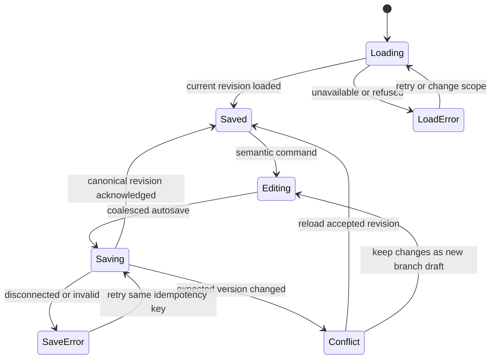
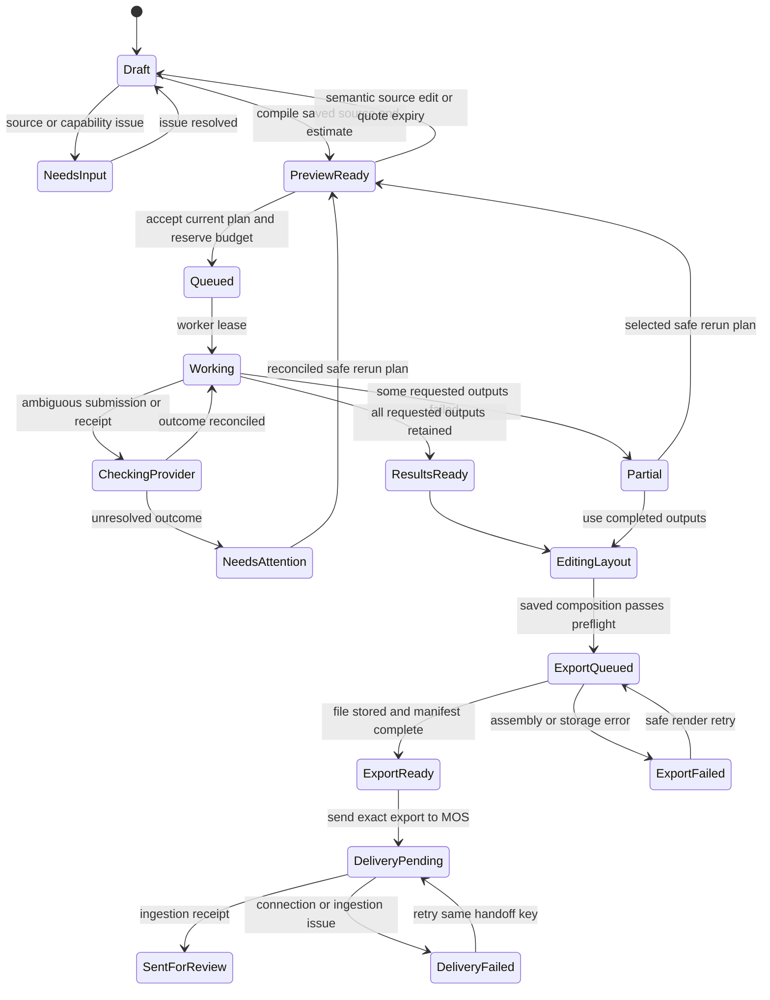

# Creative Studio — shared recipe, state and recovery

Status: CS-M1 authored design. All labels below describe required future behavior, not observed readiness.

## One authoring source

`cs-recipe-v1` is the saved source shared by Builder and Workflow. The browser loads it into one `RecipeSession` and sends semantic edit commands to the same service mutation path. Each command carries workspace, recipe ID, expected current version and a request idempotency key. Both views consume the returned canonical version and validation issues. Neither submits a model request directly.

Before the required request/treatment references exist, the service persists a workspace-scoped **authoring draft** with the incomplete form/graph content, draft ID, revision and actor. It is not a valid `cs-recipe-v1` and no compile/run/export endpoint accepts it. Builder and Workflow still use the same session/commands; promotion records the draft-to-request/treatment/recipe mapping and preserves source IDs. This avoids either losing unfinished work or weakening the executable schema. The API/storage contract owns that non-executable draft record; it does not introduce another compiler or prompt language.

The recipe pins a `cs-creative-request-v1`, accepted `cs-treatment-v1`, optional template version, typed nodes and connections, named outputs and optional composition version. A mutable run records progress against a frozen plan; it is never the editable recipe. Saved source objects carry stable ID, exact version ID, integer revision and SHA-256 as defined by the contracts package. Asset references pin asset version and file hash, never an expiring URL.

| Object | Editable behavior | What freezes it |
|---|---|---|
| Imported brand package and campaign request | Read-only source summaries; choose a different approved version through an explicit source-change action | Import receipt, original version/hash and approval evidence |
| Authoring draft | Save incomplete setup and proposed direction in the selected workspace | No execution authority; promotion requires complete source references and accepted treatment |
| Proposed creative treatment | User edits direction, shot intent and references; assistance may propose changes | **Use this direction** saves accepted `cs-treatment-v1`; compiling cannot rewrite it |
| Recipe draft | Command-based edits, autosave, undo/redo, Builder/Workflow projection | Server-acknowledged immutable recipe revision used by a compile |
| Execution plan | Inspectable resolved model, parameters, cost and affected outputs | Frozen `cs-execution-plan-v1` and compile hash; submit references this exact plan |
| Run | Server changes state and appends attempt/events/cost receipts | Stable run ID plus ordered events; a run is not falsely presented as immutable |
| Composition | Layer/shot edits create immutable composition revisions | `basis_recipe` pins the prior source recipe; asset versions pin exact material |
| Export | No editing of its bytes or lineage; download, reuse or create a replacement | Exact recipe, composition, originals, attempt receipts, renderer/version and file hash |
| MOS review | Read receipt and open MOS; no local checkbox can grant approval | MOS's exact-version copy/asset/claims/destination/policy decision |

To avoid a content-hash cycle, a composition is created against recipe revision N (`basis_recipe`), then recipe revision N+1 references that composition. `basis_run`, if present, is `{run_id, plan_id, compile_hash, observed_event_sequence}`; final assets/attempt receipts carry immutable evidence. The composition never points recursively at the recipe revision that embeds its own hash.

`authoring_view` contains positions, collapsed groups and preferred view. It does not change the semantic compile hash or invalidate generated work. Whole-file content hashes may differ when view metadata changes; the compiler hashes the semantic projection and retains source-file provenance separately. Changing a node parameter, bound version, connection or export format is a semantic edit. Merely dragging a workflow node is not.

## Source-to-workflow mapping

The visible workflow is an authoring graph. Compiler internals can be expanded under Details but are not an extra editable chain competing with it. The existing typed `graph-v1` remains the lowered execution DAG; new composition operations must be registered and validated before the UI offers them.

| Guided field / action | Canonical source | Workflow representation | Constraint and downstream effect |
|---|---|---|---|
| Workspace, brand and approved CI revision | Request's workspace scope and `brand-package-v1` version reference | **Brand** source | Read-only facts; logo/font/palette roles selected from that package. Changing it invalidates all dependent generation/layout/export plans, not historical files. |
| Campaign, offer or service group, audience, approved concept | `cs-creative-request-v1` exact source revisions | **Campaign** source | No invented CAD geometry for a service; absent ProductSpec is valid for that lane. Missing approval blocks production, not saving a draft. |
| Exact headline, supporting copy and CTA | Request/copy reference plus selected text values in treatment/composition | **Copy** source to exact text layers | Original copy stays traceable. A changed phrase becomes proposed copy and requires a new MOS copy version/review; approval is never inherited by resemblance. |
| Direction, lighting, framing, mood, scene locks | Accepted `cs-treatment-v1`; compatibility lowering into existing CreativeSpec where representable | **Visual direction** | Frozen before compile. Changes invalidate only generation nodes consuming changed fields and their dependent outputs. |
| Reference tray and “Use as reference” | Ordered role-specific `AssetRef`s | **Reference** source connected to declared input port | Role determines use: product, style, character, start frame, end frame, mask. UI only offers catalogue-supported roles/counts. Original logo is also a composition source, never implicitly a generative replacement. |
| Static pack / hero / video, ratio, number of alternatives | Recipe outputs and format-preset IDs | Named **Image**/**Clip**/**Export** steps | Required output controls derive from provider capability plus release bounds. Static artboards are separate layouts, not stretched derivatives. |
| Automatic model / chosen model | Recipe node policy and pinned provider catalogue revision | Generation step inspector | Automatic resolves the cheapest qualifying model within authorized policy; selected model remains exact or explicitly unavailable. The service may not silently replace a user's pinned model. |
| Mask and requested regional change | Versioned mask asset + EditSpec-compatible structured operation | **Region edit** attached to an exact source image | Consumes image/mask in one image coordinate system. Unsupported mask capability refuses preflight. Original file is retained. |
| Crop/resize/layout placement/upscale | Transform node or composition revision | **Crop**, **Upscale** or **Image layout** | Deterministic local transforms are distinct from paid model upscale/edit actions; cost/rebuild preview distinguishes them. |
| Shot order, trim, captions, audio, title/end cards | Video composition | **Video assembly** | Layout/trim changes rerender assembly; replacing one clip affects that clip and dependent assembly/exports only. |
| Download / Send to MOS | `cs-export-v1` / `cs-mos-handoff-v1` | **Export** endpoint | Only complete owned artifacts, known source lineage and permitted rights. Handoff is version-bound and idempotent. |

Existing `intake.load`, `jobspec.validate`, `prompt.build`, `reference.resolve`, `engine.generate`, `output.persist` and `artifacts.load` remain useful lowering stages. Board connections become real recipe connections; arbitrary user-authored labels cannot be silently filtered out of compile. An unsupported existing operation stays visible as a blocking migration issue or explicit non-executable annotation.

## Editing commands and projections

| Command category | Builder control | Workflow / editor control | Save and charge behavior |
|---|---|---|---|
| Select or replace source | Source picker/version comparison | Source node inspector | Save revision; mark dependent plan stale; no generation |
| Set direction or reference role | Direction/reference fields | Matching generation/source inspector | Same field path and validation result |
| Add output or alternative | Output-pack controls | Add output / duplicate alternative | Stable new output IDs; estimate before any run |
| Add/delete/connect registered step | Optional advanced section | Node menu and keyboard connect form | Validate types, required inputs and DAG; invalid connection cannot execute |
| Set layer / artboard / shot properties | Layout/Video forms | Direct manipulation + inspector | Same composition command; no regeneration for a deterministic edit |
| Request partial regeneration | “Create another” / “Replace this clip” | Step or result action | Computes explicit affected subgraph; admission requires reviewed current plan and budget |
| Move/collapse workflow nodes | No semantic equivalent needed | Canvas position and group controls | Authoring metadata only; no model or export invalidation |
| Restore earlier revision | History → Use as new draft | Same history action | Creates a new revision referencing retained originals; old history is not overwritten |

Builder always renders the full recipe's inputs and outputs, including a **Custom steps** summary for registered steps outside the standard setup. Editing a simple Builder field patches only that field; it does not reconstruct a template and drop Workflow-only steps. If the recipe includes an unsupported schema/node, both views present it read-only with an explicit migration issue. Future migration creates a new recipe revision and retains the original.

## Save and revision lifecycle

Autosave may coalesce rapid local commands; the UI says **Saving…** until the server acknowledges a revision. Paid creation and export require acknowledged state. A failed save keeps local edits visible and says **Changes not saved**; reload cannot promise their recovery. Concurrent edits return a conflict and offer compare/reload or a new draft branch. Do not silently use last-writer-wins for exact copy, logo, model or cost policy. Undo/redo is a new edit of the draft, not deletion of a prior saved revision.

An in-progress run stays pinned to its submitted plan. Further editing creates the next draft and never mutates the running job. Header: **Creating version 4 · You are editing version 5**. Results continue to show which version produced them.

## Plan, run, composition and delivery states

These are separate state dimensions. A creative can have a saved new draft, a running earlier revision and a downloadable old export at the same time; a single `idle/compiled/executing/done/failed` flag cannot describe it.

Run cancellation is a request with observable results. Before provider submission it may cancel safely; after submission the UI says **Stopping remaining work** and retains any active provider attempt for reconciliation. It never claims a refund or remote cancellation without a provider receipt. A cancelled run may retain completed files and incurred charges.

## Partial rerun and cost UX

The impact preview lists **Kept**, **Will be created**, **Will be rebuilt**, and **Needs your decision**. The compiler computes dependents from real connections and content hashes. It is not enough to call the existing ancestor-only `slice_to_target` and assume all paid ancestors are reused. Reuse requires immutable matching inputs, parameters, provider-plan/catalogue versions and an eligible completed attempt; user-selected “new variant” explicitly requests a fresh attempt.

| User edit | Retain | Rebuild / regenerate | Cost message |
|---|---|---|---|
| Move logo or change text color | Original image/clip and other artboards | Affected composition/export | “Layout only. No media generation.” Show any applicable render charge separately. |
| Change exact words | Original imagery where no visual treatment depends on text | Text layers, exports and MOS copy/review binding | “Copy changed. A new review is required.” |
| Region-edit one base image | Other alternatives and unconnected shots | One image attempt, layouts that use it and their exports | Name affected image, estimated additional credits/currency and ceiling |
| Replace shot 2 | Other shot assets and existing export | New shot 2, assembly, captions only if timing changed, new export | “1 clip to create; other clips kept.” Never bill again just to trim retained media. |
| Update Brand CI version | Historical run/exports | Only dependencies of changed source; new final export and review always bound to new source | Compare logo/fonts/palette/rules and recompute estimate; do not assume unchanged visuals mean approval survives |
| Provider outcome unknown | All completed independent outputs | No duplicate of unresolved paid step | “Checking whether this request completed. New creation is paused for this step.” |

Every preview shows resolved model, currency and provider credits as distinct units, per-step quantity, known estimate/range, expiry, maximum authorized amount and workspace allowance. “Unknown” is a first-class value, not `0`. UI disables new paid work when the service cannot establish an allowable bound. The budget reservation is admitted atomically on the server; a browser double-click or reload cannot reserve or submit twice.

Actual cost may be **Pending provider confirmation**, **Confirmed** or **Adjusted**. The details drawer exposes the receipt and reconciliation timestamp. Provider quota/credential errors link to Connections for an authorized user; no credential or provider status URL is exposed to the browser.

## Failure and recovery contract

| Condition | Visible state and retained work | Recovery action |
|---|---|---|
| Draft imported from wrong workspace | Access refused; no source names/files leaked | Return to authorized workspace |
| Brand/concept approval revoked or version changed | **Source changed**; old results remain historical | Compare, choose valid approved version, save new recipe; recompile affected work |
| Signed source URL expired | **Refreshing source access** while asset identity remains | Service renews authorized URL; if forbidden/missing, name the source issue |
| Original asset/font missing or usage disallowed | **Export needs [asset/font]**; layers kept | Replace with approved same-scope version or return to source authority |
| User closes tab / network lost | Saved jobs continue; browser says **Reconnecting** | Fetch run snapshot and resume events from cursor; do not mark run failed |
| Worker restarts | Last confirmed stage retained; server owns recovery | Worker reacquires eligible work; UI shows **Resuming** only from server state |
| Provider rejected request before accepted submission | Named validation/configuration failure | Fix field/credential and create a revised plan; classified-safe retry may reuse reservation |
| Submit response lost, time-out or billing uncertain | **Checking provider** with unresolved cost | Reconcile known request/attempt; no new paid attempt until safe classification |
| One output fails | **[n] of [m] ready** with failed output reason | Use complete results or review a partial rerun plan |
| Render stage reaches resource/time bound | **Export interrupted**; source clips/composition saved | Retry an eligible deterministic stage; repeated failure names reduction needed; no silent quality downgrade |
| MOS ingestion fails or version no longer eligible | **Export ready · Not sent** or **Review needs updated source** | Retry same handoff after issue resolution; old export does not become approved |
| Duplicate handoff or delayed callback | Existing delivery/receipt shown | Idempotent receipt lookup; never duplicate a MOS asset version |

The runtime event stream is advisory transport. Status refresh reads the persisted run, and missing/out-of-order events cannot produce a false success. A job is ready only after output bytes and hashes exist in owned storage. Export readiness also requires the requested dimensions/duration and a complete provenance manifest; visual/correctness acceptance is assessed under CS-M3.
